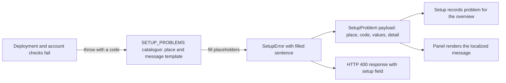

# setup.ts

`src/setup.ts` is the single place that defines how dsh-superagent talks about *setup failures* — the problems that stop the agent from taking work because a deployment setting, GitHub account, or Feishu bot is not ready. It holds the closed catalogue of problem codes (each paired with the settings area where an operator can fix it and an English sentence), the payload shape the panel receives, and the `SetupError` exception that deployment and environment checks throw. The useful takeaway: adding or reading a setup failure never requires guessing wording — code, location, and message all come from this one table.

## Functional flow of a setup problem

A verification check picks a code, this file looks up its place and message, and `SetupError` renders the sentence and exposes a structured `problem`. Managers either record that problem (the deployment overview shows it) or return it in an HTTP error body, and the browser panel turns the same code into the operator's language.

## At a glance

- Primary role (data contract): the file defines the shared vocabulary of setup problems — codes, fix locations, message templates, and the payload shape that crosses the server/client boundary.
- Secondary role (API boundary): `SetupError` is the exception contract callers throw and catch; `instanceof SetupError` is how the management layer separates an expected, fixable setup failure from an unexpected crash.
- Confidence: High — the whole file was read, and every consumer of `SETUP_PROBLEMS`, `SetupProblem`, and `SetupError` was verified in the server, HTTP, and panel code.

## What this file does

- Provides one fixed list of problem codes, grouped by where the operator fixes them: `deployment` (state directory, git version, worker environment), `github` (repository, agent GitHub CLI, permissions), and `feishu` (bot `lark-cli`, app, bot identity).
- Supplies the user-facing English sentence for each code, written with `{placeholder}` slots such as `{repository}`, `{account}`, `{app}`, `{status}`, `{mode}`, `{file}`, and `{output}`.
- Turns a code plus values into a real `Error` whose message already reads as a complete, actionable sentence.
- Exposes the same failure as a structured `SetupProblem` object so it can be transported and localized instead of being shown as raw English text.
- Keeps one reserved value, `values.output`, for raw CLI output: it is appended below the sentence rather than substituted into the template.
- Makes the code set closed and type-checked, so a throw site cannot invent a new problem name unnoticed.

## Key functions or classes

### `SETUP_PROBLEMS`

The catalogue: sixteen entries, each a `[place, template]` pair, declared `as const` so both the places and the codes are known to the type system.

    
        <a target="_self" href="#src/setup.ts:5-22?class=code" style="color: inherit; text-decoration: none;">Code: src/setup.ts:5-22</a>
    

### `SetupPlace`

Names the three settings areas a problem can point at; the values `github` and `feishu` also match Source kind ids, which is how a Source receives the problem that concerns it.

### `SetupCode`

A derived union of the catalogue keys, so every throw site is checked against the known problem names.

### `SetupProblem`

The transportable description of a failure: `place`, `code`, `values`, and the rendered `detail` sentence.

    
        <a target="_self" href="#src/setup.ts:24?class=code" style="color: inherit; text-decoration: none;">Code: src/setup.ts:24</a>
    

### `SetupError`

The exception thrown by deployment and environment verification; it looks up its code, fills the template, optionally appends output, and remembers its `place`.

    
        <a target="_self" href="#src/setup.ts:30-37?class=code" style="color: inherit; text-decoration: none;">Code: src/setup.ts:30-37</a>
    

### `SetupError.problem`

Converts the exception into the structured `SetupProblem` that the management HTTP layer returns and that sources and the overview store.

    
        <a target="_self" href="#src/setup.ts:38?class=code" style="color: inherit; text-decoration: none;">Code: src/setup.ts:38</a>
    

## Main inputs and results

- Inputs: a known problem code, plus a small record of string values whose keys match the `{placeholder}` names in that code's template; an optional `output` entry carries raw CLI text.
- Results: an `Error` whose message is the finished English sentence (with the raw output on a following line when provided), a `place` for the fix location, and a `problem` object with `place`, `code`, `values`, and `detail`.
- Visible side effects: a failing setup check shows up as the deployment overview's `problem`/`feishuProblem`, as a `400` response body containing a `setup` field, and as a localized message on the panel's deployment card — the panel shows the same sentence in Chinese and English.

## Information contract

- Represents: the identity of a setup failure — *what went wrong*, *where the operator fixes it*, and *which values* matter for the sentence.
- Produced by: the verification checks in 
<a target="_self" href="#src/deployment.ts:91-104?class=code" style="color: inherit; text-decoration: none;">deployment.ts:91-104</a>
 (GitHub account, repository access, Feishu bot) and 
<a target="_self" href="#src/infra/environment.ts:69?class=code" style="color: inherit; text-decoration: none;">environment.ts:69</a>
 (foreign files, git version), plus the worker-environment step in 
<a target="_self" href="#src/app/setup.ts:44-51?class=code" style="color: inherit; text-decoration: none;">app/setup.ts:44-51</a>
.
- Consumed by: the management HTTP layer, which returns it in the `setup` field of a `400`; the `Setup` service, which stores it as the current problem; each Source context, which receives it only when `place` equals that Source's kind; and the panel, which maps `code` to a `setup.<code>` translation key and re-uses the English template from this file as its English text.
- Behavior-shaping parts: `place` decides which settings card and which Source shows the failure; `values.output` changes what the user reads (a second, raw-output line) without changing the localized sentence; the code set is closed, so an unknown code cannot be thrown but also cannot be localized by the panel.

### Compatibility notes

The code strings travel over the HTTP boundary and are used to build the panel's translation key, so renaming or removing a code requires a matching change to the `setup.*` entries in the client locale table. Keeping the English template here and importing it into that table means the log, the main Session, and the panel can never disagree about what a problem means.

## Public contract

- Caller: server code that verifies deployment, GitHub accounts, or the Feishu bot throws `SetupError`; the runtime, HTTP layer, Source contexts, and panel catch or inspect it.
- Operation: report "setup is not usable yet" in a way that is identifiable, localizable, and actionable, instead of a bare string error.
- Accepted input: a code from the catalogue and an optional dictionary of string values, with `output` reserved for raw CLI text; an unrecognized code is a compile-time error for TypeScript callers.
- Result: a thrown `Error` whose `message` is already an operator-ready sentence, a `place` getter for routing, and a `problem` payload for transport; callers distinguish it from unexpected failures with `instanceof SetupError`, which is exactly how the runtime rethrows genuine bugs while recording expected setup problems.

---
name: setup.ts

update-time: 2026-11-02 10:19

description: `src/setup.ts` is the single place that defines how dsh-superagent talks about *setup failures* — the problems that stop the agent from taking work because a deployment setting, GitHub account, or Feishu bot is not ready. It holds the closed catalogue of problem codes (each paired with the settings area where an operator can fix it and an English sentence), the payload shape the panel receives, and the `SetupError` exception that deployment and environment checks throw. The useful takeaway: adding or reading a setup failure never requires guessing wording — code, location, and message all come from this one table.

---
