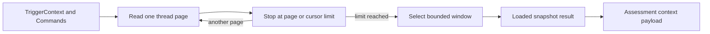

# admission-context.ts

This file builds the bounded thread snapshot that an admission assessment reasons about: it reads a trigger's thread page by page, then keeps only the opening messages and a small neighbourhood around the trigger, so an assessment neither assumes it has seen the whole conversation nor pays for reading it. The result is deliberately honest — every count describes only what was actually loaded in this snapshot. Its single production consumer is the candidate assessor, which turns the snapshot into the context payload the main session reads.

## How the snapshot is assembled

Two exported functions cooperate: `admissionContext` owns the paginated read and its stop conditions, and `threadWindow` — a pure selector — picks the reader-facing slice out of whatever pages were loaded. The snapshot is then shaped into the assessment payload by the caller.

<!-- {
  "mermaid_info": {
    "name": "Admission context loading flow",
    "nodes": [
      {
        "id": "trigger_001",
        "name": "TriggerContext and Commands",
        "path": "src/sources/kind.ts",
        "hint": "The source-specific thread reader and the CLI runner supplied by the caller",
        "isJumpable": true,
        "position": { "startLine": 76, "endLine": 83 },
        "references": []
      },
      {
        "id": "page_002",
        "name": "Read one thread page",
        "path": "src/sources/admission-context.ts",
        "hint": "Fetches a page and keeps only messages whose IDs were not seen before",
        "isJumpable": true,
        "position": { "startLine": 30, "endLine": 33 },
        "references": []
      },
      {
        "id": "limit_003",
        "name": "Stop at page or cursor limit",
        "path": "src/sources/admission-context.ts",
        "hint": "Honours maxPages, rejects a repeated cursor, and keeps the first reported status",
        "isJumpable": true,
        "position": { "startLine": 29, "endLine": 39 },
        "references": []
      },
      {
        "id": "window_004",
        "name": "Select bounded window",
        "path": "src/sources/admission-context.ts",
        "hint": "Opening five messages plus five on either side of the trigger, with omitted-gap counts",
        "isJumpable": true,
        "position": { "startLine": 6, "endLine": 17 },
        "references": []
      },
      {
        "id": "snapshot_005",
        "name": "Loaded snapshot result",
        "path": "src/sources/admission-context.ts",
        "hint": "Messages, window, completeness, next cursor and an optional fallback status",
        "isJumpable": true,
        "position": { "startLine": 40, "endLine": 41 },
        "references": []
      },
      {
        "id": "payload_006",
        "name": "Assessment context payload",
        "path": "src/app/assessment.ts",
        "hint": "Labels window messages and reduces everything outside the window to short previews",
        "isJumpable": true,
        "position": { "startLine": 192, "endLine": 206 },
        "references": []
      }
    ]
  }
} -->

    
        <a target="_self" href="#src/sources/admission-context.ts:1?class=graph" style="color: inherit; text-decoration: none;">Graph: Admission context loading flow</a>
    

## At a glance

- **Primary role — Orchestration**: the file sequences a paged read, deduplication, stop conditions and a final selection step to produce one bounded snapshot.
- **Secondary role — Data contract**: it defines the snapshot shape (`messages`, `window`, `complete`, `next`, `status`) and the per-message window entries (`position`, `omitted_before`) that downstream rendering depends on.
- **Confidence**: High — both exported functions, the `TriggerContext` contract they rely on, the assessor that calls them, and the unit tests were read directly.

## What this file does

- **Reads a thread within a page budget.** It asks the source for one page at a time and stops after `maxPages`, so a huge thread cannot make one assessment expensive.
- **Merges overlapping pages into one message list.** Messages arriving twice keep their first occurrence, so the later window never double-counts.
- **Detects broken pagination instead of guessing.** If a page hands back a cursor that was already seen, the read fails with an explicit "context is incomplete" error rather than silently returning a truncated thread.
- **Selects a small, anchor-centred window.** `threadWindow` keeps the thread's opening five messages plus five messages on either side of the trigger message, and computes how many messages each gap skipped.
- **Reports what it does not know.** `complete`, `next` and the window's `source_found`, `loaded_messages` and `omitted_after` all describe this loaded snapshot only — never unread history — and `status` carries fallback modes such as reading a chat's neighbours when the message sits outside a topic.

## Key functions or classes

### `admissionContext(context, commands, maxPages)`

Loads up to `maxPages` thread pages, deduplicates them, and returns the loaded messages together with their bounded window and completeness details.

    
        <a target="_self" href="#src/sources/admission-context.ts:22-42?class=code" style="color: inherit; text-decoration: none;">Code: src/sources/admission-context.ts:22-42</a>
    

### `threadWindow(messages, sourceId)`

Picks the opening five messages and the messages within five positions of `sourceId`, returning one entry per selected message with its 1-based position and how many messages were skipped before it.

    
        <a target="_self" href="#src/sources/admission-context.ts:6-17?class=code" style="color: inherit; text-decoration: none;">Code: src/sources/admission-context.ts:6-17</a>
    

## Main inputs and results

- **Inputs**: a source-specific `TriggerContext` (its own message ID plus a page reader for `thread`, `root` and `parent`), a `Commands` runner bound to the deployment's credentials and abort signal, and the `maxPages` budget.
- **Results**: the loaded `messages`, the `window` of selected entries with gap counts, `complete` (whether a further page was offered), `next` (the cursor to continue from, or `null`), and an optional `status` naming a fallback mode.
- **Visible side effects**: none of its own beyond the source reads it performs; the caller supplies the timeout and abort signal, and the deployment settings `admissionContextMaxPages` and `admissionContextTimeoutMs` in [006-deployment.md](docs/006-deployment.md) control how much and how long a single assessment may read.

## Coordinated flow

1. The assessor hands a trigger's `TriggerContext` to `admissionContext` and starts a paged read from the first page, with `maxPages` taken from the deployment settings.
2. Each page contributes only messages whose IDs have not been collected yet, so overlapping pages collapse into one ordered list while the first reported `status` is kept.
3. The loop stops when the source offers no next cursor or the page budget is spent; a cursor seen twice aborts the read with an explicit error, and the remaining cursor (if any) is returned as `next` so a caller may continue later.
4. `threadWindow` then reduces the loaded list to the opening messages plus the trigger's neighbourhood, and the assessor renders that window in full while every other loaded message becomes a short preview — so an assessment can still notice that something was omitted and ask for it by ID.

### Important branching and limits

- **Missing anchor**: if the trigger message is not present in the loaded snapshot, `source_found` is `false` and no neighbour window is invented — only the opening messages are offered.
- **Bounded claims**: `loaded_messages` and `omitted_after` count positions within this snapshot, so a caller can never mistake them for the whole conversation; `complete: false` plus `next` is the only signal that more pages exist.
- **No built-in retry or timeout**: failures surface to the caller, which is where the abort timeout and per-assessment caching live.

## Information contract

- **Represents**: a bounded, self-describing slice of one thread around a trigger message — what was read, which parts are in focus, and what was skipped.
- **Produced by**: `admissionContext` for the messages and completeness fields; `threadWindow` for the `entries`, `omitted_before`, `source_found`, `loaded_messages` and `omitted_after` fields.
- **Consumed by**: the candidate assessor, whose seed step caches the messages and window and whose `orchestrator_eval` payload marks window messages as readable while collapsing the rest into previews. The assessment type is derived directly from this function's return value, so additions here flow into that payload.
- **Behavior-shaping parts**: `window.entries` decides which messages are rendered in full versus as previews; `window.source_found` tells the reader whether the window is actually anchored on the trigger; `complete` and `next` decide whether a reader can continue past the initial window; `messages` supplies the text and image references the assessment may later request in full.

The unit is exercised by [tests/admission-context.spec.ts](tests/admission-context.spec.ts), which pins the exact window positions, the deduplicated overlap case, an absent trigger, the surviving pagination cursor, and the `chat_neighbours` fallback status.

---
name: admission-context.ts

update-time: 2026-11-02 11:24

description: This file builds the bounded thread snapshot that an admission assessment reasons about: it reads a trigger's thread page by page, then keeps only the opening messages and a small neighbourhood around the trigger, so an assessment neither assumes it has seen the whole conversation nor pays for reading it. The result is deliberately honest — every count describes only what was actually loaded in this snapshot. Its single production consumer is the candidate assessor, which turns the snapshot into the context payload the main session reads.

---
