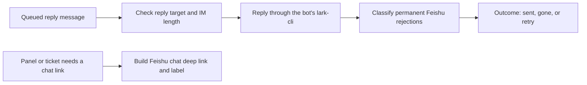

# feishu-channel.ts

This file is the Feishu side of the project's outbound messaging: it takes a message the agents already decided to send and delivers it as a threaded bot reply in the right Feishu (or Lark) chat. It also builds the chat deep link the web panel and ticket views show for a Feishu conversation. A small but important rule lives here too — deciding when Feishu's rejection means "this conversation is permanently gone" instead of "try again later", because that choice stops the reply queue from retrying forever.

## Whole-unit functional flow

The main path starts when the Outbox hands over a queued `OutboundMessage`; the reply is posted in the target message's topic, and the result is either a plain success, a permanent "gone" verdict, or a retryable failure. The right-hand branch is the read-only path that produces the clickable chat link shown in the interface.

<!-- {
  "mermaid_info": {
    "name": "Feishu outbound reply and link flow",
    "nodes": [
      {
        "id": "queued_001",
        "name": "Queued reply message",
        "path": "src/app/outbox.ts",
        "hint": "The Outbox delivers one queued receipt by asking the source registry to send it",
        "isJumpable": true,
        "position": { "startLine": 39, "endLine": 51 },
        "references": []
      },
      {
        "id": "validate_002",
        "name": "Check reply target and IM length",
        "path": "src/sources/feishu-channel.ts",
        "hint": "sendFeishu requires a target message ID and validates the IM word limit",
        "isJumpable": true,
        "position": { "startLine": 19, "endLine": 22 },
        "references": []
      },
      {
        "id": "reply_003",
        "name": "Reply through the bot's lark-cli",
        "path": "src/sources/feishu-channel.ts",
        "hint": "Builds the threaded markdown reply command with the message ID as idempotency key",
        "isJumpable": true,
        "position": { "startLine": 23, "endLine": 24 },
        "references": []
      },
      {
        "id": "classify_004",
        "name": "Classify permanent Feishu rejections",
        "path": "src/sources/feishu-channel.ts",
        "hint": "The gone predicate separates recalled or missing messages from retryable failures",
        "isJumpable": true,
        "position": { "startLine": 16, "endLine": 17 },
        "references": []
      },
      {
        "id": "result_005",
        "name": "Outcome: sent, gone, or retry",
        "path": "",
        "hint": "What the caller observes: a settled receipt or a retryable throw",
        "isJumpable": false,
        "position": { "startLine": 0, "endLine": 0 },
        "references": []
      },
      {
        "id": "panel_006",
        "name": "Panel or ticket needs a chat link",
        "path": "src/app/views/records.ts",
        "hint": "channelLink resolves a channel link and prefers a trigger's own deep link when available",
        "isJumpable": true,
        "position": { "startLine": 179, "endLine": 183 },
        "references": []
      },
      {
        "id": "link_007",
        "name": "Build Feishu chat deep link and label",
        "path": "src/sources/feishu-channel.ts",
        "hint": "feishuLink combines the chat deep link with a localized label and optional trigger ID",
        "isJumpable": true,
        "position": { "startLine": 32, "endLine": 35 },
        "references": []
      }
    ]
  }
} -->

    
        <a target="_self" href="#src/sources/feishu-channel.ts:1?class=graph" style="color: inherit; text-decoration: none;">Graph: Feishu outbound reply and link flow</a>
    

## At a glance

- **Primary role — external adapter**: this file bridges project-level reply messages to the Feishu bot CLI and turns Feishu's answers back into project-level outcomes.
- **Secondary role — domain rules**: it encodes the rule for telling a permanently unreachable conversation apart from a temporary delivery problem.
- **Confidence**: High — the whole 36-line file was read together with the channel contract it implements in 
<a target="_self" href="#src/sources/kind.ts:46-56?class=code" style="color: inherit; text-decoration: none;">kind.ts:46-56</a>
, the CLI wrapper it calls, and the Outbox that consumes its result.

## What this file does

- **Posts replies in the right place**: a message is sent as a threaded answer to the specific Feishu message that started the work, so conversations stay inside their topic.
- **Makes delivery idempotent**: the outgoing message's own ID is passed as the idempotency key, so a retry of the same queued message does not create a second reply.
- **Enforces the short-IM style**: reply text is checked against the project's IM word limit, and an over-long message is rejected instead of being silently truncated or split.
- **Reports whether the chat can still receive replies**: the caller learns `'sent'` or `'gone'`, and `'gone'` ends retries for that message.
- **Produces the chat deep link and label**: the panel and ticket views get a Feishu/Lark AppLink plus a localized "Feishu message" label, and the trigger's own message link is preferred when the interface can resolve it.

## Key functions or classes

### `sendFeishu`

Delivers one outbound message as a threaded Feishu reply and reports whether it went out or the target is permanently unavailable.

Open 
<a target="_self" href="#src/sources/feishu-channel.ts:19-30?class=code" style="color: inherit; text-decoration: none;">feishu-channel.ts:19-30</a>
 for the full reply path.

### `gone`

Decides whether a Feishu error means the target message was withdrawn, recalled, or not found, rather than a failure worth retrying.

See 
<a target="_self" href="#src/sources/feishu-channel.ts:12-17?class=code" style="color: inherit; text-decoration: none;">feishu-channel.ts:12-17</a>
 for the exact conditions.

### `feishuLink`

Builds the link record shown for a Feishu conversation: a chat deep link, a bilingual label, and — when the address names a message — the trigger ID whose own deep link is preferred.

<a target="_self" href="#src/sources/feishu-channel.ts:31-35?class=code" style="color: inherit; text-decoration: none;">feishu-channel.ts:31-35</a>
 shows how the fallback link is assembled.

### `feishuChatLink`

Returns the Feishu or Lark AppLink URL that opens a chat, used both here and when the project records a chat link elsewhere.

<a target="_self" href="#src/sources/feishu-channel.ts:9-11?class=code" style="color: inherit; text-decoration: none;">feishu-channel.ts:9-11</a>
 is also reused by the Feishu polling loops.

## Main inputs and results

- **Inputs**: one `OutboundMessage` (its `channel.address.messageId`, `channel.address.chatId`, `text`, and `id`) plus a host that exposes the configured commands; for links, a channel `address` record and the deployment's `ChannelLinks`.
- **Results**: `'sent'` or `'gone'` from `sendFeishu` (or a thrown error when delivery should be retried), and a `ChannelLink` with a URL, a `zh`/`en` label, and an optional `triggerId`.
- **Visible side effects**: a new bot reply appears in the Feishu topic of the original message, and the panel or ticket card shows a clickable "Feishu message" link that opens that chat or the exact message.

## External connection

- **External system**: Feishu / Lark, reached through the deployment's bot `lark-cli` and through AppLink URLs that open a chat in the Feishu or Lark client.
- **Outbound translation**: a project message becomes a `lark-cli` reply call targeting the original message ID, sent as markdown, inside the thread, with the message ID as idempotency key.
- **Inbound translation**: a successful CLI call becomes `'sent'`; a recognised permanent rejection becomes `'gone'`; any other failure is rethrown so the queue can retry. The reply text is also checked against the IM word limit before the call is attempted.

### Operating requirements

- A working Feishu bot must be configured in the deployment; the CLI wrapper refuses to run without one, and a bot that is not a member of the chat gets a readable remediation message from the command layer.
- The reply text is limited to the project's IM word budget (100 words, with link labels and URLs counted); longer text is rejected with an instruction to rewrite it shorter rather than split it.
- The message being answered must still exist: a reply needs a target message ID, and Feishu itself decides whether that message still accepts replies.

## Rules and decisions

- **Decision**: was this Feishu rejection permanent, meaning the conversation can never receive this reply?
- **Important conditions**: only a Feishu response carrying a specific error code counts — the recalled-message code, a code whose message reports the message as withdrawn, or a "not found" response in the Feishu message-error code range. Timeouts, crashes, and errors without a code are treated as retryable.
- **Outcomes**: `'gone'` for a permanently unreachable target, which lets the caller settle the message as gone and stop retrying; or a rethrown error, which leaves the message pending for a later attempt.
- **Invariant**: a reply is never posted anywhere except the topic of the addressed message, and one queued message ID produces at most one reply.

### Small example

A colleague recalls the message the agent was answering. Feishu rejects the reply with the recalled-message code, `sendFeishu` returns `'gone'`, and the queue settles that message instead of retrying it every few minutes. If the same call instead failed with a timeout, the error is rethrown and the reply is attempted again later.

Related reading: 
<a target="_self" href="#src/sources/feishu.ts.info.md?class=text" style="color: inherit; text-decoration: none;">feishu.ts.info.md</a>
 shows where this channel is registered, and 
<a target="_self" href="#src/sources/kind.ts.info.md?class=text" style="color: inherit; text-decoration: none;">kind.ts.info.md</a>
 documents the channel contract it implements.

---
name: feishu-channel.ts

update-time: 2026-11-02 11:28

description: This file is the Feishu side of the project's outbound messaging: it takes a message the agents already decided to send and delivers it as a threaded bot reply in the right Feishu (or Lark) chat. It also builds the chat deep link the web panel and ticket views show for a Feishu conversation. A small but important rule lives here too — deciding when Feishu's rejection means "this conversation is permanently gone" instead of "try again later", because that choice stops the reply queue from retrying forever.

---
