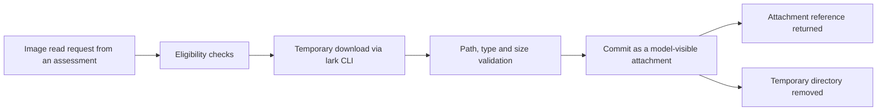

# feishu-image.ts

This file lets an assessing model actually *see* a picture that was posted in a Feishu conversation instead of guessing from text alone. It takes an image key that appears in a message, downloads the corresponding Feishu message resource, checks that the current model can accept images and that the download obeys the deployment's safety limits, and then commits the bytes as an attachment for the running session. It is the Feishu half of the optional `images` / `image` hooks on a source kind's thread-context contract.

## Whole-unit functional diagram

An assessment asks for one image of one message; the request is refused early unless the key really comes from that message and the current model route accepts image input. Only then are bytes fetched into a throw-away directory, validated, handed to the attachment service, and the directory removed, so the caller receives an attachment reference rather than a file on disk.

<!-- {
  "mermaid_info": {
    "name": "Feishu image admission flow",
    "nodes": [
      {
        "id": "request_001",
        "name": "Image read request from an assessment",
        "path": "src/sources/feishu-read.ts",
        "hint": "The Feishu thread-context adapter forwards a message and image key to this file",
        "isJumpable": true,
        "position": { "startLine": 169, "endLine": 170 },
        "references": []
      },
      {
        "id": "guard_002",
        "name": "Eligibility checks",
        "path": "src/sources/feishu-image.ts",
        "hint": "Key must come from the message text; attachment service, model route and image modality must be available",
        "isJumpable": true,
        "position": { "startLine": 23, "endLine": 34 },
        "references": []
      },
      {
        "id": "download_003",
        "name": "Temporary download via lark CLI",
        "path": "src/sources/feishu-image.ts",
        "hint": "Downloads the message resource into a private directory under the deployment state directory",
        "isJumpable": true,
        "position": { "startLine": 35, "endLine": 39 },
        "references": []
      },
      {
        "id": "validate_004",
        "name": "Path, type and size validation",
        "path": "src/sources/feishu-image.ts",
        "hint": "Checks containment, a supported image extension, a regular file and the byte limit",
        "isJumpable": true,
        "position": { "startLine": 40, "endLine": 46 },
        "references": []
      },
      {
        "id": "commit_005",
        "name": "Commit as a model-visible attachment",
        "path": "src/sources/feishu-image.ts",
        "hint": "Hands the bytes to the attachment service and receives an attachment reference",
        "isJumpable": true,
        "position": { "startLine": 47, "endLine": 51 },
        "references": []
      },
      {
        "id": "result_006",
        "name": "Attachment reference returned",
        "path": "src/sources/feishu-image.ts",
        "hint": "The AdmissionImage shape keeps the source message id, image key and attachment together",
        "isJumpable": true,
        "position": { "startLine": 16, "endLine": 20 },
        "references": []
      },
      {
        "id": "cleanup_007",
        "name": "Temporary directory removed",
        "path": "src/sources/feishu-image.ts",
        "hint": "Cleanup runs on success and on every failure path",
        "isJumpable": true,
        "position": { "startLine": 52, "endLine": 54 },
        "references": []
      }
    ]
  }
} -->

    
        <a target="_self" href="#src/sources/feishu-image.ts:1?class=graph" style="color: inherit; text-decoration: none;">Graph: Feishu image admission flow</a>
    

## At a glance

- **Primary role**: External adapter — it bridges two outside capabilities, the Feishu message-resource download and the project's attachment store, and converts one into the other.
- **Secondary roles**: Domain rules — it also enforces the rules that decide whether an image may be admitted at all (key provenance, model capability, path containment, size and type).
- **Confidence**: High — the whole file is 56 lines and its behavior is pinned down by `tests/feishu-image.spec.ts`, including refusal and cleanup paths.

## What this file does

- **Finds image keys safely**: `admissionImageKeys` scans message text for Feishu `img_…` keys, removes duplicates, and keeps their original order, so keys stay paired with the message that produced them.
- **Refuses borrowed identifiers**: a requested key is only accepted if it already appears in the text of the message being read, so a model cannot ask for an arbitrary remote resource.
- **Checks model capability first**: before any network work it resolves the session's provider and model, asks the LLM service for that model's input modalities, and stops if `image` is not among them.
- **Downloads through the sanctioned CLI path**: the resource is fetched with the deployment's own `lark` CLI wrapper into a fresh private directory under the deployment state directory, inheriting the caller's abort signal.
- **Constrains what comes back**: the saved file must resolve inside that directory, be a regular file, have a PNG/JPEG/WebP/GIF extension, and stay within the deployment's attachment byte limits.
- **Commits and cleans up**: accepted bytes become an attachment with a stable name, and the temporary directory is always removed.

## External connection

- **External system**: Feishu message resources, reached through the `lark` CLI command wrapper (see 
<a target="_self" href="#src/infra/commands.ts?class=code" style="color: inherit; text-decoration: none;">commands.ts</a>
), plus the plugin services `attachments` and `llm` mounted on the agent context.
- **Outbound translation**: a project-level pair (source message id, image key) becomes one `im +messages-resources-download` invocation with `--message-id`, `--file-key`, `--type image` and an `--output` path, executed inside the temporary directory.
- **Inbound translation**: the CLI's JSON `saved_path` becomes validated bytes with a derived media type, then an attachment reference via `saveImage`; the caller receives `{ source_message_id, image_key, image }`, which is what makes the picture visible to the assessing session.

This adapter is plugged into the source-kind contract declared in 
<a target="_self" href="#src/sources/kind.ts:70-75?class=code" style="color: inherit; text-decoration: none;">kind.ts:70-75</a>
: Feishu's thread context registers `admissionImageKeys` as `images` and `readAdmissionImage` as `image` in 
<a target="_self" href="#src/sources/feishu-read.ts:168-170?class=code" style="color: inherit; text-decoration: none;">feishu-read.ts:168-170</a>
. Assessment code uses those hooks to list image ids on messages and to serve them through `orchestrator_eval_read` (
<a target="_self" href="#src/app/assessment.ts:231-238?class=code" style="color: inherit; text-decoration: none;">assessment.ts:231-238</a>
).

### Operating requirements

A deployment must have a working `lark` CLI with permission to read the chat's message resources (a failed download surfaces as the CLI's own error, for example a permission denial), a writable state directory for the temporary download, an attachment service that exposes `saveImage` and its image byte limits, and a resolved model route whose info reports image input support. Nothing in this file sets credentials itself.

## Key functions or classes

### `admissionImageKeys`

Extracts the distinct Feishu image keys mentioned in a message's text, which is what both the context listing and the provenance check rely on.

    
        <a target="_self" href="#src/sources/feishu-image.ts:12-14?class=code" style="color: inherit; text-decoration: none;">Code: src/sources/feishu-image.ts:12-14</a>
    

### `readAdmissionImage`

Performs the whole admitted-image read: guards, download, validation, attachment commit and cleanup, returning the `AdmissionImage` triple or throwing a model-facing error.

    
        <a target="_self" href="#src/sources/feishu-image.ts:22-55?class=code" style="color: inherit; text-decoration: none;">Code: src/sources/feishu-image.ts:22-55</a>
    

### `AdmissionImage`

The result shape: the validated source message id, the image key that was read, and the attachment reference the session can display.

    
        <a target="_self" href="#src/sources/feishu-image.ts:16-20?class=code" style="color: inherit; text-decoration: none;">Code: src/sources/feishu-image.ts:16-20</a>
    

## Main inputs and results

- **Inputs**: the agent (for the attachment service, the LLM service, the session's requested model route and fallback options), the command wrapper and its abort signal, a `FeishuRef` naming the source message, the message text, the requested image key, and the deployment state directory.
- **Results**: an `AdmissionImage` whose `image` field is a saved attachment reference, or a thrown error whose message is written for the assessing model (for example "Choose an image key from this source message" or a statement that the model does not support image input).
- **Visible side effects**: the picture is attached to the main session and therefore becomes inspectable by the model, while the downloaded copy disappears with the temporary directory; the state directory never keeps the raw image.

## Rules and decisions

- **Decision**: may this image be shown to the assessing model, and does the request name an image that genuinely belongs to the message under discussion?
- **Important conditions**: the key must already be listed in that message's own text; the attachment service must be mounted; a provider and model must resolve from the session route or agent options; the model's input modalities must include `image`; the downloaded file must resolve inside the temporary directory, be a regular file, have a supported image extension, and fit within the smaller of the two deployment image limits.
- **Outcomes**: either an admitted attachment reference, or a refusal that distinguishes a wrong key, a missing service, an unresolved route, a text-only model, an unsupported file type, an oversize or non-regular file, an escaped download path, or a CLI failure.
- **Invariant**: arbitrary remote identifiers are never fetched — only keys that the source message text already contains, and only the two configured byte limits cap what may be committed.

### Small example

Suppose a Feishu message reads ` Plan mode`. The context listing offers `img_source` only, so a request for `img_other` or `../img_other` is rejected before any download. A request for `img_source` on an image-capable model produces an attachment named `img_source.png`, and the assessment can then judge the screenshot; on a text-only model the same request fails with a clear capability message, which the admission prompt asks the model to report as a failed assessment rather than a rule mismatch.

---
name: feishu-image.ts

update-time: 2026-11-02 11:26

description: This file lets an assessing model actually *see* a picture that was posted in a Feishu conversation instead of guessing from text alone. It takes an image key that appears in a message, downloads the corresponding Feishu message resource, checks that the current model can accept images and that the download obeys the deployment's safety limits, and then commits the bytes as an attachment for the running session. It is the Feishu half of the optional `images` / `image` hooks on a source kind's thread-context contract.

---
