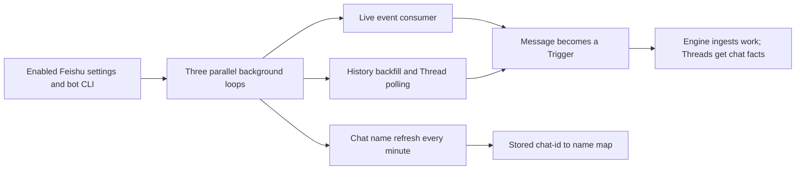

# feishu-loops.ts

This file keeps the Feishu source alive in the background. It starts three independent loops: a live event consumer that turns bot events into work, a once-a-minute refresh of chat names, and a history backfill that recovers messages the live stream never saw and polls Threads someone subscribed to. Everything an operator sees — health states, recovered messages, chat labels on Threads — is produced by these loops, so this is the place to read when asking "why did a Feishu message appear (or not appear) as work?"

## Whole-unit functional diagram

The three loops start together and each keeps its own cadence; live events and recovered history converge on the same conversion step, so the same Feishu message is not handled twice. Chat names are a display aid that feed Thread labels, not work ingestion.

<!-- {
  "mermaid_info": {
    "name": "Feishu background loops overview",
    "nodes": [
      {
        "id": "config_001",
        "name": "Enabled Feishu settings and bot CLI",
        "path": "src/sources/feishu-loops.ts",
        "hint": "Reads the Source configuration while enabled and resolves the bot CLI from the deployment",
        "isJumpable": true,
        "position": { "startLine": 20, "endLine": 25 },
        "references": []
      },
      {
        "id": "loops_002",
        "name": "Three parallel background loops",
        "path": "src/sources/feishu-loops.ts",
        "hint": "Entry point that runs the consumer, the name refresh and the backfill side by side",
        "isJumpable": true,
        "position": { "startLine": 18, "endLine": 19 },
        "references": []
      },
      {
        "id": "consume_003",
        "name": "Live event consumer",
        "path": "src/sources/feishu-loops.ts",
        "hint": "Spawns the bot's event stream and reads one JSON event per line",
        "isJumpable": true,
        "position": { "startLine": 70, "endLine": 105 },
        "references": []
      },
      {
        "id": "names_004",
        "name": "Chat name refresh every minute",
        "path": "src/sources/feishu-loops.ts",
        "hint": "Rereads the joined chat list once a minute so new chats get names",
        "isJumpable": true,
        "position": { "startLine": 117, "endLine": 127 },
        "references": []
      },
      {
        "id": "backfill_005",
        "name": "History backfill and Thread polling",
        "path": "src/sources/feishu-loops.ts",
        "hint": "Recovers chat and topic history per cursor, then polls subscribed Threads",
        "isJumpable": true,
        "position": { "startLine": 128, "endLine": 161 },
        "references": []
      },
      {
        "id": "receive_006",
        "name": "Message becomes a Trigger",
        "path": "src/sources/feishu-loops.ts",
        "hint": "Normalizes a Feishu message into a trigger, ingests it and annotates its Thread",
        "isJumpable": true,
        "position": { "startLine": 26, "endLine": 33 },
        "references": []
      },
      {
        "id": "engine_007",
        "name": "Engine ingests work; Threads get chat facts",
        "path": "",
        "hint": "The Orchestrator stores the trigger and schedules evaluation",
        "isJumpable": false,
        "position": { "startLine": 0, "endLine": 0 },
        "references": []
      },
      {
        "id": "labels_008",
        "name": "Stored chat-id to name map",
        "path": "src/sources/feishu-loops.ts",
        "hint": "Persists chat_id to name so Threads can be labelled with a readable chat",
        "isJumpable": true,
        "position": { "startLine": 108, "endLine": 115 },
        "references": []
      }
    ]
  }
} -->

    
        <a target="_self" href="#src/sources/feishu-loops.ts:1?class=graph" style="color: inherit; text-decoration: none;">Graph: Feishu background loops overview</a>
    

## At a glance

- Primary role: Orchestration — the file decides when to spawn the event stream, when to recover history, in what order cursors may advance, and how all of that shuts down.
- Secondary role: External adapter — it bridges the project to Feishu by driving the bot's `lark-cli` subprocess and translating its output into project Triggers.
- Confidence: High — every loop, schema and state key is visible in this file and confirmed by its callers in 
<a target="_self" href="#src/sources/feishu.ts:132-139?class=code" style="color: inherit; text-decoration: none;">feishu.ts:132-139</a>
.

## What this file does

- **Receives live messages from the bot.** It runs `lark-cli event consume im.message.receive_v1 --as bot`, reports "Listening for bot events" when the stream says it is ready, and ingests each message event as a Trigger.
- **Recovers history the live stream missed.** Each round walks every configured chat (plus known direct chats) between the last stored cursor and "now", so messages sent while the process was down or while the Source was off still arrive.
- **Follows active conversations.** Active topics inside a chat are scanned too, and Threads that someone subscribed to are polled for new replies, including replies from people who only answer inside a topic.
- **Keeps chats readable.** A separate once-a-minute loop refreshes a `chat_id -> name` map, which is what makes Thread labels show a chat name instead of an opaque ID.
- **Reflects being switched off.** Turning the Source off pauses all three loops: the live consumer is stopped within a few seconds, backfill and polling report "Off", and already-streamed events are discarded rather than ingested.

## Key functions or classes

### `runFeishu`

The single entry point: starts all three loops with `Promise.allSettled`, so a crashing loop does not take the others down.

    
        <a target="_self" href="#src/sources/feishu-loops.ts:18-19?class=code" style="color: inherit; text-decoration: none;">Code: src/sources/feishu-loops.ts:18-19</a>
    

### `watch`

Waits for setup, then repeatedly runs the live consumer while the Source is enabled, with backoff and health reporting between attempts.

    
        <a target="_self" href="#src/sources/feishu-loops.ts:43-66?class=code" style="color: inherit; text-decoration: none;">Code: src/sources/feishu-loops.ts:43-66</a>
    

### `consume`

Owns one event-stream subprocess: readiness detection, error capture, sequential event handling, and shutdown.

    
        <a target="_self" href="#src/sources/feishu-loops.ts:70-105?class=code" style="color: inherit; text-decoration: none;">Code: src/sources/feishu-loops.ts:70-105</a>
    

### `refreshChatNames`

Reads the full list of joined chats and stores their names; it throws on failure so a previously stored list is never replaced by a broken read.

    
        <a target="_self" href="#src/sources/feishu-loops.ts:108-115?class=code" style="color: inherit; text-decoration: none;">Code: src/sources/feishu-loops.ts:108-115</a>
    

### `backfillLoop`

Decides which chats to recover in a round, advances each chat cursor only after a successful backfill, and then hands over to Thread polling.

    
        <a target="_self" href="#src/sources/feishu-loops.ts:128-161?class=code" style="color: inherit; text-decoration: none;">Code: src/sources/feishu-loops.ts:128-161</a>
    

### `backfillChat`

Recovers one chat's messages plus its active topics between two timestamps, pruning topics nothing follows any more.

    
        <a target="_self" href="#src/sources/feishu-loops.ts:166-206?class=code" style="color: inherit; text-decoration: none;">Code: src/sources/feishu-loops.ts:166-206</a>
    

### `threadRef` and `pollThreads`

Find the retained source message for a subscribed Thread, then poll every subscribed Thread that is still within the polling horizon.

    
        <a target="_self" href="#src/sources/feishu-loops.ts:209-220?class=code" style="color: inherit; text-decoration: none;">Code: src/sources/feishu-loops.ts:209-220</a>
    

## Coordinated flow

1. **Startup gate.** `runFeishu` launches the loops, but each one first waits for setup to finish and checks that the Source is configured and a bot CLI exists; otherwise it reports a paused health state and stops before contacting Feishu.
2. **Live path.** `watch` runs `consume`, which spawns the bot's event stream, waits for its readiness line, and feeds each JSON event through `feishuTrigger`. Accepted events are ingested through `receive`, which also records the chat as seen and attaches a chat name/link to the affected Threads.
3. **Recovery path.** `backfillLoop` reads each chat's stored cursor, calls `backfillChat` to page through chat history and then through each known topic, and only then advances the cursor to (just before) the round's start time.
4. **Follow-up path.** After backfill, `pollThreads` visits subscribed Threads, skips messages it has already recorded, and ingests only genuinely new replies — the live stream, the history scan and the poller therefore all hand work to the same `receive` step, which owns the final observable outcome: a Trigger in the Engine and an updated Thread label.

### Important branching, retry and ordering

- Events from the stream are handled strictly one at a time, and an event larger than 1 MiB is rejected instead of parsed.
- The consumer restarts after 1 second if it stayed up for at least a minute, otherwise with exponential backoff capped at 60 seconds.
- If the stream never announces readiness within 45 seconds it is stopped and its last diagnostic is reported, so "no messages" is visible as a health error rather than silence.
- Backfill and polling run once a minute; names run once a minute as well, deliberately independent of backfill rounds, which can take much longer.
- Cursor advancement is conditional: a failed chat leaves its cursor untouched and is reported, so the next round retries the same window. The cursor is stepped back by five seconds to catch late-arriving messages, and duplicate messages are collapsed because Trigger IDs derive from message IDs.
- Histories that return a message from another chat or topic, or whose pagination stops advancing, are treated as errors rather than silently ingested.
- Shutdown is cooperative: aborting the signal kills the consumer subprocess, and disabling the Source is rechecked every five seconds so the stream stops without a restart.
- On a Thread's first poll, the root and parent messages are marked as already seen and older replies are ignored, so joining mid-conversation does not replay history as new work.

## External connection

- External system: Feishu, reached only through the bot's `lark-cli` command — an event-stream subprocess plus one-shot `im` and `api` calls.
- Outbound translation: Source settings decide what to read; the file issues `im +chat-list --page-all` for names, `event consume im.message.receive_v1 --as bot` for live events, and `api GET /open-apis/im/v1/messages` with container, time range and page parameters for history.
- Inbound translation: stream lines, chat lists and paged messages are validated with schema parsing and then converted — via `feishuTrigger`, `historyEvent` or `topicEvent` — into project Triggers, with Feishu timestamps normalized to ISO strings, the bot's own messages dropped, and reply/resource details carried into Thread metadata.

### Operating requirements

A working bot CLI must be resolved from the deployment before anything runs, and the Source must be enabled in its own settings; when either is missing the loops report `feishuCliUnset` or `setupPending` instead of failing. The status entries this file writes (`feishu`, `history`) are the declared health entries of the Feishu source kind, so they appear directly in the operational view.

## Main inputs and results

- Inputs: the Feishu Source configuration (chats, direct messages, page size) while enabled, the deployment's bot CLI, incoming event-stream lines, Feishu history API responses, and the list of subscribed Threads with their stored cursors and seen-message checkpoints.
- Results: Triggers ingested into the Engine for live events, recovered history and new Thread replies; an updated `chat_id -> name` map, chat/direct classification, and per-chat history cursors, topic last-seen timestamps, per-Thread seen IDs and initialization flags.
- Visible side effects: health entries that show "Listening for bot events", "Off", waiting-for-setup states or error details with the failing chat; Thread labels showing the chat name, a link to the chat, and "Direct message" for one-to-one chats; and a count of unreadable messages skipped during a recovery round.

---
name: feishu-loops.ts

update-time: 2026-11-02 11:32

description: This file keeps the Feishu source alive in the background. It starts three independent loops: a live event consumer that turns bot events into work, a once-a-minute refresh of chat names, and a history backfill that recovers messages the live stream never saw and polls Threads someone subscribed to. Everything an operator sees — health states, recovered messages, chat labels on Threads — is produced by these loops, so this is the place to read when asking "why did a Feishu message appear (or not appear) as work?"

---
