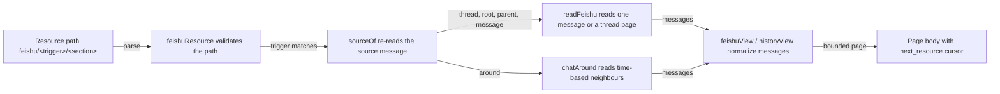

# feishu-read.ts

This file is the read-only window into a Feishu conversation: given an accepted Trigger, a caller can ask for the source message itself, its topic root, the message it replies to, a page of its thread, or the chat messages around it. Every read is anchored to the Trigger's own chat and message, so an agent can inspect what people said without gaining the ability to point at arbitrary chats. The results are normalized messages for model inspection only — nothing read here becomes a new Trigger.

## Whole-unit functional diagram

A resource path is validated first, then the Trigger's source message is re-read to learn its chat, root, parent and thread IDs. From there the module either fetches one message or a thread page, or walks the chat by timestamp, and finally returns model-facing messages plus a cursor for the next page.

<!-- {
  "mermaid_info": {
    "name": "Feishu context read flow",
    "nodes": [
      {
        "id": "request_001",
        "name": "Resource path feishu/<trigger>/<section>",
        "path": "",
        "hint": "A model or assessment asks for one slice of Feishu context",
        "isJumpable": false,
        "position": { "startLine": 0, "endLine": 0 },
        "references": []
      },
      {
        "id": "validate_002",
        "name": "feishuResource validates the path",
        "path": "src/sources/feishu-read.ts",
        "hint": "Rejects unknown sections and cursors outside thread/around before any network call",
        "isJumpable": true,
        "position": { "startLine": 47, "endLine": 53 },
        "references": []
      },
      {
        "id": "source_003",
        "name": "sourceOf re-reads the source message",
        "path": "src/sources/feishu-read.ts",
        "hint": "Confirms the retained message still exists and belongs to the trigger's chat",
        "isJumpable": true,
        "position": { "startLine": 54, "endLine": 64 },
        "references": []
      },
      {
        "id": "read_004",
        "name": "readFeishu reads one message or a thread page",
        "path": "src/sources/feishu-read.ts",
        "hint": "Serves message, root, parent and paginated thread reads",
        "isJumpable": true,
        "position": { "startLine": 69, "endLine": 97 },
        "references": []
      },
      {
        "id": "around_005",
        "name": "chatAround reads time-based neighbours",
        "path": "src/sources/feishu-read.ts",
        "hint": "Reads five messages before and after the source message, then earlier pages",
        "isJumpable": true,
        "position": { "startLine": 115, "endLine": 135 },
        "references": []
      },
      {
        "id": "view_006",
        "name": "feishuView / historyView normalize messages",
        "path": "src/sources/feishu-read.ts",
        "hint": "Turns API payloads into id, author, ISO time, text and flags",
        "isJumpable": true,
        "position": { "startLine": 101, "endLine": 113 },
        "references": []
      },
      {
        "id": "page_007",
        "name": "Page body with next_resource cursor",
        "path": "",
        "hint": "The observable result a caller or model continues from",
        "isJumpable": false,
        "position": { "startLine": 0, "endLine": 0 },
        "references": []
      }
    ]
  }
} -->

    
        <a target="_self" href="#src/sources/feishu-read.ts:1?class=graph" style="color: inherit; text-decoration: none;">Graph: Feishu context read flow</a>
    

## At a glance

- **Primary role (callable boundary)**: it exposes a small, well-defined read API — a resource string in, one page or one message out — for both the model's resource reads and assessments.
- **Secondary role (external adapter)**: it translates those project-level reads into `lark-cli` calls (single-message fetch, thread listing, chat history API) and translates the answers back into validated project messages.
- **Secondary role (domain rules)**: it enforces the containment rules that make context reads safe — results must stay inside the source chat and thread, and pagination must actually advance.
- **Confidence**: High — the whole file was read together with its callers (`src/app/resources.ts`, `src/sources/feishu.ts`, `src/app/links.ts`), its schemas in `src/sources/feishu-trigger.ts`, and its behavior tests.

## What this file does

- **Reads one bounded slice of Feishu context per call**: the source message, its topic root, the message it replies to, a page of its topic thread, or the chat messages surrounding it in time. Each section is a distinct address, so a model can ask for exactly what it needs instead of dumping a chat.
- **Keeps every read anchored to an accepted Trigger**: reads are namespaced by trigger ID, and the source message's chat and thread IDs act as proof boundaries — a resource that names another trigger, or results Feishu returns from another chat, are refused.
- **Returns messages shaped for a model, not raw API payloads**: identifiers, author display name, ISO-8601 time, text with `@name` mention substitution, the message it replies to, its app link, and `bot`/`deleted` markers. Unreadable items in a list are skipped individually and counted rather than failing the whole page.
- **Publishes explicit, opaque pagination**: a page carries `next_resource` (a ready-to-read path with an encoded cursor) or `null`, so continuing is a matter of following the returned address rather than guessing offsets.
- **Provides the Feishu ThreadContext contract**: the exported `feishuThreadContext` gives assessments `thread`/`root`/`parent` reads plus image hooks delegated to `feishu-image.ts`, and falls back to preceding chat messages when the source message has no topic thread.
- **Resolves a single message's app link on demand**: used for link enrichment in the UI, kept separate so the expanded thread is never fetched just to obtain a URL.

## Key functions or classes

### `feishuResource(resource)`

Parses and validates a model-supplied resource string, returning the trigger ID, section and decoded cursor — and rejects anything else before a network request is made.

<a target="_self" href="#src/sources/feishu-read.ts:46-53?class=code" style="color: inherit; text-decoration: none;">feishu-read.ts:46-53</a>

### `readFeishu(commands, ref, resource, pageSize, order)`

Serves the message, root, parent and thread sections: it re-reads the source message, then fetches either a single message or one validated page of the topic thread.

<a target="_self" href="#src/sources/feishu-read.ts:68-97?class=code" style="color: inherit; text-decoration: none;">feishu-read.ts:68-97</a>

### `feishuRead(commands, ref, resource, pageSize)`

The model-facing entry point: it adds the `around` section (delegated to the time-based chat walk) and normalizes every result into model-facing messages.

<a target="_self" href="#src/sources/feishu-read.ts:136-147?class=code" style="color: inherit; text-decoration: none;">feishu-read.ts:136-147</a>

### `chatAround(commands, ref, cursor, before = 5, after = 5)`

Reads the chat around the source message's timestamp — five messages before and after on the first read, then pages of ten older messages — deduplicated and ordered oldest first.

<a target="_self" href="#src/sources/feishu-read.ts:114-135?class=code" style="color: inherit; text-decoration: none;">feishu-read.ts:114-135</a>

### `feishuThreadContext`

The registration object that plugs these reads into the source-kind contract, exposing `messageId`, `read`, and the image hooks, including the `chat_neighbours` fallback for messages outside a topic thread.

<a target="_self" href="#src/sources/feishu-read.ts:153-171?class=code" style="color: inherit; text-decoration: none;">feishu-read.ts:153-171</a>

### `feishuReferences(ref)` and `readFeishuLink(commands, ref)`

`feishuReferences` advertises the resource paths available for a trigger (context pointers alongside a trigger card), while `readFeishuLink` resolves only one message's app link and fails cleanly when it is unavailable, deleted, or from another chat.

<a target="_self" href="#src/sources/feishu-read.ts:39-44?class=code" style="color: inherit; text-decoration: none;">feishu-read.ts:39-44</a>

## Main inputs and results

- **Inputs**: a `Commands` handle (the bot's `lark-cli` runner), a `FeishuRef` (`triggerId`, `chatId`, `messageId`, optional `at` timestamp), a resource path such as `feishu/<trigger-id>/thread` or `feishu/<trigger-id>/around/<cursor>`, a page size, and an optional thread order (`asc` by default).
- **Results**: either a page (`status`, optional `thread_id`, `messages`, `next_resource`, optional `skipped`) or a single item (`status`, `message`). Statuses name the answer plainly: `available`, `no_thread`, `no_parent`/`no_root`/`no_message`, `deleted`, or `chat_neighbours` for the assessment fallback.
- **Visible side effects**: read-only `lark-cli` calls under the deployment's bot identity; nothing is stored, and no Trigger, candidate or disposition is created by a context read.

## Public contract

- **Caller**: the model's resource reads (the `feishu/` route in the app's resource table) and the Feishu source kind, which registers this reader as its ThreadContext, plus link enrichment which calls `readFeishuLink` only.
- **Operation**: read one page or one message of a Trigger's Feishu context.
- **Accepted input**: `feishu/<trigger-id>/message`, `/root`, `/parent`, `/thread` or `/around`; a cursor segment is allowed only on `thread` and `around`, and is percent-decoded before use. The trigger ID in the path must equal the trigger ID of the reference, and message IDs must look like Feishu message IDs.
- **Result**: a page body or single-message body as above; `next_resource` is the follow-up path for `thread` and `around`, so callers never construct cursors themselves.
- **Errors instead of guesses**: unknown paths, a missing or deleted source message, a chat mismatch, a thread page that escapes its thread, and a page token that fails to advance all raise errors with actionable text rather than returning partial or invented content.

### Access or validation requirements

Reads run through the Feishu source's configured bot CLI, so a Source without a working bot reports that plainly, and a bot that is not a member of the chat surfaces the rewritten membership message. Page size comes from the source configuration (`readPageSize`, 1–50, default 20), which is why the assessment path passes `config.readPageSize` while the model path passes the host's page size.

## Rules and decisions

- **Decision**: how much of a conversation an agent may see, and which messages it may see it from — always the neighborhood of one accepted Trigger's message.
- **Important conditions**: the section requested; whether the message belongs to a topic thread (otherwise there is nothing to page); the source message's timestamp (`around` cannot run without a readable time); and a cursor, which switches `around` from "five before, five after" to "ten older messages".
- **Outcomes**: a page of messages with a next cursor, a single message with an available/deleted status, an explicit "there is no such root/parent/thread" answer, or the `chat_neighbours` fallback that shows preceding chat messages instead of an empty thread.
- **Invariant**: every returned message belongs to the source chat, and thread pages belong to the source thread; results are inspection material and never enter intake as new work.

### Small example

An assessment asks for `thread` of a trigger whose message is an ordinary chat message rather than a topic reply. Instead of reporting an empty thread, the reader returns five earlier messages from the same chat labelled `chat_neighbours`, so the agent still has conversational evidence to judge from. Asking for the same trigger's `thread` on a real topic returns a page whose `next_resource` is the only sanctioned way to continue.

## External connection

- **External system**: Feishu, accessed through the deployment's `lark-cli` bot identity via `Commands.lark` (Feishu is never called directly).
- **Outbound translation**: `message`/`root`/`parent` become a single-message fetch with reactions suppressed and automatic thread expansion turned off; `thread` becomes a topic-page listing with order, page size and optional page token; `around` becomes chat-history queries on `/open-apis/im/v1/messages` bounded by `end_time` for earlier items and `start_time` for later ones. Parent and root IDs are learned from a raw message lookup so the CLI does not expand threads implicitly.
- **Inbound translation**: responses are schema-validated with zod; list items are validated one by one so a single malformed message is skipped and counted (`skipped`) instead of failing the page; timestamps are converted to ISO-8601 (with a pass-through when Feishu returns an unparsable value); mentions become readable `@name` text; non-user senders are flagged as bots; deleted messages keep their slot with empty text.

### Operating requirements

The Feishu Source must be configured with a bot CLI and the bot must be able to read the chats involved. Chat-history and thread queries count milliseconds into whole seconds, and the source message counts among the earlier items — which is why the "before" query asks for one extra message and the results are deduplicated by message ID.

---
name: feishu-read.ts

update-time: 2026-11-02 11:27

description: This file is the read-only window into a Feishu conversation: given an accepted Trigger, a caller can ask for the source message itself, its topic root, the message it replies to, a page of its thread, or the chat messages around it. Every read is anchored to the Trigger's own chat and message, so an agent can inspect what people said without gaining the ability to point at arbitrary chats. The results are normalized messages for model inspection only — nothing read here becomes a new Trigger.

---
