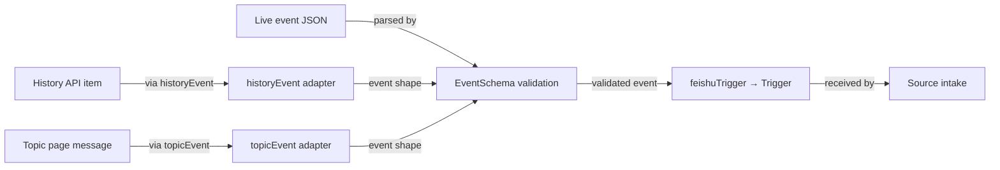

# feishu-trigger.ts

This file is the single place where raw Feishu message data becomes a domain `Trigger`. Feishu delivers the same real-world message in three different payload shapes — a live event from the event consumer, an item from the chat-history API, and a message from a topic page — and this file normalizes all three into one canonical shape before converting it into the project's `Trigger`. It also owns the Feishu identity rules (message IDs, thread IDs, chat addresses) that every other Feishu module reuses, so nothing else has to guess how a Feishu message is addressed.

## Whole-unit functional diagram

The two non-live read paths do not get their own conversion logic: they reshape what they read into the same event shape the live stream prints, and then the single `feishuTrigger` conversion produces a `Trigger` identical to the one the live stream would have produced for that message.

<!-- {
  "mermaid_info": {
    "name": "Feishu message to Trigger flow",
    "nodes": [
      {
        "id": "live_001",
        "name": "Live event JSON",
        "path": "",
        "hint": "A message event printed by the Feishu event consumer",
        "isJumpable": false,
        "position": { "startLine": 0, "endLine": 0 },
        "references": []
      },
      {
        "id": "history_002",
        "name": "History API item",
        "path": "",
        "hint": "One message returned by Feishu's chat or topic history endpoint",
        "isJumpable": false,
        "position": { "startLine": 0, "endLine": 0 },
        "references": []
      },
      {
        "id": "topic_003",
        "name": "Topic page message",
        "path": "",
        "hint": "A message read from a Feishu topic (thread) page",
        "isJumpable": false,
        "position": { "startLine": 0, "endLine": 0 },
        "references": []
      },
      {
        "id": "parse_004",
        "name": "EventSchema validation",
        "path": "src/sources/feishu-trigger.ts",
        "hint": "The one canonical message shape, with mention and option defaults",
        "isJumpable": true,
        "position": { "startLine": 11, "endLine": 15 },
        "references": []
      },
      {
        "id": "adapt_005",
        "name": "historyEvent adapter",
        "path": "src/sources/feishu-trigger.ts",
        "hint": "Reshapes a history item into the event shape",
        "isJumpable": true,
        "position": { "startLine": 74, "endLine": 79 },
        "references": []
      },
      {
        "id": "adapt_006",
        "name": "topicEvent adapter",
        "path": "src/sources/feishu-trigger.ts",
        "hint": "Reshapes a topic-page message into the event shape",
        "isJumpable": true,
        "position": { "startLine": 84, "endLine": 89 },
        "references": []
      },
      {
        "id": "trigger_007",
        "name": "feishuTrigger → Trigger",
        "path": "src/sources/feishu-trigger.ts",
        "hint": "Converts a validated event into a domain Trigger, or nothing for the bot's own messages",
        "isJumpable": true,
        "position": { "startLine": 31, "endLine": 44 },
        "references": []
      },
      {
        "id": "intake_008",
        "name": "Source intake",
        "path": "src/sources/feishu-loops.ts",
        "hint": "The Feishu loops hand each Trigger to the Source context",
        "isJumpable": true,
        "position": { "startLine": 26, "endLine": 33 },
        "references": []
      }
    ]
  }
} -->

    
        <a target="_self" href="#src/sources/feishu-trigger.ts:1?class=graph" style="color: inherit; text-decoration: none;">Graph: Feishu message to Trigger flow</a>
    

## At a glance

- Primary role: External adapter — it translates Feishu's payload formats into the project's own `Trigger` model, so the rest of the system never reads a Feishu field.
- Secondary roles: Data contract — it defines the shared message shapes and schemas that both the history-read and topic-poll paths validate against.
- Confidence: High — every exported helper was traced to its callers in the Feishu loops, the Feishu reads, the outbound channel and the tests.

## What this file does

- Gives Feishu messages a single canonical shape. `EventSchema` describes one message with sensible defaults (an absent mention list becomes empty), so live events, history items and topic messages can all be validated by the same parser.
- Converts a message into a domain `Trigger` carrying everything downstream code needs: a deterministic ID, the thread it belongs to, who sent it, whether a person wrote it, whether the bot was addressed, the message text, a reply address, an optional link to the original message, and the raw Feishu identifiers under `meta`.
- Ignores the bot's own messages. A message whose sender is the bot or the bot's app yields no `Trigger` at all, which keeps the agent from answering itself on any of the three intake paths.
- Rebuilds readable text. Feishu delivers content either as plain text (typical for system messages) or as JSON containing a text body, and mention placeholders are replaced with the mentioned user's name.
- Makes message identity stable and deterministic. The same Feishu message produces the same trigger ID regardless of which path read it, so the history backfill and the live stream cannot create duplicates.
- Provides the small identity helpers other Feishu modules build on: the thread key of a message, the reply channel address, the trigger a message replies to, and the retained reference used to reread a message later.

## Key functions or classes

### `feishuTrigger`

The central conversion: it validates the incoming event, drops messages sent by the bot itself, and returns a complete `Trigger` — or `undefined` when the message is the bot's own.

    
        <a target="_self" href="#src/sources/feishu-trigger.ts:31-44?class=code" style="color: inherit; text-decoration: none;">Code: src/sources/feishu-trigger.ts:31-44</a>
    

### `EventSchema` and `FeishuEvent`

The single message contract: identifiers, chat type, sender and sender type, content, timestamp, mentions and optional thread/parent/link fields. `FeishuEvent` is the inferred TypeScript type, and it is the only shape the conversion accepts.

    
        <a target="_self" href="#src/sources/feishu-trigger.ts:11-15?class=code" style="color: inherit; text-decoration: none;">Code: src/sources/feishu-trigger.ts:11-15</a>
    

### `historyEvent` and `topicEvent`

The two adapters that make the batch read paths look like the live stream, so no second conversion rule is needed; they fill in the chat type from the chat's direct/group flag and normalize the sender type to `user` or `bot`.

    
        <a target="_self" href="#src/sources/feishu-trigger.ts:74-89?class=code" style="color: inherit; text-decoration: none;">Code: src/sources/feishu-trigger.ts:74-89</a>
    

### `historyText`

Extracts readable text from a history item's body, tolerating both a JSON body with a `text` field and Feishu's plain-text system messages, and a body missing entirely on deleted messages.

    
        <a target="_self" href="#src/sources/feishu-trigger.ts:67-73?class=code" style="color: inherit; text-decoration: none;">Code: src/sources/feishu-trigger.ts:67-73</a>
    

### `feishuChannel`

Builds the reply address for a message. It records `direct` explicitly, because Feishu gives group chats and direct chats the same `oc_` ID prefix, so the chat ID alone cannot tell an operator whether a reply goes to a person or a group.

    
        <a target="_self" href="#src/sources/feishu-trigger.ts:8-9?class=code" style="color: inherit; text-decoration: none;">Code: src/sources/feishu-trigger.ts:8-9</a>
    

### `feishuTriggerId` and `feishuThreadId`

The identity rules: a trigger is named after its message, and a thread is named after the chat plus the message's root (falling back to the message itself) — the same identifiers every read path produces.

    
        <a target="_self" href="#src/sources/feishu-trigger.ts:16-18?class=code" style="color: inherit; text-decoration: none;">Code: src/sources/feishu-trigger.ts:16-18</a>
    

### `feishuParent` and `feishuRef`

Two lookups over an existing trigger: the trigger it answers (so replies can be threaded onto the message they answer) and the retained reference used to reread that message later. Both return `undefined` for triggers from other sources.

    
        <a target="_self" href="#src/sources/feishu-trigger.ts:45-51?class=code" style="color: inherit; text-decoration: none;">Code: src/sources/feishu-trigger.ts:45-51</a>
    

### `feishuTime` and `withMentionNames`

Two normalizers for values that reach stored records: timestamps become ISO-8601 regardless of whether Feishu sent epoch milliseconds or a local `2026-09-11 12:00` string (an unreadable time throws rather than being silently stored), and mention placeholders in text become `@name`.

    
        <a target="_self" href="#src/sources/feishu-trigger.ts:19-29?class=code" style="color: inherit; text-decoration: none;">Code: src/sources/feishu-trigger.ts:19-29</a>
    

## Main inputs and results

- Inputs: an unvalidated Feishu message payload plus the configured bot identity (`botId` and `appId`), which are compared against the sender and against mention targets. In the loops, the live event stream, the chat/topic history backfill and the subscribed-thread poll all supply these — see 
<a target="_self" href="#src/sources/feishu-loops.ts:70-105?class=code" style="color: inherit; text-decoration: none;">feishu-loops.ts:70-105</a>
.
- Results: a `Trigger` with a deterministic ID, primary thread, actor, human flag, optional `addressed` (`direct` for a private chat, `mention` when the bot is mentioned), ISO timestamp, mention-expanded text, reply channel, optional original-message link and Feishu metadata — or no result at all for the bot's own messages.
- Visible side effects: none inside this file. It performs no network calls and stores nothing; the observable effect is that a message appears as work in the system, and that the chat is remembered as a group or a direct chat by the caller.

## External connection

- External system: Feishu (Lark) messages, as surfaced through the bot's `lark-cli` event stream and message-read endpoints. This file never contacts Feishu itself; it only describes and reshapes what those reads return.
- Outbound translation: there is no outbound request here, but the reply address produced by `feishuChannel` is what the outbound path later uses to post a threaded reply, and `feishuTriggerId` names the trigger that the message link points back to. See 
<a target="_self" href="#src/sources/feishu-channel.ts:19-35?class=code" style="color: inherit; text-decoration: none;">feishu-channel.ts:19-35</a>
.
- Inbound translation: three Feishu payload dialects collapse into one event shape and then into a `Trigger`, with the differences that matter preserved — private chat versus group, a person versus a bot sender, an explicit mention of the bot, topic membership, and whether the message was recalled or deleted.

### Operating requirements

The bot identity must be configured for the Feishu Source, because dropping the bot's own messages and recognizing `@` mentions both depend on comparing sender and mention IDs against the bot's ID and app ID. Reply addresses also require a matching chat-and-message pair, and mention expansion only happens for mentions that carry both a placeholder key and a display name.

## Information contract

- Represents: one Feishu message, canonicalized — identifiers, chat identity, sender, text, timestamp, mentions, topic position and an optional link.
- Produced by: `EventSchema` and its `FeishuEvent` type for the normalized message; `HistoricalMessageSchema`, `HistoryPageSchema` and the `HistoricalMessage` type for what the history endpoint returns.
- Consumed by: the Feishu loops for live intake, backfill and subscribed-thread polling; 
<a target="_self" href="#src/sources/feishu-read.ts:1-11?class=code" style="color: inherit; text-decoration: none;">feishu-read.ts:1-11</a>
 for trigger-scoped context reads and the retained `FeishuRef`; the outbound channel and the app resources for trigger IDs; and the Feishu kind module, which re-exports these helpers.
- Behavior-shaping parts: `chat_type` decides private versus group and therefore sets `addressed: 'direct'`; the sender ID decides the `human` flag; mention IDs decide `addressed: 'mention'`; `root_id`/`message_id` decide the thread; `create_time` format decides how the timestamp is parsed; `deleted` suppresses text on messages that were recalled; `message_app_link` becomes the trigger's URL when present.

### Compatibility notes

The history and topic schemas are deliberately loose objects, so unknown Feishu fields pass through untouched and page items are validated one by one — an unreadable item is skipped alone instead of failing a whole page. Nearly all optional message fields (mentions, parent, root, thread, link) are genuinely absent in some payloads, and both adapters tolerate missing content on deleted messages by substituting an empty string. Because IDs are derived from the message ID rather than from a read counter, a message seen first through the live stream and later through backfill maps to the same `Trigger`.

---
name: feishu-trigger.ts

update-time: 2026-11-02 11:33

description: This file is the single place where raw Feishu message data becomes a domain `Trigger`. Feishu delivers the same real-world message in three different payload shapes — a live event from the event consumer, an item from the chat-history API, and a message from a topic page — and this file normalizes all three into one canonical shape before converting it into the project's `Trigger`. It also owns the Feishu identity rules (message IDs, thread IDs, chat addresses) that every other Feishu module reuses, so nothing else has to guess how a Feishu message is addressed.

---
