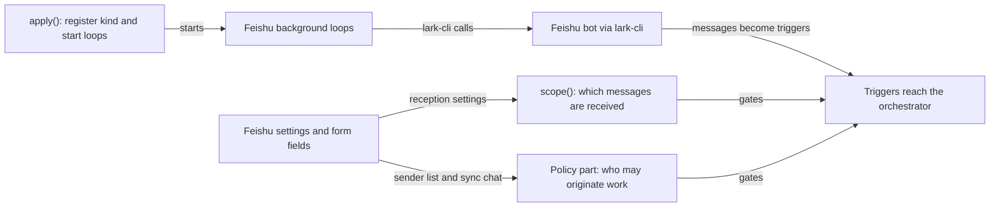

# feishu.ts

This file is the Feishu Source's configuration and registration surface: it declares what an operator can set for Feishu (received chats, direct messages, page size, link timeout, who may originate work), describes those settings as a panel form, and registers the result with the orchestrator as a pluggable Source kind. Almost no Feishu traffic handling lives here — message conversion, sending, backfill and polling are done by the sibling `feishu-*` modules that this file wires together. Read it when you want to know which setting changes which behavior, or where the Feishu plugin attaches to the application lifecycle.

## Whole-unit functional diagram

The left side is pure configuration: saved settings produce both a reception decision per message and a policy section about senders. The right side is the plugin entry point, which registers the kind and starts the Feishu loops that talk to the bot through `lark-cli`; messages arriving there are only admitted after the reception and policy gates agree.

<!-- {
  "mermaid_info": {
    "name": "Feishu configuration and source registration",
    "nodes": [
      {
        "id": "cfg_001",
        "name": "Feishu settings and form fields",
        "path": "src/sources/feishu.ts",
        "hint": "Validated configuration schema with defaults, plus the panel field descriptions",
        "isJumpable": true,
        "position": { "startLine": 21, "endLine": 52 },
        "references": []
      },
      {
        "id": "scope_002",
        "name": "scope(): which messages are received",
        "path": "src/sources/feishu.ts",
        "hint": "Decides listening, observation and admission-table row per message",
        "isJumpable": true,
        "position": { "startLine": 54, "endLine": 59 },
        "references": []
      },
      {
        "id": "policy_003",
        "name": "Policy part: who may originate work",
        "path": "src/sources/feishu.ts",
        "hint": "Allowed users, bot candidates, admission rows and roster sync from chat members",
        "isJumpable": true,
        "position": { "startLine": 70, "endLine": 117 },
        "references": []
      },
      {
        "id": "plugin_004",
        "name": "apply(): register kind and start loops",
        "path": "src/sources/feishu.ts",
        "hint": "Cordis plugin entry that registers the kind and starts the Feishu loops with an abortable lifecycle",
        "isJumpable": true,
        "position": { "startLine": 132, "endLine": 139 },
        "references": []
      },
      {
        "id": "loops_005",
        "name": "Feishu background loops",
        "path": "src/sources/feishu-loops.ts",
        "hint": "Event consumer, history backfill and chat name refresh started by runFeishu",
        "isJumpable": true,
        "position": { "startLine": 18, "endLine": 19 },
        "references": []
      },
      {
        "id": "bot_006",
        "name": "Feishu bot via lark-cli",
        "path": "",
        "hint": "External Feishu/Lark bot reached through the configured lark-cli",
        "isJumpable": false,
        "position": { "startLine": 0, "endLine": 0 },
        "references": []
      },
      {
        "id": "live_007",
        "name": "Triggers reach the orchestrator",
        "path": "",
        "hint": "Admitted Feishu messages continue as work items in the orchestrator",
        "isJumpable": false,
        "position": { "startLine": 0, "endLine": 0 },
        "references": []
      }
    ]
  }
} -->

    
        <a target="_self" href="#src/sources/feishu.ts:1?class=graph" style="color: inherit; text-decoration: none;">Graph: Feishu configuration and source registration</a>
    

## At a glance

- Primary role: Configuration — the file defines every Feishu setting, its defaults and validation, the panel form that edits it, and the values finally handed to the runtime.
- Secondary roles: Domain rules — reception scope, reply permission and the sender admission table express real policy decisions. External adapter — chats, message links, outgoing sends, chat names and member rosters are bridged to Feishu through `lark-cli`.
- Confidence: High — the complete `SourceKind` descriptor, the policy section and the Cordis plugin entry are readable here, and the contract it fills is visible in the related `kind.ts` and `registry.ts` modules.

## What this file does

- Declares the `feishu` Source: its stable kind ID, bilingual title and description, and the two health entries (`feishu`, `history`) that only this kind may report.
- Validates and defaults the settings. The schema extends the deployment's bot CLI with `readPageSize`, `linkTimeoutMs`, a `chats` list (each chat with an `@ only` or `All` mode), `directMessages` and `otherChats`, rejecting duplicate chat IDs and unknown keys.
- Describes the settings form so an operator can configure Feishu without touching code: chat rows with a chooser backed by stored chat names, an advanced section for page size and link timeout, and a read-only "current bot" fact.
- Converts settings into reception decisions and policy table rows: a message is received or not depending on its chat, the "other chats" mode and the direct-message switch, which also fixes the row label the policy's admission table uses.
- Defines the policy section for Feishu senders — the allowed human list, an optional chat whose members become that list, and a bot list whose messages can only ever become inferred candidates — plus the sync action that rebuilds the list from chat membership.
- Bridges the rest of the host: the outbound channel (reply permission, send, deep link), the thread context reader, message-ID search terms, parent-message linkage, the two environment variables, and the plugin entry that registers the kind and starts the Feishu loops.

## Key functions or classes

### `FeishuConfigSchema`

The validated shape of every Feishu setting, with defaults applied for anything omitted.

    
        <a target="_self" href="#src/sources/feishu.ts:21-29?class=code" style="color: inherit; text-decoration: none;">Code: src/sources/feishu.ts:21-29</a>
    

### `feishuKind`

The descriptor object that implements the `SourceKind` contract: everything the orchestrator, panel, policy and executor need to know about Feishu in one place.

    
        <a target="_self" href="#src/sources/feishu.ts:31-126?class=code" style="color: inherit; text-decoration: none;">Code: src/sources/feishu.ts:31-126</a>
    

### `feishuKind.scope`

Answers whether a message is received at all, whether unaddressed messages are also observed, and which admission row it belongs to — or why it is rejected.

    
        <a target="_self" href="#src/sources/feishu.ts:54-59?class=code" style="color: inherit; text-decoration: none;">Code: src/sources/feishu.ts:54-59</a>
    

### `feishuKind.channel`

The reply adapter: it reuses `scope` to refuse replies to chats the Source no longer receives, and delegates sending and deep links to the Feishu channel module.

    
        <a target="_self" href="#src/sources/feishu.ts:61-65?class=code" style="color: inherit; text-decoration: none;">Code: src/sources/feishu.ts:61-65</a>
    

### `feishuKind.policy.rows`

Projects the saved settings into admission-table rows (one per listed chat, plus "other chats" and "direct messages") so the policy can show which combinations of sender and chat are possible.

    
        <a target="_self" href="#src/sources/feishu.ts:90-101?class=code" style="color: inherit; text-decoration: none;">Code: src/sources/feishu.ts:90-101</a>
    

### `feishuKind.policy.sync.run`

Rebuilds the allowed-sender list from one chat's members: it refuses an incomplete member list, keeps survivors in their existing order and appends new members.

    
        <a target="_self" href="#src/sources/feishu.ts:105-115?class=code" style="color: inherit; text-decoration: none;">Code: src/sources/feishu.ts:105-115</a>
    

### `feishuSettings`

Reads the current Feishu settings from the registry and falls back to schema defaults while the plugin is disabled, so callers such as link resolution and the runtime can always ask for a page size or timeout.

    
        <a target="_self" href="#src/sources/feishu.ts:128?class=code" style="color: inherit; text-decoration: none;">Code: src/sources/feishu.ts:128</a>
    

### `apply`

The plugin entry point: it registers the kind with the source registry and starts the Feishu loops behind an abort controller, stopping them when the plugin unloads.

    
        <a target="_self" href="#src/sources/feishu.ts:132-139?class=code" style="color: inherit; text-decoration: none;">Code: src/sources/feishu.ts:132-139</a>
    

## Main inputs and results

- Inputs: settings submitted from the panel (validated by the schema), the deployment's resolved Feishu bot (CLI, app ID, bot ID, name, brand), message metadata such as `chatId` and `direct` for reception decisions, and a stored policy section with allowed users, sync chat and bot list.
- Results: a reception verdict (`listened` with `observed` flag and admission row, or `listened` false with a reason such as `chat_not_allowed`), a validated policy section whose allowed list can be refreshed from chat members, an allow/deny answer for replies plus sent messages and chat/message links, and the environment values `DSH_SUPERAGENT_FEISHU_BOT` and `DSH_SUPERAGENT_FEISHU_CHAT` for the executor.
- Visible side effects: the settings panel shows localized labels, hints and the current bot; the chat chooser offers names collected by the kind's label refresh; saving the bot CLI triggers a restart of `dsh-superagent`; the `feishu` and `history` health entries reported by the loops appear in the panel, and disabling the Source stops incoming Feishu messages within seconds.

## Configurable behavior

- Controls: which Feishu chats are received and in which mode, whether unlisted chats contribute mentions, whether direct messages are received, messages per page when agents read threads and history, how long to wait for an original message link, and — in the policy section — who may originate work, which chat the sender list syncs from, and which bots may produce inferred candidates.
- Value source: the stored Source instance configuration, validated by this file's schema with defaults filled in; the bot CLI itself comes from deployment setup rather than the Source form; policy values live under the policy's Feishu section and are validated by the policy schema declared here.
- Takes effect: reception, page size and link timeout are read whenever the corresponding decision is made, so saved reception changes apply to the next message without a restart. Changing the bot CLI is a deployment change and restarts the application, as the field hint states.

### Common adjustment

`chats` — adding a chat and choosing `@ only` narrows it to mentions of the bot and threads that already have a ticket, while `All` also takes the rest of that chat's messages for inference; the same row then appears in the policy's admission table under that chat's name.

## Rules and decisions

- Decision: is a message from this conversation received? A listed chat is always received, with `observed` only in `All` mode; an unlisted chat is received only when "other chats" is set to `@ only`; a direct message is received only when direct messages are enabled.
- Decision: may a reply still be sent here? The channel permission check re-derives the same reception verdict from the saved address, so a chat removed from the settings stops receiving replies as well as new messages.
- Decision: who may originate work? Only listed Feishu users; their mention of the bot or direct message is always an explicit request, while listed bots can at most become inferred candidates and can never request work or stop a ticket.
- Important conditions: the reception verdict carries a row label (`direct`, a chat ID, or `other`) that must correspond to a row the admission table shows; a chat listed in the settings outranks the "other chats" mode.
- Invariant: roster sync keeps existing members in their current order and only updates names in place, so the policy version does not churn when membership is unchanged; an incomplete member list is rejected instead of silently shrinking the roster.
- Outcomes: `listened` with or without observation, or a rejection reason such as `direct_messages_not_allowed` or `chat_not_allowed`; a sync either returns a reordered-and-extended list or throws.

### Small example

A chat is listed with `@ only` and "other chats" is `@ only`. A bot mention there is received and can start work; an unaddressed message in the same chat is not observed, so it cannot become an inferred candidate; a mention in some other chat the bot has joined is still received, but the policy's admission table shows it under "other chats".

## External connection

- External system: a Feishu or Lark bot, reached through a bot-only `lark-cli` command as resolved by deployment setup.
- Outbound translation: settings become panel choices (chat rows, selects, switches), saved addresses become chat or message deep links, replies are handed to the Feishu channel sender, and the sync action becomes a `lark-cli` chat-member listing; the kind's label refresh reads the bot's joined chat list.
- Inbound translation: the member listing is parsed into the allowed-sender list with names taken from the chat, chat names are stored so the panel can label chats, and message metadata decides the reception verdict. Converting raw Feishu messages into triggers happens outside this file, in the Feishu trigger and loop modules.

### Operating requirements

The `lark-cli` must allow only the bot identity, a restart is needed after changing it, and the bot has to be a member of the chats involved. Choosing `All` for a chat additionally requires that the bot be allowed to read all messages there, which the field hint states explicitly.

To see the contract this file implements, open 
<a target="_self" href="#src/sources/kind.ts?class=code" style="color: inherit; text-decoration: none;">kind.ts</a>
; registration and configuration resolution live in 
<a target="_self" href="#src/sources/registry.ts:20-35?class=code" style="color: inherit; text-decoration: none;">registry.ts:20-35</a>
, and the loops started by the plugin entry are in 
<a target="_self" href="#src/sources/feishu-loops.ts:18-19?class=code" style="color: inherit; text-decoration: none;">feishu-loops.ts:18-19</a>
.

---
name: feishu.ts

update-time: 2026-11-02 11:31

description: This file is the Feishu Source's configuration and registration surface: it declares what an operator can set for Feishu (received chats, direct messages, page size, link timeout, who may originate work), describes those settings as a panel form, and registers the result with the orchestrator as a pluggable Source kind. Almost no Feishu traffic handling lives here — message conversion, sending, backfill and polling are done by the sibling `feishu-*` modules that this file wires together. Read it when you want to know which setting changes which behavior, or where the Feishu plugin attaches to the application lifecycle.

---
