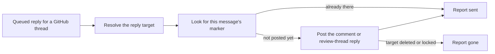

# github-channel.ts

This file is the outbound half of the GitHub Source: it turns a queued reply into a real comment on a GitHub Issue, pull request, or inline review thread, posted under the agent's own account. It exists so replies survive the messy realities of a remote API — a send that succeeds but looks failed, a deleted Issue, a review comment inside a long thread — without producing duplicates or endless retries. It also builds the link and label a reader clicks in the panel or timeline to reach that thread.

## How an outbound GitHub reply flows

<!-- {
  "mermaid_info": {
    "name": "GitHub outbound reply flow",
    "nodes": [
      {
        "id": "queued_001",
        "name": "Queued reply for a GitHub thread",
        "path": "",
        "hint": "An OutboundMessage the Outbox hands to the GitHub channel",
        "isJumpable": false,
        "position": { "startLine": 0, "endLine": 0 },
        "references": []
      },
      {
        "id": "resolve_002",
        "name": "Resolve the reply target",
        "path": "src/sources/github-channel.ts",
        "hint": "Reads the number and URL of the address to choose the Issue comment, PR comment, or review thread root",
        "isJumpable": true,
        "position": { "startLine": 21, "endLine": 33 },
        "references": []
      },
      {
        "id": "dedupe_003",
        "name": "Look for this message's marker",
        "path": "src/sources/github-channel.ts",
        "hint": "Lists existing comments and stops early when the agent already posted this message ID",
        "isJumpable": true,
        "position": { "startLine": 34, "endLine": 37 },
        "references": []
      },
      {
        "id": "post_004",
        "name": "Post the comment or review-thread reply",
        "path": "src/sources/github-channel.ts",
        "hint": "Creates the comment with the hidden marker appended to the message text",
        "isJumpable": true,
        "position": { "startLine": 38, "endLine": 39 },
        "references": []
      },
      {
        "id": "sent_005",
        "name": "Report sent",
        "path": "src/sources/github-channel.ts",
        "hint": "The receipt settles as delivered",
        "isJumpable": true,
        "position": { "startLine": 40, "endLine": 40 },
        "references": []
      },
      {
        "id": "gone_006",
        "name": "Report gone",
        "path": "src/sources/github-channel.ts",
        "hint": "A deleted or locked target settles as channelGone instead of retrying",
        "isJumpable": true,
        "position": { "startLine": 42, "endLine": 42 },
        "references": []
      }
    ]
  }
} -->

    
        <a target="_self" href="#src/sources/github-channel.ts:1?class=graph" style="color: inherit; text-decoration: none;">Graph: GitHub outbound reply flow</a>
    

Every reply walks the same path: pick the right place on GitHub for this address, check whether this exact message already landed, then either post it once or report that the target no longer accepts replies. The check before posting is what makes the channel safe to retry, because the Outbox may deliver the same message again after a failure.

## At a glance

- Primary role: External adapter — it translates a project-level outgoing message into GitHub API calls and translates GitHub's answers back into `'sent'` or `'gone'`.
- Confidence: High — the whole file was read together with the channel contract it implements, the Source kind that registers it, the outbox path that calls it, and tests that assert the marker and review-thread routing.

## What this file does

- **Posts agent replies as GitHub conversation comments.** A reply addressed to an Issue or PR becomes a new comment written by the account the agent's GitHub CLI is signed in to.
- **Routes inline review replies into the right review thread.** When the address points at a discussion comment on a PR, the reply is posted inside that thread instead of at the top of the conversation.
- **Makes delivery retry-safe.** Each comment ends with a hidden HTML marker derived from the outgoing message ID, so a swallowed error cannot cause a second identical comment.
- **Distinguishes dead targets from temporary trouble.** A deleted Issue (410) or a locked conversation (403 mentioning "locked") ends delivery, while a 404 is deliberately retried because it can mean temporary permission loss on a private repository.
- **Builds the human-visible link.** It supplies the URL and localized label used wherever a GitHub thread is shown, with a different label for review discussions.

## Key functions or classes

### `sendGithub`

The channel's send operation: resolves the reply target from the message's channel address, skips posting if this message ID is already present, otherwise posts the comment or review-thread reply and reports the outcome.

    
        <a target="_self" href="#src/sources/github-channel.ts:18-45?class=code" style="color: inherit; text-decoration: none;">Code: src/sources/github-channel.ts:18-45</a>
    

### `githubLink`

Turns a stored channel address into a `ChannelLink`: the original message or review-comment URL when one was recorded, otherwise the Issue page of that number in the configured repository, plus a Chinese/English label.

    
        <a target="_self" href="#src/sources/github-channel.ts:46-52?class=code" style="color: inherit; text-decoration: none;">Code: src/sources/github-channel.ts:46-52</a>
    

These two functions are not called directly by the GitHub poller; they are plugged in as the `channel` of the GitHub Source kind in 
<a target="_self" href="#src/sources/github.ts:64?class=code" style="color: inherit; text-decoration: none;">github.ts:64</a>
, and the registry forwards deliveries to them from the Outbox.

## Main inputs and results

- Inputs: an outgoing message (`id`, `kind`, `text`, and a channel address carrying `number` plus, when it is known, the comment `url`), together with the `Commands` handle from the Source context; the deployment must supply the repository and the agent's GitHub login and CLI.
- Results: `'sent'` when the comment is either newly posted or already present, `'gone'` when GitHub reports the target deleted or locked, and a thrown error for anything the retry loop should try again. The link function returns a `ChannelLink` with `url` and a `{ zh, en }` label.
- Visible side effects: a comment appears on the Issue, pull request, or review thread under the agent account, with the message text rendered as written and the marker invisible; a dead target settles the reply receipt as `channelGone` instead of retrying.

## External connection

- External system: the GitHub REST API, reached through the agent's own `gh` CLI via the shared `Commands` wrapper, restricted to the Source's configured repository.
- Outbound translation: a channel address becomes an API path — `issues/<n>/comments` for conversation replies, `pulls/<n>/comments` for top-level PR replies, and `pulls/<n>/comments/<root>/replies` for a review thread — and the message text plus marker is sent as the comment body.
- Inbound translation: paged comment lists are read back to detect an earlier delivery, and `CliError` HTTP codes are reclassified into project outcomes: gone (delivery ends), retryable (error propagates to the outbox), or recoverable (a missing review comment falls back to a top-level PR comment).

### Operating requirements

The Source must be configured with a repository and a GitHub CLI signed in to the agent account, because the posted comment's author is whoever that CLI is authenticated as; the same account name is used to recognize the agent's own earlier comments when checking for duplicates. API paths outside the configured repository are rejected by the command layer, so the address on the message must already refer to that repository.

---
name: github-channel.ts

update-time: 2026-11-02 11:32

description: This file is the outbound half of the GitHub Source: it turns a queued reply into a real comment on a GitHub Issue, pull request, or inline review thread, posted under the agent's own account. It exists so replies survive the messy realities of a remote API — a send that succeeds but looks failed, a deleted Issue, a review comment inside a long thread — without producing duplicates or endless retries. It also builds the link and label a reader clicks in the panel or timeline to reach that thread.

---
