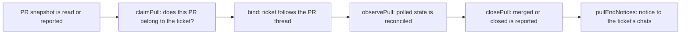

# github-pull.ts

This file holds the pull-request rules of the GitHub Source: it decides whether a pull request belongs to a ticket, keeps that relationship in sync as the PR is polled, and reports merges and closes into the ticket lifecycle. It also builds the human-readable notice that reaches chat conversations when a ticket ends together with its PR. Read it when you need to understand why a PR was accepted or rejected for a ticket, or where the "PR #12 has merged" message comes from.

## Whole-unit functional diagram

<!-- {
  "mermaid_info": {
    "name": "Pull request claim, observation and notice flow",
    "nodes": [
      {
        "id": "pull_read_001",
        "name": "PR snapshot is read or reported",
        "path": "src/sources/github-pull.ts",
        "hint": "A PR is fetched from GitHub, or handed in by the Executor report tool",
        "isJumpable": true,
        "position": { "startLine": 16, "endLine": 21 },
        "references": []
      },
      {
        "id": "claim_002",
        "name": "claimPull: does this PR belong to the ticket?",
        "path": "src/sources/github-pull.ts",
        "hint": "Checks the source PR or an agent PR on the ticket's branch, and exclusive ownership",
        "isJumpable": true,
        "position": { "startLine": 35, "endLine": 50 },
        "references": []
      },
      {
        "id": "bind_003",
        "name": "bind: ticket follows the PR thread",
        "path": "src/sources/github-pull.ts",
        "hint": "Atomically binds the ticket to the thread and records PR metadata",
        "isJumpable": true,
        "position": { "startLine": 70, "endLine": 75 },
        "references": []
      },
      {
        "id": "observe_004",
        "name": "observePull: polled state is reconciled",
        "path": "src/sources/github-pull.ts",
        "hint": "Re-reads open/merged/closed state and auto-binds a single ticket on the branch",
        "isJumpable": true,
        "position": { "startLine": 57, "endLine": 69 },
        "references": []
      },
      {
        "id": "close_005",
        "name": "closePull: merged or closed is reported",
        "path": "src/sources/github-pull.ts",
        "hint": "Reports the closing PR thread to the open tickets that follow it",
        "isJumpable": true,
        "position": { "startLine": 80, "endLine": 84 },
        "references": []
      },
      {
        "id": "notice_006",
        "name": "pullEndNotices: notice to the ticket's chats",
        "path": "src/sources/github-pull.ts",
        "hint": "Builds idempotent merge/close notices in the ticket's language",
        "isJumpable": true,
        "position": { "startLine": 90, "endLine": 105 },
        "references": []
      }
    ]
  }
} -->

    
        <a target="_self" href="#src/sources/github-pull.ts:1?class=graph" style="color: inherit; text-decoration: none;">Graph: Pull request claim, observation and notice flow</a>
    

A PR enters through a claim (the agent reports a PR number) or through polling (the Source re-reads PRs of open tickets); either way the same ownership rules decide whether the ticket starts following that PR thread. Once bound, the PR's later merge or close is reported to the core, which ends the ticket and lets this file format the notice people see in chat.

## At a glance

- Primary role: Domain rules — the file encodes who may claim a PR, when a PR binds to a ticket, and what a merged or closed PR means for that ticket.
- Secondary roles: Information contract — it defines and reads the shared pull-request snapshot (`PullSchema`, `Pull`) used by the Source and by the Executor tool. Message presentation — it produces the bilingual, idempotent outbound notice text.
- Confidence: High — the whole file was read together with the GitHub polling loop, the Executor report tool, the ticket-rules of the core, and the runtime's notice dispatch.

## What this file does

- Decides whether a PR may belong to a ticket: either it is the PR that started the ticket, or it is an agent-authored PR opened from the configured repository on a branch named after the ticket.
- Keeps ownership exclusive, so one PR cannot be claimed by two open tickets.
- Binds an accepted PR to the ticket as a followed thread and records its number, URL and author on the thread, so later comments on that PR reach the ticket.
- Reconciles polled PR state: an open PR that is the only candidate on a ticket's branch binds itself, and a PR that ends is reported as merged or closed.
- Publishes thread facts such as the Auto-merge badge, and builds the end-of-ticket notice for the ticket's non-GitHub conversations.

## Key functions or classes

### `claimPull`

Returns a rejection message when a PR may not belong to the ticket, and otherwise binds it (or does nothing when the PR is not open).

    
        <a target="_self" href="#src/sources/github-pull.ts:35-50?class=code" style="color: inherit; text-decoration: none;">Code: src/sources/github-pull.ts:35-50</a>
    

### `observePull`

Reconciles one polled PR against the tickets, auto-binding a lone open ticket on the PR's branch and returning whether the PR has ended.

    
        <a target="_self" href="#src/sources/github-pull.ts:57-69?class=code" style="color: inherit; text-decoration: none;">Code: src/sources/github-pull.ts:57-69</a>
    

### `bind`

Performs the actual binding in one atomic step: the ticket follows the PR thread, and the thread gains its PR number, flag, URL and author.

### `closePull`

Tells the core that a followed PR thread closed as merged or closed, using the PR's merge or close time; the core decides which tickets that ends.

### `pullEndNotices`

Builds the chat notices for a ticket that ended with its PR, in the language of the ticket's original request.

    
        <a target="_self" href="#src/sources/github-pull.ts:90-105?class=code" style="color: inherit; text-decoration: none;">Code: src/sources/github-pull.ts:90-105</a>
    

### `readPull`

Fetches one PR from GitHub through the Source's command runner and returns its snapshot with the PR number attached.

### `pullsOf` and `pullOf`

Read the PR numbers a ticket follows from its followed threads, optionally only the still-open ones; `pullOf` prefers the newest open PR and otherwise the newest followed one, which is how panels show a ticket's PR hint.

### `agentPull` and `ticketBranch`

Two small predicates behind the ownership rule: is the PR authored by the configured agent account from the configured repository rather than a fork, and does the branch's last path segment name this ticket.

## Main inputs and results

- Inputs: a Source context (ticket, thread, trigger and deployment access, plus a command runner for GitHub reads), a ticket id, a PR number or an already-read PR snapshot, and — for notices — the ended ticket, the text of its original request and the repository name.
- Results: a rejection string or `undefined` from claiming, a boolean "has ended" from observing, thread bindings and thread metadata patches, a "closed" report to the core, and an array of outbound notice messages.
- Visible side effects: the ticket starts following the PR thread (so later PR comments are delivered to it), the thread shows its PR number, author and Auto-merge fact, and when the PR merges or closes the ticket ends and the ticket's chat conversations receive one merge/close notice. GitHub channels are deliberately skipped because GitHub already shows the merge itself.

## Rules and decisions

- Decision: does this PR belong to this ticket? A PR qualifies only as the ticket's origin PR, or as an agent PR on the ticket's own branch; anything else is refused with a message explaining what to do instead.
- Important conditions: the PR must be open and must be authored by the configured agent account from the configured repository (a fork does not count); the head branch's last path segment must equal the ticket's name, as in `agent/<ticket name>`; the ticket must still be live; and no other open ticket may already follow that PR.
- Outcomes: bound as the ticket's own PR, bound as a merely followed PR, refused with an explanatory message, or left untouched when the PR is already closed (closing is not a claim error).
- Invariant: a PR belongs to at most one open ticket, and once a ticket owns a PR that ownership is not downgraded to a plain follow. The ticket's own PR decides when the ticket ends.
- Decision: what does a polled PR change? A merged or closed PR is reported to the core; an open PR is followed again if the ticket had followed it before it closed, or binds itself when it is the only open ticket on that branch.
- Important condition: automatic binding from polling requires exactly one open ticket on the branch; with several candidates nothing is bound, and only the Executor's explicit report can claim the PR.

### Small example

A ticket named `fix-login` has work in progress. Its Executor reports PR #42, authored by the agent account from branch `agent/fix-login` in the configured repository: the PR is bound as the ticket's own. If someone then reports PR #43, which the same agent opened from a fork, the call is refused with a message telling the reporter to use the source PR or an agent PR whose branch ends in the ticket name. When PR #42 is later polled as merged, the thread closes as merged, the ticket ends, and each of its chat conversations receives "[PR #42](…) has merged." — once.

## Information contract

- Represents: one GitHub pull request as the Source needs it — title, open/closed state, page URL, author, body, creation time, merged flag and timestamps, whether auto-merge is armed, and the head SHA, branch name and head repository.
- Produced by: `readPull`, which reads `pulls/<number>` and attaches the PR number that the endpoint path already names; deleted GitHub accounts arrive as `ghost` instead of breaking the read.
- Consumed by: the GitHub polling loops (which call `observePull` for every PR they touch), the Executor's report tool (which claims a reported PR number), and this file's own predicates and notice builder.
- Behavior-shaping parts: `state` with `merged` and `merged_at`/`closed_at` decide whether the PR has ended and how it ended; `auto_merge` only toggles the Auto-merge thread fact; `head.ref` and `head.repo.full_name` decide branch and fork eligibility; `user.login` feeds both authorship and the recorded PR author. Unknown fields are tolerated, so new GitHub response fields do not break reads.

## What the user experiences

- Presents: a short notice in each of the ticket's chat conversations — a linked PR number plus "has merged" or "was closed without merging", or the Chinese equivalents — announcing the outcome of the PR that ended the ticket.
- Interaction: there is nothing to click or configure here; the notice is outbound, and the ticket ends on its own once its own PRs are closed. Which PR the notice names follows the ticket: the last-closed PR the ticket owned, otherwise the last-closed PR it merely followed.
- Prepared data: the ticket must have ended as merged or closed and must still carry a closed PR follow, with the ticket's request text available to pick the notice language. The notice language follows that request: Chinese when it contains Han characters and no kana, otherwise English. Each notice gets a stable identity from the PR number, conversation and outcome, so re-running the end event does not post it twice.

The polling side that calls these rules lives in 
<a target="_self" href="#src/sources/github.ts:375-413?class=code" style="color: inherit; text-decoration: none;">github.ts:375-413</a>
, the Executor claim path in 
<a target="_self" href="#src/app/tools/executor.ts:85-101?class=code" style="color: inherit; text-decoration: none;">executor.ts:85-101</a>
, the Source capabilities used here in 
<a target="_self" href="#src/sources/host.ts:31-66?class=code" style="color: inherit; text-decoration: none;">host.ts:31-66</a>
, and the shared GitHub identifiers and page URLs in 
<a target="_self" href="#src/sources/github-trigger.ts:6-21?class=code" style="color: inherit; text-decoration: none;">github-trigger.ts:6-21</a>
.

---
name: github-pull.ts

update-time: 2026-11-02 11:34

description: This file holds the pull-request rules of the GitHub Source: it decides whether a pull request belongs to a ticket, keeps that relationship in sync as the PR is polled, and reports merges and closes into the ticket lifecycle. It also builds the human-readable notice that reaches chat conversations when a ticket ends together with its PR. Read it when you need to understand why a PR was accepted or rejected for a ticket, or where the "PR #12 has merged" message comes from.

---
