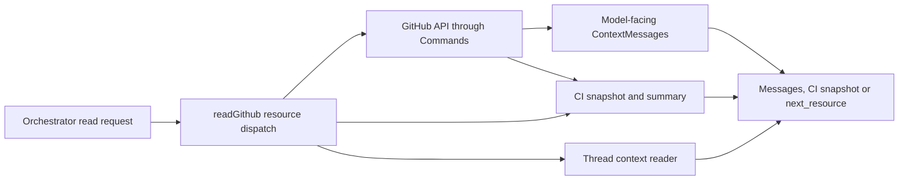

# github-read.ts

This file is the read half of the GitHub source: it turns the project's own resource names (like `github/pulls/12/comments/2`) into ordinary GitHub API calls, and turns the API's raw records into the small message shapes an assessment or worker model can safely read. It never posts, labels, or emits a Trigger, so it is the safe counterpart to the polling side of the GitHub integration. If you want to know what an agent can actually *see* of a pull request, an issue, a review thread, or CI, this is the file that decides it.

## Overall functional flow

A read starts as a short resource string, is routed to the matching GitHub endpoint, and comes back either as a list of normalized messages with an optional `next_resource`, or as a CI snapshot. The same normalization and CI helpers are reused by the source's assessment thread-context and by polling code, so what a model reads matches what the poller observed.

## At a glance

- **Primary role**: External adapter — it bridges the project to GitHub, translating local resource names into API calls and API records into project-level messages.
- **Secondary roles**: API boundary — it defines the accepted `github/…` resource grammar, paging, and error messages callers rely on; Domain rules — it decides what counts as a CI failure, which senders are bots, and which repository paths may be read.
- **Confidence**: High — the whole file was read, together with its call sites in `src/sources/github.ts`, `src/app/resources.ts`, and `src/app/assessment.ts`.

## What this file does

- **Serves on-demand GitHub reads by name.** Callers ask for `github/issues/<n>`, `github/pulls/<n>` and their sub-sections, and get normalized messages instead of raw API JSON.
- **Reads CI state for a commit or a pull request.** Check runs and legacy commit statuses are merged into a single snapshot, then summarized as a short human-readable CI line plus counts.
- **Reads bounded review threads.** Given one inline review comment ID, it finds the thread root and returns the root first with every reply, so a reviewer's discussion is readable in order.
- **Reads repository files and directory listings.** Read-only, restricted to non-hidden paths, used by assessments to look at source without cloning.
- **Supplies the GitHub thread-context reader.** `githubThreadContext` plugs this file into the source-kind contract so assessments can read the thread, root, or parent around a trigger.
- **Produces thread status facts.** `ciFact` renders CI state as the small fact badge shown on a GitHub thread.

## External connection

- **External system**: GitHub, reached exclusively through the project's `Commands` wrapper (the configured GitHub CLI hitting the API of the configured repository).
- **Outbound translation**: a resource string or a `(path, kind)` pair becomes a repository-scoped API path — `issues/<n>/comments?per_page=20&page=
`, `pulls/<n>/comments?per_page=100`, `commits/<sha>/check-runs?per_page=100 --paginate --slurp`, `contents/<path>` — with page size and pagination flags chosen per endpoint.
- **Inbound translation**: API records are parsed with permissive zod schemas into `ContextMessage` values (`id`, `from`, `at`, `text`, and optional `reply_to`, `url`, `path`, `line`, `bot`), or into `{ head, checks, statuses }` snapshots and short strings. Records that fail validation are dropped and counted as `skipped` instead of failing the whole read.

### Operating requirements

The read only works through a `Commands` instance whose deployment names a configured repository and GitHub CLI; requests outside that repository are rejected by `Commands` itself, and CLI failures surface as `CliError` with GitHub's HTTP status. No extra credentials, ports, or settings are introduced by this file.

## Public contract

- **Caller**: `orchestrator_read` (and worker sessions reading their own ticket) through `src/app/resources.ts`, which forwards anything starting with `github/` to `readGithub`; assessments separately call `readRepositoryPath` for `file`/`directory` reads, and the GitHub source kind registers `githubThreadContext` for thread reads.
- **Operation**: read one GitHub original — a description, one page of comments or reviews, one review thread, a CI snapshot, or a repository path.
- **Accepted input**: `github/issues/<number>`, `github/pulls/<number>`, optionally followed by `/comments/<page>`, `/reviews/<page>`, `/thread/<comment-id>`, or `/checks`; plus `github/commits/<sha>/checks` for CI on a commit that no pull request names. Pages default to page 1; `/checks` takes no page number; `/reviews`, `/thread`, and `/checks` are rejected for issues.
- **Result**: for descriptions, a single object with `number`, `title`, `state`, optional `merged`, `draft`, `labels`, `head`/`base` branches, merged with the normalized message; for comment and review pages, `{ messages, skipped?, next_resource? }` where `next_resource` appears only when the page was full; for threads, `{ messages }` with the root first; for checks, a `CiSnapshot`. Invalid resource forms and empty threads raise plain `Error`s that spell out the acceptable forms.

## Rules and decisions

- **Decision**: is this check failing, still running, or passed? Conclusions and states in `failure`, `timed_out`, `cancelled`, `action_required`, `startup_failure`, and `error` count as failures; `success`, `neutral`, `skipped`, and `stale` do not. A check is "running" until its status is `completed`, and a commit status is "running" only while `pending`.
- **Decision**: which of several statuses for the same context counts? Only the newest status per `context` is kept, so a context re-reported as passing stops counting as failed.
- **Decision**: may this message authorize work? A sender that is not a plain human account (a `[bot]` login or a GitHub App type) is still readable but marked `bot: true`, because bot messages can never authorize work on their own.
- **Decision**: which repository paths are readable? Only non-hidden paths: `..`, dot-prefixed segments, and `node_modules` are rejected, and directory listings omit hidden entries and `node_modules`.
- **Invariant**: the review thread root is stable — any comment ID resolves to its thread root, the root is always returned first, and replies follow in `created_at` order.

### Small example

Suppose a pull request's checks return two failures out of five checks. `ciSummary` renders a line such as `CI failed 2/5 on PR #12 at 3f9a1c2: build, lint` followed by a pointer to `github/pulls/12/checks`, `ciFailures` returns the sorted failing names used to detect changes between polls, and `ciFact` turns the counts into a "CI failed / 2" fact for the thread card.

## Key functions or classes

### `readGithub`

Routes one resource string to the right endpoint and returns normalized messages, a description object, or a CI snapshot.

    
        <a target="_self" href="#src/sources/github-read.ts:102-141?class=code" style="color: inherit; text-decoration: none;">Code: src/sources/github-read.ts:102-141</a>
    

### `githubThreadContext`

The source-kind thread reader: returns a branch-CI trigger as a single self-describing message, a whole review thread for inline triggers, or one page of the issue/PR conversation otherwise.

    
        <a target="_self" href="#src/sources/github-read.ts:159-177?class=code" style="color: inherit; text-decoration: none;">Code: src/sources/github-read.ts:159-177</a>
    

### `pullChecks`

Reads every check run and commit status for a commit and merges them into one snapshot without emitting a trigger.

    
        <a target="_self" href="#src/sources/github-read.ts:60-70?class=code" style="color: inherit; text-decoration: none;">Code: src/sources/github-read.ts:60-70</a>
    

### `ciSummary`

Produces the one-line CI report (failed, running, or passed, with up to five names and a pointer to the detailed read).

### `ciCounts` and `ciFailures`

`ciCounts` returns `{ failed, running }` numbers for badges and change detection; `ciFailures` returns the sorted names of failing checks and statuses.

### `ciFact`

Converts those counts into the bilingual thread fact used on GitHub thread cards.

### `readRepositoryPath`

Reads one file's raw content or a sorted directory listing from the default branch, rejecting hidden paths.

    
        <a target="_self" href="#src/sources/github-read.ts:48-57?class=code" style="color: inherit; text-decoration: none;">Code: src/sources/github-read.ts:48-57</a>
    

### `reviewThread` and `threadMessages`

`reviewThread` collects one inline discussion in chronological order; `threadMessages` formats it, prefixing the root with its file:line and diff context and linking replies back to the root.

## Main inputs and results

- **Inputs**: a `Commands` instance already scoped to the configured repository (with its abort signal), a `github/…` resource string, or a `path` with `kind: 'file' | 'directory'`; and, for `githubThreadContext`, a Trigger whose `meta` names the issue/PR number, an inline comment ID, or a CI branch, plus an optional page cursor.
- **Results**: normalized `ContextMessage` arrays (with `reply_to`, `path`, `line`, `url`, `bot`) and an optional `next_resource`; a `CiSnapshot` of `{ head, checks, statuses }`; human-readable CI summary strings; a bilingual CI fact; or raw file text and a newline-separated directory listing.
- **Visible side effects**: none beyond read traffic — nothing is written to GitHub and no trigger is emitted here; the only observable outcomes are the returned text, a `skipped` count when records fail validation, and errors such as `Only non-hidden repository source paths are available` or the reminder listing the valid resource forms.

---
name: github-read.ts

update-time: 2026-11-02 11:37

description: This file is the read half of the GitHub source: it turns the project's own resource names (like `github/pulls/12/comments/2`) into ordinary GitHub API calls, and turns the API's raw records into the small message shapes an assessment or worker model can safely read. It never posts, labels, or emits a Trigger, so it is the safe counterpart to the polling side of the GitHub integration. If you want to know what an agent can actually *see* of a pull request, an issue, a review thread, or CI, this is the file that decides it.

---
