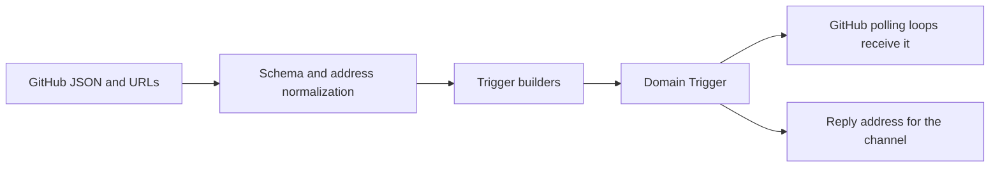

# github-trigger.ts

This file is the translation layer between GitHub and the rest of the project: it reads raw GitHub payloads (issues, pull requests, conversation comments, inline review comments, reviews and CI results) and turns them into the project's own event object, called a `Trigger`. It also parses GitHub URLs into issue/PR numbers and produces the reply address the project later uses to post back on GitHub. Everything here is pure data shaping — no network calls and no credentials — so readers can treat it as the authoritative answer to "what does the project consider one GitHub event?".

Sources: 
<a target="_self" href="#src/sources/github-trigger.ts?class=code" style="color: inherit; text-decoration: none;">github-trigger.ts</a>

## Whole-unit functional diagram

Raw GitHub data first passes tolerant schemas and URL parsing, then one of the builders assembles a `Trigger` with its thread, sender, text, reply address and source-specific detail. That object either enters the polling loops as a received event, or carries an address that lets the outbound channel answer in the same GitHub thread.

<!-- {
  "mermaid_info": {
    "name": "GitHub events becoming domain Triggers",
    "nodes": [
      {
        "id": "payload_001",
        "name": "GitHub JSON and URLs",
        "path": "",
        "hint": "Raw issue, pull request, comment, review and CI data returned by GitHub",
        "isJumpable": false,
        "position": { "startLine": 0, "endLine": 0 },
        "references": []
      },
      {
        "id": "normalize_002",
        "name": "Schema and address normalization",
        "path": "src/sources/github-trigger.ts",
        "hint": "Tolerant zod schemas, deleted-account fallback and URL parsing",
        "isJumpable": true,
        "position": { "startLine": 13, "endLine": 47 },
        "references": []
      },
      {
        "id": "builders_003",
        "name": "Trigger builders",
        "path": "src/sources/github-trigger.ts",
        "hint": "Comment, issue, pull request and CI trigger construction",
        "isJumpable": true,
        "position": { "startLine": 65, "endLine": 108 },
        "references": []
      },
      {
        "id": "trigger_004",
        "name": "Domain Trigger",
        "path": "src/core/model.ts",
        "hint": "The source-independent event shape the core consumes",
        "isJumpable": true,
        "position": { "startLine": 23, "endLine": 39 },
        "references": []
      },
      {
        "id": "receive_005",
        "name": "GitHub polling loops receive it",
        "path": "src/sources/github.ts",
        "hint": "Notifications, repository streams and thread polls call receive with the trigger",
        "isJumpable": true,
        "position": { "startLine": 224, "endLine": 242 },
        "references": []
      },
      {
        "id": "reply_006",
        "name": "Reply address for the channel",
        "path": "src/sources/github-channel.ts",
        "hint": "The stored channel address is used to post a comment or review-thread reply",
        "isJumpable": true,
        "position": { "startLine": 18, "endLine": 45 },
        "references": []
      }
    ]
  }
} -->

    
        <a target="_self" href="#src/sources/github-trigger.ts:1?class=graph" style="color: inherit; text-decoration: none;">Graph: GitHub events becoming domain Triggers</a>
    

## At a glance

- **Primary role — External adapter**: it bridges the project to GitHub by translating GitHub's request and response shapes into project vocabulary, and by producing the address needed to send a reply back to GitHub.
- **Secondary role — Data contract**: it also defines the shared schemas (`CommentSchema`, `IssueSchema`) and the source-specific `meta` details that the reader, the channel and the source loop all agree on.
- **Confidence**: High — the whole file was read, and every consumer (`src/sources/github.ts`, `github-read.ts`, `github-channel.ts`) was inspected to confirm how these exports are used.

## What this file does

- **Recognizes GitHub addresses.** Given a web or API URL, it returns the issue/PR number, whether it is a pull request, and the review-comment id when the URL points at a discussion comment — but only for the repository being watched, compared case-insensitively.
- **Reads GitHub payloads tolerantly.** Schemas accept extra fields, tolerate missing optional ones, and normalize a deleted account (GitHub returns `null`, displays it as `ghost`) into a usable sender, so one odd payload does not break the flow.
- **Builds one event per kind of GitHub activity.** Conversation comments, inline review comments, review decisions, newly opened issues, newly opened pull requests, default-branch CI changes and pull-request CI changes each get their own builder with the text an operator would actually want to read.
- **Says who wrote it.** Each trigger carries the sender identity plus a `human` flag that is true only for a regular user account that is not the agent itself, and an `addressed` marker when the text genuinely mentions the agent (an email-like `@name.example` does not count).
- **Provides the reply route.** Triggers carry a channel address built from the issue/PR number and the comment URL, which is what allows a later reply to land in the right conversation or review thread.

## Key functions or classes

### `githubAddress`

Parses a GitHub web or API URL into `{ number, pr, discussion? }`, returning `undefined` for other repositories or unrelated URLs; this is how notifications and stored reply URLs are resolved to a thread number.

### `githubChannel`

Builds the write-only reply address (`github:<number>` thread plus number and optional URL), the single place that decides what a GitHub reply target looks like.

### `CommentSchema` / `IssueSchema`

Tolerant zod schemas for any comment or review and for an issue as `issues/<number>` returns it, including the `pull_request` marker that reveals the number is actually a pull request.

### `isHumanLogin`

Decides whether a GitHub account is a person rather than a bot or GitHub App; review bots operating under ordinary user accounts deliberately count as human here, because the prompts identify which accounts are automated.

### `commentTrigger`

Assembles the richest trigger shape: content-derived id, thread, sender, timestamp, composed text, mention marker, reply address, URL, and `meta` with number, PR flag, comment id, kind, and — for inline comments — file, line and the reply parent.

    
        <a target="_self" href="#src/sources/github-trigger.ts:65-77?class=code" style="color: inherit; text-decoration: none;">Code: src/sources/github-trigger.ts:65-77</a>
    

### `issueTrigger`

Builds the trigger for a newly opened issue's title and body; its identifier format is kept stable on purpose so bodies stored by an earlier version are not ingested a second time.

    
        <a target="_self" href="#src/sources/github-trigger.ts:82-89?class=code" style="color: inherit; text-decoration: none;">Code: src/sources/github-trigger.ts:82-89</a>
    

### `pullTrigger`

Reuses the issue trigger and only rewrites `meta`, marking the event as a pull request and recording its author; PR and issue numbers share one sequence on GitHub, so no collision arises.

### `branchCiTrigger` / `ciTrigger`

Build CI events: the default-branch variant has no person to answer, so it carries no channel, while the pull-request variant keeps a reply channel and the PR author.

    
        <a target="_self" href="#src/sources/github-trigger.ts:98-108?class=code" style="color: inherit; text-decoration: none;">Code: src/sources/github-trigger.ts:98-108</a>
    

## Main inputs and results

- **Inputs**: GitHub issue, pull-request, comment, review and check data; GitHub web or API URLs; a `PullRef` describing the thread a comment belongs to; and the agent's own login, supplied by the caller to exclude the agent's own activity.
- **Results**: a `Trigger` value carrying `source: 'github'`, a content-derived `id`, a primary thread, sender actor and `human` flag, optional `addressed`, readable `text`, optional `channel` and `url`, and a `meta` record with number, kind, CI and review-thread details.
- **Visible side effects**: none on its own — no network calls, no storage. The effects appear downstream: the polling loops receive the trigger, the source's scope rules read `meta.kind`/`meta.ci` to decide whether such events are observed at all, and the channel address is what makes a later GitHub reply land in the right thread.

## External connection

- **External system**: GitHub's REST payloads and URL structure for issues, pull requests, conversation comments, inline review comments, reviews and check runs.
- **Outbound translation**: project-level intent to answer becomes a GitHub address (`number` plus optional `url`) that the outbound channel resolves into either an issue comment or a review-thread reply, falling back to a top-level comment when the original review comment is gone.
- **Inbound translation**: GitHub JSON is validated into `GithubComment` / `GithubIssue`, empty bodies and bodyless reviews collapse to an empty text, a review with a decision becomes a sentence naming the state and commit, and an inline comment gains its `file:line` plus the last lines of its diff hunk before everything else is normalized into a `Trigger`.

### Operating requirements

Nothing in this file authenticates or fetches: the GitHub source must already be configured with a repository and an agent account, and the caller passes that account's login in so the agent's own comments and PRs are skipped. Repository comparisons are case-insensitive, and only URLs belonging to the configured repository are accepted, so unrelated notifications are ignored.

## Information contract

- **Represents**: one GitHub event worth acting on, in project vocabulary — plus the sender classification (`human`, `addressed`) and the reply address — while `meta` holds source-native detail that the core never interprets.
- **Produced by**: the schemas and builders in this file, driven by the notification and repository polling loops in the GitHub source.
- **Consumed by**: the GitHub source's receive path and scope rules; the GitHub reader, which reuses the schemas, `isHumanLogin` and `reviewPlace` for thread context; and the GitHub channel, which reuses `githubAddress` and `githubPage` to link and reply.

  
Related guide: 
<a target="_self" href="#src/sources/sources.info.md?class=text" style="color: inherit; text-decoration: none;">sources.info.md</a>

- **Behavior-shaping parts**: `meta.kind` and `meta.ci` select which observation switch governs the event; the presence of `channel` decides whether a reply is even possible (CI on the default branch has none); `threads[0]` is the thread that hosts the evaluation; `addressed: 'mention'` and `human` feed the admission decision; and `meta.inReplyTo` keeps a review thread's identity.

### Compatibility notes

Trigger identifiers are derived from stable content (kind, URL or thread, comment id, revision), so receiving the same GitHub item twice is a no-op, and pull-request descriptions deliberately reuse the issue identifier format so previously stored bodies are not ingested again. CI identifiers include a revision counter, which is preserved across restarts so future CI events keep unique ids.

---
name: github-trigger.ts

update-time: 2026-11-02 11:38

description: This file is the translation layer between GitHub and the rest of the project: it reads raw GitHub payloads (issues, pull requests, conversation comments, inline review comments, reviews and CI results) and turns them into the project's own event object, called a `Trigger`. It also parses GitHub URLs into issue/PR numbers and produces the reply address the project later uses to post back on GitHub. Everything here is pure data shaping — no network calls and no credentials — so readers can treat it as the authoritative answer to "what does the project consider one GitHub event?".

---
