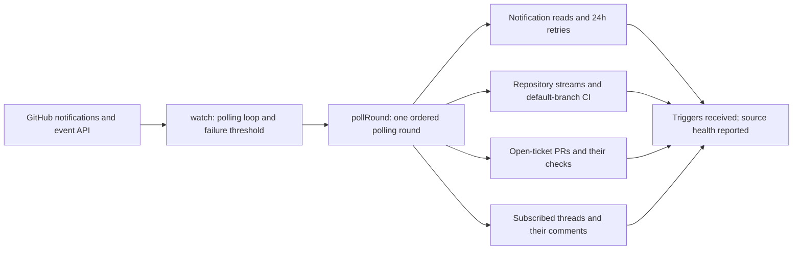

# github.ts

This file is the GitHub side of the project's Source system: it turns one repository's notifications, Issues, pull requests, comments, and CI results into Triggers that the rest of the application can act on. It also declares how a GitHub Source is configured, which senders may start work, which environment variables a ticket receives, and how replies travel back to GitHub. Most readers arrive here to understand why a comment or CI change on GitHub eventually becomes a ticket, or to find where polling behavior and its saved cursors live.

## Whole-unit functional flow

The plugin starts one polling loop, and each round walks the same four steps in order: notifications first, then repository-wide streams, then the pull requests of open tickets, then subscribed threads. Every step feeds `ctx.receive`, so GitHub activity becomes Triggers, while the round's final outcome is reported as the `github` health entry.

<!-- {
  "mermaid_info": {
    "name": "GitHub polling round flow",
    "nodes": [
      {
        "id": "github_001",
        "name": "GitHub notifications and event API",
        "path": "",
        "hint": "The external GitHub account and REST endpoints read through the agent's gh CLI",
        "isJumpable": false,
        "position": { "startLine": 0, "endLine": 0 },
        "references": []
      },
      {
        "id": "loop_002",
        "name": "watch: polling loop and failure threshold",
        "path": "src/sources/github.ts",
        "hint": "Waits for setup, runs rounds, and only reports an error after several consecutive failures",
        "isJumpable": true,
        "position": { "startLine": 127, "endLine": 146 },
        "references": []
      },
      {
        "id": "round_003",
        "name": "pollRound: one ordered polling round",
        "path": "src/sources/github.ts",
        "hint": "Runs notifications, repository streams, ticket PRs, and subscribed threads in order",
        "isJumpable": true,
        "position": { "startLine": 280, "endLine": 296 },
        "references": []
      },
      {
        "id": "notify_004",
        "name": "Notification reads and 24h retries",
        "path": "src/sources/github.ts",
        "hint": "Reads notified Issues and PRs since the cursor, retrying failures and abandoning them after 24 hours",
        "isJumpable": true,
        "position": { "startLine": 298, "endLine": 343 },
        "references": []
      },
      {
        "id": "streams_005",
        "name": "Repository streams and default-branch CI",
        "path": "src/sources/github.ts",
        "hint": "Cursor and ETag based reading of new Issues, PRs, comments, and default-branch CI changes",
        "isJumpable": true,
        "position": { "startLine": 203, "endLine": 272 },
        "references": []
      },
      {
        "id": "pulls_006",
        "name": "Open-ticket PRs and their checks",
        "path": "src/sources/github.ts",
        "hint": "Observes the PRs of open tickets and emits a trigger only when their check results change",
        "isJumpable": true,
        "position": { "startLine": 404, "endLine": 424 },
        "references": []
      },
      {
        "id": "threads_007",
        "name": "Subscribed threads and their comments",
        "path": "src/sources/github.ts",
        "hint": "Polls subscribed Issue and PR threads and reads conversation, inline, and review comments",
        "isJumpable": true,
        "position": { "startLine": 430, "endLine": 459 },
        "references": []
      },
      {
        "id": "result_008",
        "name": "Triggers received; source health reported",
        "path": "src/sources/github.ts",
        "hint": "Received triggers enter the engine and the round's outcome is reported as the github health entry",
        "isJumpable": true,
        "position": { "startLine": 290, "endLine": 294 },
        "references": []
      }
    ]
  }
} -->

    
        <a target="_self" href="#src/sources/github.ts:1?class=graph" style="color: inherit; text-decoration: none;">Graph: GitHub polling round flow</a>
    

## At a glance

- **Primary role — external adapter**: this file is the bridge between the project and a GitHub repository. It issues reads through the agent's own `gh` CLI and converts what GitHub returns into the project's Trigger, Thread, and ticket vocabulary.
- **Secondary roles — configuration, orchestration, state-storage**: it declares the Source's settings and policy rows, orders the polling steps and isolates their failures, and keeps cursors, retry records, and CI fingerprints between rounds.
- **Confidence**: High — the descriptor, plugin entry, polling loop, and persisted state are all visible in this file and its direct collaborators (`host.ts`, `poll.ts`, `kv.ts`, `kind.ts`).

## What this file does

- Declares the `github` Source kind, so the panel can render its configuration card, default instance, help text, and read-only facts such as the current account.
- Enables selective reception: notifications, repository-wide new Issues/PRs, all repository comments, and default-branch CI can each be switched on, and unaddressed items then depend on the Policy's admission table.
- Runs a long-lived polling loop that reports `paused` before setup is resolved, backs off while the Source is off, and turns repeated read failures into one error health entry instead of crashing the process.
- Converts GitHub data into Triggers: newly opened Issues and PRs, conversation, inline and review comments, PR check changes, and default-branch CI transitions, while ignoring the agent's own activity.
- Publishes Thread metadata (title, number, `ci` fact) and per-Thread `pollError`, so an operator can see which GitHub thread is currently unreadable.
- Registers the environment variables a ticket started on GitHub receives, including the repository, agent account, commit email, Issue/PR number, and the PR head ref.

## Key functions or classes

### `githubKind`

The complete Source descriptor: schema, form fields, listening scope, health entry, outbound channel, thread context, search mapping, policy section, environment variables, and facts.

    
        <a target="_self" href="#src/sources/github.ts:38-109?class=code" style="color: inherit; text-decoration: none;">Code: src/sources/github.ts:38-109</a>
    

### `apply`

The Cordis plugin entry: registers the kind with the source registry and starts the polling loop as a cancellable effect, converting an escaped rejection into source health.

    
        <a target="_self" href="#src/sources/github.ts:112-122?class=code" style="color: inherit; text-decoration: none;">Code: src/sources/github.ts:112-122</a>
    

### `watch`

Waits for setup, then repeats polling rounds, choosing the next delay from GitHub's requested interval and the configured minimum, and reporting an error only after the configured number of consecutive failures.

### `pollRound`

Runs one round as four ordered steps and returns the interval GitHub asked for; per-step and per-item failures are collected so all steps still run before the round reports failure.

### `pollNotifications`

Reads notifications since the account cursor, resolves each Issue or PR they name, and advances the cursor atomically together with the retry map.

### `readStream`

Reads one repository-wide stream from its saved cursor, using ETag-conditional requests when the cursor has not moved, and ignores items from before their kind was switched on.

### `pollBranchCi`

Compares the default branch's failing check set against a stored baseline and emits a trigger only when the set changes after the first observation.

### `pollThreads`

Polls subscribed threads that were not already read in this round, recording deleted Issues separately from genuine failures.

## Main inputs and results

- **Inputs**: GitHub notifications, Issues, pull requests, comments, reviews, and check results, read through the agent's CLI commands; the deployment's repository and agent account; the stored `github` Source configuration and Policy; and the subscribed Threads and open tickets exposed by the source context.
- **Results**: Triggers handed to `ctx.receive`; Thread titles, facts, and `pollError` updates; the single `github` health entry (`ready`, `paused`, or `error` with details); saved cursors, retry records, and CI fingerprints; and the resolved environment values for tickets that start on GitHub.
- **Visible side effects**: the Source card and health status in the interface, thread lists showing CI facts and read errors, and the polling interval actually chosen (GitHub may request a longer one than configured).

## External connection

- **External system**: a GitHub repository reachable by the agent account. The configured `cli` value (a command name or absolute path, usually a `gh` wrapper signed in through `GH_CONFIG_DIR`) is used for both API reads and agent operations.
- **Outbound translation**: configuration becomes concrete requests — repository paths such as `notifications`, `issues`, `pulls/comments`, `commits/<branch>`, and check reads — with cursor timestamps, page sizes, and ETag headers derived from the state described below.
- **Inbound translation**: GitHub payloads are parsed with loose Zod schemas and mapped into project Triggers and Thread metadata by the sibling modules `github-trigger.ts`, `github-pull.ts`, and `github-read.ts`; this file owns the reading schedule and the decision of what counts as new.

### Operating requirements

The Source stays `paused` while setup has not resolved the accounts, and it stays off when no enabled `github` configuration exists. Saving the configuration checks that the agent account can push to the repository and then restarts `dsh-superagent`; polling starts only after that restart. Items authored by the agent account itself are skipped, so a loop cannot be started by the agent's own comments.

## Configurable behavior

- **Controls**: the repository and agent CLI, the polling interval (60–3600 seconds, default 60), how many consecutive failed polls become an error (1–20, default 3), and four reception switches for new Issues, new pull requests, repository comments, and default-branch CI (all off by default).
- **Value source**: stored Source configuration validated by the extended schema, with defaults filled on parse; the Policy supplies the allowed accounts that may originate work and the bot accounts whose comments may become inferred candidates.
- **Takes effect**: the reception switches also feed the listening scope — turned on, the Source observes the whole repository for that kind and the Policy's admission table decides candidates; turned off, only items that explicitly address the agent arrive. Switching a kind off resets its stream cursor, and each kind starts reading from the moment it was switched on rather than from earlier history.

### Common adjustment

`observeCi` — switching it off clears the stored default-branch failure baseline while keeping the revision counter, so later triggers still get unique identities; switching it back on establishes a fresh baseline and only subsequent changes are reported.

## Coordinated flow

1. `apply` registers the kind and starts `watch` with an abort controller bound to the plugin effect.
2. `watch` waits for the deployment to resolve, skips round execution while the Source is unconfigured or off, and pauses between rounds.
3. `pollRound` runs notifications, repository streams, ticket PRs, and subscribed threads in that order, collecting failures per step and per item.
4. Triggers flow into the engine through `ctx.receive`, and the round ends by reporting `ready` with the notification count, the next minimum interval, and any dropped or skipped items.

### Important branching and concurrency

A round never rereads the same PR or Thread: reads are memoized per round, so a PR reached from both a ticket and a subscribed thread costs one read. Stopping mid-read aborts before advancing a cursor, so unread items are retried next round, and the five-second cursor overlap plus deterministic Trigger IDs make repeated items harmless.

## Stored state lifecycle

- **Stores**: the account-level notification cursor and pending retry records; a read cursor per Issue or PR shared by notification and polled reads; a cursor, per-kind start times, and an ETag per repository stream; the default-branch CI baseline and revision; and a check fingerprint plus revision per PR.
- **Read path**: every round and every stream or thread read loads its own entry through the source-scoped state handle; missing entries are initialized from the round start time.
- **Write path**: cursors advance only after a read succeeded, notification cursors and retries are written atomically together, stream entries store the ETag only while their cursor stays unchanged, and disabled kinds have their entries cleared.
- **Visible result**: polling resumes from exactly the last confirmed read after a restart, and unchanged lists or check results cost nothing and produce no duplicate Triggers.

### Important persistence behavior

A failing read is retried on later rounds for up to 24 hours; after that the retry is abandoned, its cursor is kept so a later notification or thread poll still reads what was missed, and the thread's `pollError` records the reason. Reads that GitHub reports as permanently gone (HTTP 410) do not fail the round, while 404 is treated as a genuinely failing read because it can mean revoked access to a private repository.

---
name: github.ts

update-time: 2026-11-02 11:35

description: This file is the GitHub side of the project's Source system: it turns one repository's notifications, Issues, pull requests, comments, and CI results into Triggers that the rest of the application can act on. It also declares how a GitHub Source is configured, which senders may start work, which environment variables a ticket receives, and how replies travel back to GitHub. Most readers arrive here to understand why a comment or CI change on GitHub eventually becomes a ticket, or to find where polling behavior and its saved cursors live.

---
