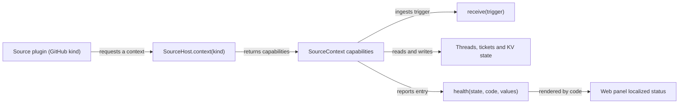

# host.ts

This file is the contract sheet a Source plugin programs against. It defines the `SourceHost` service the application offers to plugins and the per-kind `SourceContext` it hands back: bounded operations for reading configuration, ingesting triggers, managing threads and tickets, sending notifications, and reporting health. It also defines the small `Health` shape plus the fixed English health templates that the web panel re-localizes. It contains almost no implementation — its job is to say exactly what a plugin may call, what it receives, and what it must not reach for.

## Whole-unit functional diagram

A plugin never touches storage or the evaluation engine directly: it asks `SourceHost` for a context bound to its own kind, then works only through the operations listed on that context. Everything it pushes back out appears either as an ingested trigger or as a health entry that the panel displays.

<!-- {
  "mermaid_info": {
    "name": "Source plugin capability boundary",
    "nodes": [
      {
        "id": "plugin_001",
        "name": "Source plugin (GitHub kind)",
        "path": "src/sources/github.ts",
        "hint": "A registered source kind that polls or listens for events and needs application capabilities",
        "isJumpable": true,
        "position": { "startLine": 112, "endLine": 121 },
        "references": []
      },
      {
        "id": "host_002",
        "name": "SourceHost.context(kind)",
        "path": "src/sources/host.ts",
        "hint": "The single service interface a plugin uses to obtain a scoped context",
        "isJumpable": true,
        "position": { "startLine": 23, "endLine": 27 },
        "references": []
      },
      {
        "id": "context_003",
        "name": "SourceContext capabilities",
        "path": "src/sources/host.ts",
        "hint": "The operations and data a plugin may use, limited to its own kind",
        "isJumpable": true,
        "position": { "startLine": 31, "endLine": 66 },
        "references": []
      },
      {
        "id": "receive_004",
        "name": "receive(trigger)",
        "path": "src/sources/host.ts",
        "hint": "Hands an incoming event to the engine and schedules the next evaluation pass",
        "isJumpable": true,
        "position": { "startLine": 42, "endLine": 42 },
        "references": []
      },
      {
        "id": "state_005",
        "name": "Threads, tickets and KV state",
        "path": "src/sources/host.ts",
        "hint": "Source-scoped reads and writes for read cursors, thread descriptions, and ticket binding",
        "isJumpable": true,
        "position": { "startLine": 44, "endLine": 62 },
        "references": []
      },
      {
        "id": "health_006",
        "name": "health(state, code, values)",
        "path": "src/sources/host.ts",
        "hint": "Builds a health value carrying a template code and its placeholder values",
        "isJumpable": true,
        "position": { "startLine": 11, "endLine": 22 },
        "references": []
      },
      {
        "id": "panel_007",
        "name": "Web panel localized status",
        "path": "src/client/text.ts",
        "hint": "Renders the health code in the interface language instead of the raw English detail",
        "isJumpable": true,
        "position": { "startLine": 35, "endLine": 36 },
        "references": []
      }
    ]
  }
} -->

    
        <a target="_self" href="#src/sources/host.ts:1?class=graph" style="color: inherit; text-decoration: none;">Graph: Source plugin capability boundary</a>
    

## At a glance

- Primary role: API boundary — it declares the operations a Source plugin may call on the host application and what each call accepts and returns.
- Secondary roles: Data contract — it also fixes the shared `Health` value, the health-code vocabulary, and the thread description a plugin publishes.
- Confidence: High — the whole file was read, together with its server-side implementation in `src/app/source-context.ts` and its web-panel consumer in `src/client/locales.ts` and `src/client/text.ts`.

## What this file does

- **Gives plugins one entry point.** `SourceHost.context(kind)` returns the capabilities for exactly one source kind, so a plugin can do its work without importing storage, engine, or settings modules.
- **Scopes what a plugin is allowed to do.** The context exposes configuration, trigger ingestion, atomic state, threads, tickets, triggers, notifications, and health — and deliberately no registry, no store, and no engine handle.
- **Restricts health reporting to declared entries.** A kind declares the health entry names it owns; `report` throws for any other name, so two plugins can never overwrite the same status line.
- **Keeps status text translatable.** Health carries a stable `code` plus placeholder `values`, so the English detail is a fallback and the panel can render the same status in either interface language.
- **Stays safe for the browser bundle.** The file uses type-only imports plus one tiny string-format helper, because the web panel imports it directly and must not pull in Node-only modules.
- **Provides a one-line convenience accessor.** `sourceContext(host, kind)` is the shorthand plugins actually call instead of invoking `host.context` themselves.

## Key functions or classes

### `SourceHost`

The interface a source plugin receives as the application's service; it exposes the source registry and the per-kind context factory.

<a target="_self" href="#src/sources/host.ts:23-27?class=code" style="color: inherit; text-decoration: none;">host.ts:23-27</a>

### `SourceContext`

The bounded capability set for one source kind: deployment and command handles, a readiness signal, guarded configuration access, trigger ingestion, state, threads, tickets, triggers, notifications, and health reporting.

<a target="_self" href="#src/sources/host.ts:31-66?class=code" style="color: inherit; text-decoration: none;">host.ts:31-66</a>

### `health()`

Builds a `Health` value from a state, a template code, and optional placeholder values, filling the English detail as a fallback.

<a target="_self" href="#src/sources/host.ts:20-22?class=code" style="color: inherit; text-decoration: none;">host.ts:20-22</a>

### `HEALTH_TEXT` and `HealthCode`

The fixed English templates for the shared statuses (waiting for setup, off, missing CLI, missing bot, repeated poll failures) and the union of their keys that both plugins and the panel use.

<a target="_self" href="#src/sources/host.ts:11-18?class=code" style="color: inherit; text-decoration: none;">host.ts:11-18</a>

### `ThreadDescription`

The display information a plugin may attach to a thread: a label, a URL, and named facts, where a `null` fact removes an earlier one.

<a target="_self" href="#src/sources/host.ts:29?class=code" style="color: inherit; text-decoration: none;">host.ts:29</a>

### `sourceContext()`

The helper plugins call to obtain their context in one expression, for example when starting a polling loop.

<a target="_self" href="#src/sources/host.ts:67?class=code" style="color: inherit; text-decoration: none;">host.ts:67</a>

## Main inputs and results

- Inputs: the host service plus a kind descriptor made of the kind's id and the list of health entry names it declares; from the application side, a resolved `Deployment`, a `Commands` handle, and the readiness signal.
- Results: a `SourceContext` object whose methods return stored threads, tickets, triggers, and configuration, or accept a trigger, a thread description, an outbound message, or a health value.
- Visible side effects: an ingested trigger schedules an evaluation pass; a reported health entry changes the status shown in the web panel; `notify` queues an outbound message; `threads.describe` and `threads.patch` change how a thread is labelled for people.

## Public contract

- Caller: source plugins (for example the GitHub and Feishu kinds) that need to read their own configuration, poll for events, and publish status.
- Operation: obtain a context for one kind and use its operations to ingest events, read and annotate threads and tickets, store cursors, notify, and report health.
- Accepted input: a kind descriptor `{ kind, health }` when requesting the context. The returned `config` lookup takes a kind id, `receive` takes a `Trigger`, `state.set` takes a key plus a value (or `undefined` to remove), `threads.describe` takes a key plus a `ThreadDescription`, `tickets.bindThread` takes a ticket id, a thread reference, and an `own` flag, `notify` takes an `OutboundMessage`, and `report` takes a declared entry name plus a `Health`.
- Result: configuration comes back only while the source is enabled and installed; `receive` returns `'stored' | 'duplicate' | 'filtered'`; thread, ticket, and trigger lookups return `undefined` when nothing matches; `report` throws for an entry name the kind did not declare.

### Access and validation requirements

There is no authentication step, but the boundary is enforced by identity and declaration. The context is built per kind, so `report` can only write the health entries that kind declared, and reporting stops having any effect once that registration is removed. `config` cannot return a disabled source's configuration, `problem` is only populated for the kind whose setup check failed, and plugins are expected to wait for `ready` and to check `configured()` before polling, because nothing upstream is resolved until setup finishes.

## Information contract

- Represents: a health status — `state` (`starting`, `ready`, `paused`, `error`), a human-readable `detail`, an optional timestamp, and, for the shared statuses, a `code` plus the `values` that fill its placeholders.
- Produced by: source plugins through `health(...)` and `context.report(...)`, and by the runtime for its own entries.
- Consumed by: the health board behind the runtime and ultimately the web panel, which renders `healthCode.<code>` in the interface language and falls back to `detail` when no code is set.
- Behavior-shaping parts: `code` decides whether the panel can localize the message at all; `state` decides whether the status reads as working, paused, or failing; `values` supplies the numbers and error text substituted into the template.

### Compatibility notes

`HEALTH_TEXT` is exported so the panel can keep both languages in step with the English templates — the file is imported by the client bundle, which is why it must remain free of Node-only imports. Codes are shared vocabulary: adding a new one requires a matching panel translation, while plugin-specific statuses can stay as plain `detail` text without a code.

---
name: host.ts

update-time: 2026-11-02 11:36

description: This file is the contract sheet a Source plugin programs against. It defines the `SourceHost` service the application offers to plugins and the per-kind `SourceContext` it hands back: bounded operations for reading configuration, ingesting triggers, managing threads and tickets, sending notifications, and reporting health. It also defines the small `Health` shape plus the fixed English health templates that the web panel re-localizes. It contains almost no implementation — its job is to say exactly what a plugin may call, what it receives, and what it must not reach for.

---
