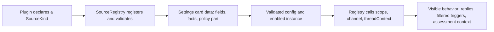

# kind.ts

`src/sources/kind.ts` is the contract every source integration (Feishu, GitHub, or your own) must satisfy before the rest of the application can use it. It declares one type-only vocabulary: the `SourceKind` descriptor, the form fields that configure it, the outbound channel, the thread-context reader, the policy extension and the stored instance record. Nothing here runs code; instead it fixes what a plugin may offer and what the registry, settings panel, runtime and assessments can count on.

## How the contract flows

A plugin author writes a descriptor, the registry registers it and validates configuration against the descriptor's schema, the settings panel turns `fields` into a card, and the runtime then reaches the same descriptor for listening rules, replies and context reads.

## At a glance

- Primary role: data contract — this file defines shared shapes, not behavior, so plugin authors and generic application code agree on what a source can expose.
- Secondary roles: extension point — `SourceKind` is the deliberate plugin surface registered with `SourceRegistry`.
- Confidence: High — the interfaces are fully readable, and each consumer (`registry.ts`, `views/settings.ts`, `client/source.tsx`, `github.ts`) confirms how the members are used.

## What this file does

- Declares the required identity of a source: `kind`, bilingual `title` and `description`, a Zod `schema` for its configuration, the `fields` that render its settings card, and the `health` entry names it owns.
- Defines the form vocabulary (`FieldSpec`) shared by the settings panel, the agent-side settings view and the settings-history diff, including `advanced` fields that hide behind an Advanced section and `fact` fields that only display derived values.
- Declares optional behavior slots: `scope` (listening rules), `channel` (outbound replies and links), `threadContext` (bounded conversation reads for assessments), `find`, `repliesTo`, `policy`, `refreshLabels` and `environment`.
- Describes the policy extension for kinds whose senders have their own identity: allowed senders, admission-table rows, fallback labels and optional external roster sync.
- Normalizes the messages an assessment sees (`ContextMessage`, `ContextPart`) and the per-trigger reader wrapper (`TriggerContext`) the registry hands to the assessor.
- Records the persisted instance shape (`SourceInstance`) that settings store per source id.

## Key functions or classes

### `SourceKind`

The plugin descriptor: identity, configuration schema and fields, health entry names, plus every optional capability a kind may add.

    
        <a target="_self" href="#src/sources/kind.ts:85-113?class=code" style="color: inherit; text-decoration: none;">Code: src/sources/kind.ts:85-113</a>
    

### `FieldSpec`

The declarative form-field union (`switch`, `select`, `number`, `text`, `fact`, `rows`) with bilingual labels and hints that drives every source settings card.

### `SourcePolicyPart`

The kind's slice of the Policy: a schema that validates the part, the policy form fields (the first is `allowed`), a sentence describing what counts as addressing the agent, admission rows and an optional roster sync.

### `SourceChannel`

The outbound adapter: optional `allowed` check for an address, idempotent `send` returning `'sent'` or `'gone'`, and `link` producing a URL and label for an address.

### `ThreadContext`

The bounded reader used by assessments: the trigger's own message id, paged reads of the thread, its root or the replied-to message, and optional image helpers.

### `ContextMessage`

One normalized message read from a thread, including `bot` and `deleted` markers so downstream logic can tell a non-human sender from a person.

### `TriggerContext`

The registry-bound view of `ThreadContext` for one trigger and one configuration, so callers no longer pass the trigger and config themselves.

### `SourceInstance`

The stored shape for a configured source: `id`, `kind`, `enabled` and its resolved `config`.

## Main inputs and results

- Inputs: a plugin's `SourceKind` object, the stored `enabled`/`config` values per source, the resolved `Deployment`, a `Trigger`, and a committed policy part submitted from the settings panel.
- Results: a validated configuration, a `ScopeResult` per trigger (`listened`/`observed`, or a reason), send results `'sent'` or `'gone'`, a `ChannelLink`, a `ContextPart` page, environment variable values, and refreshed display labels.
- Visible side effects: source cards appear in the settings panel with their fields and derived facts, replies reach the conversation, health entries show under the source's names, and resolved names are stored so the panel can show them.

## Information contract

- Represents: what a source integration is allowed to be — its identity, configuration surface, listening rules, reply adapter, context reader, policy slice and environment contribution.
- Produced by: plugin authors. For example `githubKind` fills the descriptor, its fields, `scope`, `channel`, `threadContext`, `find` and `policy`.
- Consumed by: `SourceRegistry`, which registers kinds, validates instances and policy parts, and implements the engine's `SourceScope`; the settings view and panel render cards from it; assessments read thread context through it.
- Behavior-shaping parts: `health` names decide which health entries a kind may report; `scope` decides whether a trigger is listened to and observed; the presence of `channel` decides whether replies exist; `advanced` and `type` on a field decide where and how the panel edits it; `allowed` in a policy part decides who may originate work.

### Compatibility notes

Configuration generic `C` defaults to a loose record, so a kind can stay untyped and still register, while typed kinds get schema-inferred config values. Only `kind`, `title`, `description`, `schema`, `fields` and `health` are required; every other member is optional, and the registry substitutes a defined fallback when it is missing.

## How to extend it

- Extension capability: add a new source integration — its settings form, its own listening rule, replies, context reads, policy senders, label refresh or environment variables.
- Contract: implement `SourceKind<C>` and its `schema` (Zod) so stored and submitted configuration validates; add `policy` only if senders have their own identity, `channel` only if the source replies, and `threadContext` only if assessments need conversation context.
- Registration or discovery: `SourceRegistry.register` installs the descriptor, rejects a duplicate `kind` id, claims the declared `health` entry names (refusing names starting with `sync:`, which settings owns) and returns an unregister disposer.
- Use path: after registration, generic code resolves the kind by `kind` id and calls into it — `send`, `link`, `find`, `repliesTo`, `threadContext`, `scope`, `declarations`/`environments` — while the settings view publishes `fields` and `facts` to the panel.

### Compatibility boundary

Because the optional members carry fallbacks, a kind without `scope` listens to everything it produces and observes nothing, a kind without `channel` can never receive a reply, and a kind without `threadContext` gives assessments no thread context. Health entry names must be exclusive: a second kind declaring an already-claimed name, or a `sync:`-prefixed name, fails registration.

    
        <a target="_self" href="#src/sources/host.ts.info.md?class=text" style="color: inherit; text-decoration: none;">Document: src/sources/host.ts.info.md</a>
    

    
        <a target="_self" href="#src/sources/registry.ts.info.md?class=text" style="color: inherit; text-decoration: none;">Document: src/sources/registry.ts.info.md</a>
    

<!-- {
  "mermaid_info": {
    "name": "Source kind contract flow",
    "nodes": [
      {
        "id": "plugin_001",
        "name": "Plugin declares a SourceKind",
        "path": "src/sources/github.ts",
        "hint": "An implementation such as githubKind fills in the descriptor",
        "isJumpable": true,
        "position": { "startLine": 38, "endLine": 90 },
        "references": []
      },
      {
        "id": "registry_002",
        "name": "SourceRegistry registers and validates",
        "path": "src/sources/registry.ts",
        "hint": "Registration, health claiming and schema validation of instances and policy parts",
        "isJumpable": true,
        "position": { "startLine": 20, "endLine": 35 },
        "references": []
      },
      {
        "id": "settings_003",
        "name": "Settings card data: fields, facts, policy part",
        "path": "src/app/views/settings.ts",
        "hint": "Per-source card data built from the descriptor",
        "isJumpable": true,
        "position": { "startLine": 30, "endLine": 38 },
        "references": []
      },
      {
        "id": "config_004",
        "name": "Validated config and enabled instance",
        "path": "src/sources/kind.ts",
        "hint": "The SourceInstance shape carrying id, kind, enabled and config",
        "isJumpable": true,
        "position": { "startLine": 115, "endLine": 115 },
        "references": []
      },
      {
        "id": "runtime_005",
        "name": "Registry calls scope, channel, threadContext",
        "path": "src/sources/registry.ts",
        "hint": "Generic use of the optional capabilities on the registered descriptor",
        "isJumpable": true,
        "position": { "startLine": 95, "endLine": 132 },
        "references": []
      },
      {
        "id": "outcome_006",
        "name": "Visible behavior: replies, filtered triggers, assessment context",
        "path": "",
        "hint": "Observable results for the operator and the agent",
        "isJumpable": false,
        "position": { "startLine": 0, "endLine": 0 },
        "references": []
      }
    ]
  }
} -->

    
        <a target="_self" href="#src/sources/kind.ts:1?class=graph" style="color: inherit; text-decoration: none;">Graph: Source kind contract flow</a>
    

---
name: kind.ts

update-time: 2026-11-02 11:36

description: `src/sources/kind.ts` is the contract every source integration (Feishu, GitHub, or your own) must satisfy before the rest of the application can use it. It declares one type-only vocabulary: the `SourceKind` descriptor, the form fields that configure it, the outbound channel, the thread-context reader, the policy extension and the stored instance record. Nothing here runs code; instead it fixes what a plugin may offer and what the registry, settings panel, runtime and assessments can count on.

---
