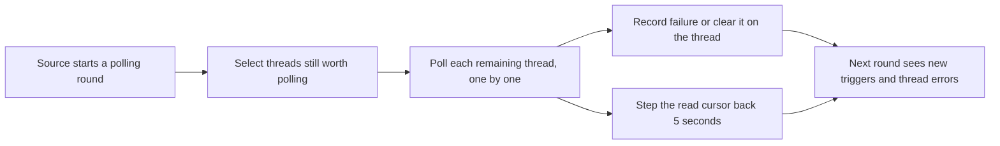

# poll.ts

This file is the small shared toolkit that the GitHub and Feishu source plugins both rely on to keep already-subscribed threads up to date. It answers four recurring questions: is this thread still worth polling, how far back should a read cursor be placed so late-arriving remote events are not missed, how should a per-thread poll run without one failure breaking the whole round, and how can a polling loop wait in a way a stop request can interrupt. Reading it makes the polling behavior of both sources understandable in one short file (41 lines).

## Whole-unit functional diagram

A polling round hands `pollThreads` the Source's context and a per-thread poll function; the helper filters the subscribed threads down to the ones inside the polling horizon, runs the caller's poll for each and stores the outcome on the thread. The cursor helper is used by the callers inside that poll so the next round re-reads a small overlapping window instead of losing events.

## At a glance

- Primary role: Utility — a compact set of reuse-oriented helpers shared by more than one Source instead of being duplicated per Source.
- Secondary roles: Domain rules — it fixes the policies that decide how long a thread stays watched and how much read overlap is tolerated.
- Confidence: High — the whole file was read, both consumers (`src/sources/github.ts` and `src/sources/feishu-loops.ts`) were inspected at their call sites, and the recorded thread errors are asserted in `tests/sources.spec.ts`.

## What this file does

- **Decides whether a subscribed thread still matters.** A thread keeps being polled while it has a live ticket or while its newest activity (or a ticket end) is inside a two-week horizon, so quiet threads eventually stop costing reads.
- **Polls threads independently.** Each subscribed thread of one Source is polled in turn; one thread's failure is stored on that thread and the loop continues with the rest.
- **Keeps cursors overlap-safe.** Poll start timestamps are stepped back a few seconds, so an event that arrives slightly late at the provider is still inside the next read window.
- **Respects stop requests.** Both the loop and the delay check an abort signal, so a Source that is switched off or shutting down stops promptly and does not record misleading failures.
- **Offers a timer-friendly delay.** The wait helper is written so test fake timers can drive polling cadence, which is why polling loops in this project are testable without real waiting.

## Reusable capability

- **Solves:** the duplicated, error-prone parts of "poll my subscribed threads" that every Source would otherwise re-implement.
- **Input:** a `SourceContext` (threads, tickets, and state access), a Source name, a `stopped()` predicate, a `poll(thread)` function, an optional `skip(thread)` filter, an `AbortSignal`, and a delay in milliseconds.
- **Result:** a yes/no answer about thread freshness, a backdated ISO timestamp for cursors, a completed loop with per-thread `pollError` state, or a promise that settles when the delay elapses or the signal aborts.
- **Main usage area:** the polling step of the GitHub and Feishu Sources. GitHub supplies a `skip` filter so an Issue already read earlier in the same round is not fetched twice, and both Sources store the cursor returned by `cursorAt` after a successful read.

Callers reach these helpers through 
<a target="_self" href="#src/sources/poll.ts:1-41?class=code" style="color: inherit; text-decoration: none;">poll.ts:1-41</a>
, while the contract they pass in is defined in 
<a target="_self" href="#src/sources/host.ts:31-66?class=code" style="color: inherit; text-decoration: none;">host.ts:31-66</a>
.

### Important usage constraint

`pause` resolves rather than rejects when the signal aborts, so a `while` loop must re-check `signal.aborted` (or a `stopped()` predicate) after waiting. Likewise, `pollThreads` performs no retries or backoff itself: retry policy, health reporting, and how long to wait before the next round stay with the calling Source.

## Polling rules and decisions

- **Decision:** should this subscribed thread be read again in this round?
- **Important conditions:** a thread is polled when at least one of its tickets is still open; otherwise its most recent timestamp — the newest trigger time (falling back to creation time) and each ticket's end time — must be within `POLL_HORIZON_MS` (14 days). The caller's `skip` filter and a stop request can remove a thread from the round regardless of that answer.
- **Outcomes:** the thread is either polled (and its stored `pollError` cleared) or left untouched; when the poll throws and polling has not been stopped, the error text is stored on the thread.
- **Invariant:** a stop request never writes a failure for the thread it interrupted, so turning a Source off cannot make healthy threads look broken.

### Small example

A GitHub Issue thread is polled and the provider answers `502`. The helper keeps the loop going, stores that message as the thread's `pollError`, and the round's own health reporting is unaffected by this per-thread bookkeeping. On the next round, once the read succeeds, the stored error is removed again. Because read cursors are stepped back five seconds, the items re-read across the overlap are deduplicated as already-seen triggers instead of producing duplicate activity.

## Key functions or classes

### `POLL_HORIZON_MS`

The single shared freshness window (14 days) used by the polling decision here, by the GitHub stream horizon, and by an obsolete-state migration.

    
        <a target="_self" href="#src/sources/poll.ts:5-6?class=code" style="color: inherit; text-decoration: none;">Code: src/sources/poll.ts:5-6</a>
    

### `polled`

Returns whether a subscribed thread has a live ticket or recent enough activity/completion to keep being polled.

### `cursorAt`

Steps a poll start timestamp back by five seconds and returns it as an ISO string for the next read.

### `pollThreads`

Walks the Source's subscribed threads, skips stopped or already-handled ones, runs the caller's poll, and records or clears `pollError` per thread.

    
        <a target="_self" href="#src/sources/poll.ts:17-31?class=code" style="color: inherit; text-decoration: none;">Code: src/sources/poll.ts:17-31</a>
    

### `pause`

Waits for a number of milliseconds, or settles immediately when the abort signal fires, so polling loops stay cancellable and testable.

    
        <a target="_self" href="#src/sources/poll.ts:32-40?class=code" style="color: inherit; text-decoration: none;">Code: src/sources/poll.ts:32-40</a>
    

## Main inputs and results

- **Inputs:** a `SourceContext`, a Source name such as `github` or `feishu`, a stop predicate or `AbortSignal`, a per-thread poll callback, an optional skip filter, and — for the delay helper — a duration in milliseconds.
- **Results:** a boolean freshness answer, a backdated ISO cursor timestamp, and either a completed thread loop or a settled delay promise.
- **Visible side effects:** each polled thread's metadata gains or loses a `pollError` entry, which operators see as the thread's reported polling problem; successful polls feed new triggers into the engine as the caller ingests them or, per the caller's choice, wait until the watch loop runs again.

---
name: poll.ts

update-time: 2026-11-02 11:39

description: This file is the small shared toolkit that the GitHub and Feishu source plugins both rely on to keep already-subscribed threads up to date. It answers four recurring questions: is this thread still worth polling, how far back should a read cursor be placed so late-arriving remote events are not missed, how should a per-thread poll run without one failure breaking the whole round, and how can a polling loop wait in a way a stop request can interrupt. Reading it makes the polling behavior of both sources understandable in one short file (41 lines).

---
