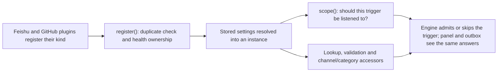

# registry.ts

`src/sources/registry.ts` is the single place where a Source plugin (Feishu, GitHub, or a future one) becomes usable by the rest of the application. It keeps the list of installed kinds, turns the stored settings into validated instances, and gives the Engine, the settings panel, and the outbox one consistent answer about what each Source is allowed to do. Read it when you want to add a Source, debug why a Source is not listening, or find out where a configuration value gets checked.

## How the registry fits together

A plugin declares its kind and calls `register`, which claims that kind's health entries and stores it. Every later question — "does this Source listen?", "may we reply to this channel?", "what is its resolved config?" — is answered by re-reading stored settings and the installed kind map, so the Engine, the panel, and the outbox never disagree.

<!-- {
  "mermaid_info": {
    "name": "Source registry flow",
    "nodes": [
      {
        "id": "trigger_001",
        "name": "Feishu and GitHub plugins register their kind",
        "path": "src/sources/feishu.ts",
        "hint": "A Source plugin hands its kind descriptor to the registry",
        "isJumpable": true,
        "position": { "startLine": 133, "endLine": 133 },
        "references": []
      },
      {
        "id": "register_002",
        "name": "register(): duplicate check and health ownership",
        "path": "src/sources/registry.ts",
        "hint": "Rejects duplicate kind IDs and refused health names, then stores the kind",
        "isJumpable": true,
        "position": { "startLine": 19, "endLine": 35 },
        "references": []
      },
      {
        "id": "resolve_003",
        "name": "Stored settings resolved into an instance",
        "path": "src/sources/registry.ts",
        "hint": "Stored config is validated and defaults are filled in",
        "isJumpable": true,
        "position": { "startLine": 133, "endLine": 137 },
        "references": []
      },
      {
        "id": "scope_004",
        "name": "scope(): should this trigger be listened to?",
        "path": "src/sources/registry.ts",
        "hint": "The SourceScope answer the Engine asks for each incoming trigger",
        "isJumpable": true,
        "position": { "startLine": 124, "endLine": 132 },
        "references": []
      },
      {
        "id": "query_005",
        "name": "Lookup, validation and channel/category accessors",
        "path": "src/sources/registry.ts",
        "hint": "Instance lookup, settings validation, policy parts, sending, links and thread context",
        "isJumpable": true,
        "position": { "startLine": 43, "endLine": 123 },
        "references": []
      },
      {
        "id": "result_006",
        "name": "Engine admits or skips the trigger; panel and outbox see the same answers",
        "path": "",
        "hint": "The observable outcome shared by all callers",
        "isJumpable": false,
        "position": { "startLine": 0, "endLine": 0 },
        "references": []
      }
    ]
  }
} -->

    
        <a target="_self" href="#src/sources/registry.ts:1?class=graph" style="color: inherit; text-decoration: none;">Graph: Source registry flow</a>
    

## At a glance

- **Primary role — extension point**: it is the registration surface through which a Source plugin joins the application, and the place that decides what an installed kind may report or expose.
- **Secondary role — API boundary**: the Engine, the settings panel, the outbox, link building, and the execution environment all read Sources through the operations of this class rather than touching plugins directly.
- **Secondary role — domain rules**: it answers the behavioural questions "is this Source listening?", "may we reply to this channel?", and "what config is actually in force when the stored one is invalid?".
- **Confidence**: High — the whole file was read, together with the `SourceKind` contract it consumes and its verified callers in `src/app/runtime.ts`, `src/app/settings.ts`, `src/app/outbox.ts`, and `src/app/source-context.ts`.

## What this file does

- **Registers Source kinds and keeps registration exclusive.** A kind ID can only be registered once, and registration returns a disposer that removes the kind again — used by plugins wired into the runtime's lifetime effects.
- **Owns the health names a kind declares.** Each declared entry is claimed on the shared `HealthBoard` before the kind becomes visible, so two components can never write the same status, and an unregistered kind's later reports silently do nothing.
- **Resolves stored settings into usable configuration.** Stored config is validated by the kind's own schema; if it fails, the instance falls back to schema defaults and is marked disabled instead of running with bad values.
- **Implements `SourceScope` for the Engine.** It reports whether a trigger's Source listens, whether it also observes unaddressed messages, and why it was skipped when it is not listened to.
- **Validates submitted settings and policy fragments.** Source config and per-Source policy parts are checked against their kind, while uninstalled kinds keep whatever is stored.
- **Feeds the surrounding features.** It supplies outbound sending with channel gating, deep links, thread context readers, search-key discovery, environment variable declarations and values, and the health entries handed to each Source context.

## Key functions or classes

### `SourceRegistry`

Implements `SourceScope` and takes three inputs: a thunk returning current `Settings`, a `HealthBoard` claimer, and an optional callback invoked for each newly registered kind.

### `register`

Validates that the kind ID and its health names are unclaimed, claims the entries as `starting`, stores the kind, and returns an unregister function.

### `instances` and `instance`

List installed instances sorted by ID (followed by stored entries whose kind is missing, marked `installed: false`) or look up one Source's resolved instance.

### `validate`, `validatePolicy`, and `policyPart`

Check a submitted Source config, validate each Source's policy fragment (with the shared admission table handled centrally), and return the currently effective policy part for a Source.

### `scope`

The Engine's listening decision for one incoming trigger, including the reason when the Source is disabled or its plugin is not installed.

### `channelAllowed` and `send`

Decide whether a reply may still reach a channel address, and deliver an outbound message through the kind's channel adapter.

### `threadContext`, `link`, `find`, and `repliesTo`

Adapt the optional reader, link, search, and reply-target features of a kind into the shapes the assessment and link-building code expects.

### `healthEntries`, `declarations`, and `environments`

Hand a Source context its own live health entries, list environment variable declarations for every installed kind, and provide the enabled kinds' environment values.

## Main inputs and results

- **Inputs**: `SourceKind` descriptors supplied by plugins, the current settings snapshot (always read fresh through the injected `settings()` thunk), the shared health board, and per-call arguments such as a kind ID, a trigger, a channel address, or a submitted policy fragment.
- **Results**: a registered-kind lookup, resolved instances with defaults applied, `ScopeResult` values, validated configuration objects, `'sent' | 'gone' | 'waiting'` send outcomes, channel links, thread context readers, and environment declarations and values.
- **Visible side effects**: Source status entries appear and disappear in the health panels as kinds register and unregister, the settings panel lists which Sources are installed, and outbox deliveries settle on a channel policy answer instead of being silently dropped.

## How to extend it

- **Extension capability**: add a new Source (a chat platform, an issue tracker, an internal system) without changing the Engine, the settings panel, or the outbox.
- **Contract**: provide a `SourceKind` as described in the kind contract — a stable `kind` ID, a config `schema`, form `fields`, its `health` entry names, and any of the optional capabilities (listening `scope`, `channel`, `threadContext`, `policy`, `environment`, `find`, `repliesTo`, `refreshLabels`). Health names starting with `sync:` are refused because the settings layer owns them.
- **Registration or discovery**: call `register(kind)` from the plugin's effect setup, as the Feishu and GitHub plugins do; registration returns the disposer that removes the kind and releases its health entries.
- **Use path**: after registration the kind becomes visible through `kind`, `instances`, `scope`, `send`, and the other accessors; the optional registration callback lets the runtime react to a kind loading after startup, which is how a late-loading kind's policy sync is triggered.

### Compatibility boundary

Installed instances are returned in kind-ID order so panel and API output stays stable, and stored-but-uninstalled Sources are appended rather than hidden. Health entries are bound to one registration: after a kind unregisters, reports through the entries it was given earlier do nothing, even if the same kind registers again.

Open the plugin contract in 
<a target="_self" href="#src/sources/kind.ts:85-113?class=code" style="color: inherit; text-decoration: none;">kind.ts:85-113</a>
 and the wiring in 
<a target="_self" href="#src/app/runtime.ts:109-114?class=code" style="color: inherit; text-decoration: none;">runtime.ts:109-114</a>
.

## Public contract

- **Caller**: `Runtime` constructs one registry and passes it to the Engine as its `SourceScope`; `Settings` uses it to list, validate, and sync Sources; `Outbox` uses it to gate and send replies; link building, the execution environment, the management views, and each Source context read it too.
- **Operation**: register and look up kinds, expose resolved instances, validate stored or submitted configuration and policy parts, decide listening and channel permission, send outbound messages, and produce links, search keys, thread context, health entries, and environment values.
- **Accepted input**: kind descriptors; kind IDs that must be installed for validation; stored `{ enabled, config }` shapes; per-Source policy fragments; `{ source, meta }` scope inputs; channel addresses; outbound messages with a command runner; trigger objects.
- **Result**: resolved or `undefined` lookups, `ScopeResult` unions, validated config objects, `'sent' | 'gone' | 'waiting'` send outcomes, links that degrade to an empty URL with the Source name as label, and explicit errors such as `Source kind not installed: <id>` or a duplicate-registration error.

### Access or validation requirements

Configuration is always checked by the owning kind's schema, so a caller cannot save values the kind itself rejects. Policy fragments are split: each kind validates its own part, while the `admission` table is validated by the shared policy schema for every Source. Sending is intentionally forgiving — a message whose kind is not installed yet returns `'waiting'` rather than failing, which lets the outbox retry later.

Compare with the port declared in 
<a target="_self" href="#src/core/ports.ts:12-14?class=code" style="color: inherit; text-decoration: none;">ports.ts:12-14</a>
 and the Source context built from it in 
<a target="_self" href="#src/app/source-context.ts:29-71?class=code" style="color: inherit; text-decoration: none;">source-context.ts:29-71</a>
.

## Rules and decisions

- **Decision**: for a given trigger or channel, should this Source's messages be listened to and replied to at all?
- **Important conditions**: whether the kind is installed, whether a stored instance exists for it, whether that instance is enabled, and whether the kind supplies its own `scope` or `channel.allowed` rule.
- **Outcomes**: a stored Source whose plugin is missing is not listened to (`source_not_installed`); an installed but disabled Source is not listened to (`source_disabled`); an installed, enabled Source is listened to and may additionally observe messages not addressed to the agent. Channel replies are allowed only while the instance is enabled and the kind does not reject the address.
- **Invariant**: invalid stored configuration never takes effect. The instance silently falls back to schema defaults and is treated as disabled, so a hand-edited or outdated settings file degrades to "off" instead of running with unknown values.

### Small example

Someone switches a Source off in the settings panel. The stored entry still exists, the plugin is still installed, but every trigger from that Source now resolves to "not listened to, source disabled", and outbound replies to its channels are refused — without anything in the Engine or the outbox needing its own copy of that rule.

Follow the settings path that feeds these decisions in 
<a target="_self" href="#src/app/settings.ts:215-250?class=code" style="color: inherit; text-decoration: none;">settings.ts:215-250</a>
.

---
name: registry.ts

update-time: 2026-11-02 11:40

description: `src/sources/registry.ts` is the single place where a Source plugin (Feishu, GitHub, or a future one) becomes usable by the rest of the application. It keeps the list of installed kinds, turns the stored settings into validated instances, and gives the Engine, the settings panel, and the outbox one consistent answer about what each Source is allowed to do. Read it when you want to add a Source, debug why a Source is not listening, or find out where a configuration value gets checked.

---
