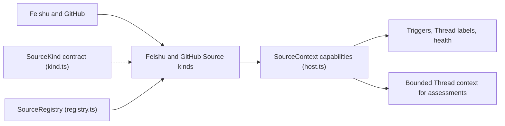

# Sources

`src/sources` is where the project's outside conversations become work. It defines the plugin contract a "Source kind" must satisfy, registers the kinds that are installed, and ships two complete implementations — Feishu and GitHub — that poll or consume remote messages, turn them into `Trigger` events, post replies back, and let an assessment read a bounded slice of the original conversation. Read this directory when you want to know why a message did or did not become work, how a reply travels back out, or how to add a third integration of your own.

## Whole-unit functional diagram

<!-- {
  "mermaid_info": {
    "name": "Source plugin flow",
    "nodes": [
      {
        "id": "external_001",
        "name": "Feishu and GitHub",
        "path": "",
        "hint": "The outside systems a Source kind talks to",
        "isJumpable": false,
        "position": { "startLine": 0, "endLine": 0 },
        "references": []
      },
      {
        "id": "kinds_002",
        "name": "Feishu and GitHub Source kinds",
        "path": "src/sources/feishu.ts",
        "hint": "The shipped kind descriptors and their Cordis plugin entries",
        "isJumpable": true,
        "position": { "startLine": 31, "endLine": 139 },
        "references": []
      },
      {
        "id": "contract_003",
        "name": "SourceKind contract (kind.ts)",
        "path": "src/sources/kind.ts",
        "hint": "What a kind may offer: config, channel, thread context, policy, environment",
        "isJumpable": true,
        "position": { "startLine": 85, "endLine": 113 },
        "references": []
      },
      {
        "id": "registry_004",
        "name": "SourceRegistry (registry.ts)",
        "path": "src/sources/registry.ts",
        "hint": "Registers kinds, validates instances, dispatches sends, links and reads",
        "isJumpable": true,
        "position": { "startLine": 13, "endLine": 35 },
        "references": []
      },
      {
        "id": "host_005",
        "name": "SourceContext capabilities (host.ts)",
        "path": "src/sources/host.ts",
        "hint": "The bounded service a plugin programs against",
        "isJumpable": true,
        "position": { "startLine": 31, "endLine": 66 },
        "references": []
      },
      {
        "id": "result_006",
        "name": "Triggers, Thread labels, health",
        "path": "",
        "hint": "What the rest of the application observes",
        "isJumpable": false,
        "position": { "startLine": 0, "endLine": 0 },
        "references": []
      },
      {
        "id": "context_007",
        "name": "Bounded Thread context for assessments",
        "path": "src/sources/admission-context.ts",
        "hint": "Pages of the Trigger's Thread reduced to a small window",
        "isJumpable": true,
        "position": { "startLine": 22, "endLine": 42 },
        "references": []
      }
    ]
  }
} -->

    
        <a target="_self" href="#src/sources:1?class=graph" style="color: inherit; text-decoration: none;">Graph: Source plugin flow</a>
    

A kind entry file registers itself with the registry and starts its own background loops. Those loops read the outside system through a `SourceContext`, convert what they find into Triggers, and push each one back through `receive`; the same context reports health and labels Threads, while the registry answers sends, links, and assessment reads for everyone else.

## At a glance

- **Main role**: This directory is the project's Source plugin surface — the contract a Source kind must satisfy, the registry that makes installed kinds usable, and the two kinds (Feishu, GitHub) that actually produce and answer messages.
- **Shipped integrations**: Feishu (bot events, chat history, images) and GitHub (notifications, Issues, PRs, comments, CI).
- **Main inputs**: raw Feishu and GitHub payloads plus the stored per-kind settings; for read requests, an accepted `Trigger` together with that kind's resolved config.
- **Main results**: Triggers handed to the Engine, outbound replies and deep links for the Outbox and panel, normalized messages for assessments, and health entries on the health board.
- **Confidence**: High — the contract in `kind.ts`, the registration path in `registry.ts`, and the two kind entries all agree on the same `register` + `apply` shape.

## Responsibilities and non-responsibilities

- **Responsible for**: the `SourceKind` / `SourceHost` / `SourceContext` contracts; installing kinds and validating their stored settings; starting and stopping each kind's background loops; normalizing remote payloads into Triggers; delivering outbound replies and building channel links; bounded read-only thread context (including images); each kind's Policy part and admission-row description; per-kind environment variables; health reporting; shared polling helpers.
- **Kept elsewhere**: the `Trigger`/`Thread`/`Ticket` data model and admission decisions (`src/core`, `src/admission.ts`), the shared admission table schema and Policy storage (`src/policy.ts`), CLI/API transport and credentials (`src/infra/commands.ts`), deployment resolution and the health board (`src/deployment.ts`, `src/setup.ts`, `src/infra/health.ts`), the reply queue (`src/app/outbox.ts`), assessment prompting (`src/app/assessment.ts`), and panel rendering (`src/app/views`, `src/client`).

## Important direct children

### `kind.ts`

The type-only vocabulary every Source kind is written against: the `SourceKind` descriptor with its config `schema` and panel `fields`, plus the outbound channel, thread-context reader, Policy part, environment variables and stored instance record.

    
        <a target="_self" href="#src/sources/kind.ts?class=code" style="color: inherit; text-decoration: none;">Code: src/sources/kind.ts</a>
    

### `host.ts`

The service the application hands to a plugin — `SourceHost`, the per-kind `SourceContext` with its bounded read/receive/thread/ticket/notify/report operations, and the shared `Health` shape with fixed English health templates that the panel re-localizes.

    
        <a target="_self" href="#src/sources/host.ts?class=code" style="color: inherit; text-decoration: none;">Code: src/sources/host.ts</a>
    

### `registry.ts`

The single place where an installed kind becomes usable: it claims the kind's health entries, turns stored settings into validated instances, and gives the Engine, settings panel, outbox and assessments one consistent answer.

    
        <a target="_self" href="#src/sources/registry.ts?class=code" style="color: inherit; text-decoration: none;">Code: src/sources/registry.ts</a>
    

### `poll.ts`

A short shared toolkit both kinds use to keep subscribed Threads current: whether a Thread is still worth polling, how far back to place a read cursor so late remote events are not missed, how to fail one Thread without failing the round, and how to wait in a way a stop request can interrupt.

    
        <a target="_self" href="#src/sources/poll.ts?class=code" style="color: inherit; text-decoration: none;">Code: src/sources/poll.ts</a>
    

### `admission-context.ts`

Builds the deliberately bounded snapshot an admission assessment reads: pages of the Trigger's Thread reduced to the opening messages plus a small neighbourhood around the Trigger, with counts that describe only what was actually loaded.

    
        <a target="_self" href="#src/sources/admission-context.ts?class=code" style="color: inherit; text-decoration: none;">Code: src/sources/admission-context.ts</a>
    

### `feishu.ts`

Feishu's configuration and registration surface: the config schema and panel fields, the listening rule, the Policy part (allowed users, bot candidates, roster sync from chat members), the environment variables a ticket receives, and the Cordis `apply` that registers the kind and starts its loops.

    
        <a target="_self" href="#src/sources/feishu.ts?class=code" style="color: inherit; text-decoration: none;">Code: src/sources/feishu.ts</a>
    

### `feishu-loops.ts`

Feishu's background loops — a live event consumer, a periodic chat-name refresh, and a history backfill that also polls subscribed Threads — which together decide why a Feishu message appears (or never appears) as work.

    
        <a target="_self" href="#src/sources/feishu-loops.ts?class=code" style="color: inherit; text-decoration: none;">Code: src/sources/feishu-loops.ts</a>
    

### `feishu-trigger.ts`

The one place a Feishu message becomes a `Trigger`, normalizing all three payload shapes (live event, history item, topic page) and owning the Feishu identity rules — deterministic trigger IDs, thread IDs and reply addresses — that the other Feishu modules reuse.

### `feishu-read.ts`

The read-only window into a Feishu conversation, anchored to an accepted Trigger: the source message, its topic root, the message it replies to, a page of the Thread, or the chat around it. Nothing read here becomes a new Trigger.

### `feishu-channel.ts`

Feishu's outbound half: it delivers an already-decided message as a threaded bot reply in the right chat, builds the chat deep link shown in the panel, and decides when a Feishu rejection means the conversation is permanently gone instead of worth retrying.

### `feishu-image.ts`

Lets an assessing model actually see a picture from a Feishu message: it accepts only image keys that appear in that message, checks the current model route accepts images, downloads the resource within the deployment's safety limits, and commits the bytes as a session attachment.

### `github.ts`

GitHub's kind definition together with its polling loops — notifications, repository-wide Issue/PR/comment streams, default-branch and per-PR CI, PRs of open tickets, and subscribed Threads — and the place where saved cursors and GitHub health live.

    
        <a target="_self" href="#src/sources/github.ts?class=code" style="color: inherit; text-decoration: none;">Code: src/sources/github.ts</a>
    

### `github-trigger.ts`

Pure translation with no network or credentials: it turns raw Issues, PRs, conversation comments, inline review comments, reviews and CI transitions into Triggers, and parses GitHub URLs into numbers and reply addresses.

### `github-pull.ts`

The pull-request rules of the source: whether a PR belongs to a ticket, keeping that binding in sync while the PR is polled, and reporting merges and closes into the ticket lifecycle along with the notice that reaches chat.

### `github-read.ts`

The read half of the GitHub source: project resource names become ordinary API calls, and raw records become the small message shapes an assessment or worker can safely read. It never posts or emits a Trigger.

### `github-channel.ts`

The outbound half of the GitHub source: it posts a comment or inline review-thread reply under the agent's own account, embeds a marker so a retried send does not duplicate, treats a deleted Issue as `'gone'`, and builds the link and label shown in the panel.

## How the children work together

A kind entry (`feishu.ts`, `github.ts`) declares the descriptor and, in `apply`, registers it with the registry and starts its loops through a `SourceContext` built by `host.ts`. The loops read the outside system, call the kind's trigger normalizer (`feishu-trigger.ts`, `github-trigger.ts`), and push each Trigger with `ctx.receive`; polling cadence and cursors come from `poll.ts` plus values saved in the Source's own KV state. From then on the registry is the single switchboard: `scope()` answers the Engine, `send()` and `link()` answer the outbox and panel, `threadContext()` answers assessments (with `admission-context.ts` shrinking what is loaded), `declarations()`/`environments()` feed the execution environment, and `policy`/`fields`/`facts` feed settings and the admission table.

## How to extend it

- **Extension capability**: Adding a new Source kind — an outside system that can originate work, receive replies, be read by assessments, and appear as a card in settings. Feishu and GitHub are two such extensions; a third lives beside them.
- **Contract**: An object matching `SourceKind<C>`: a stable `kind` ID, localized title and description, a zod `schema` for its config, the `fields` that render that config, declared `health` entry names, and whichever optional capabilities apply — `scope`, `channel`, `threadContext`, `find`, `repliesTo`, `policy`, `refreshLabels`, `environment`, `facts`.
- **Registration or discovery**: There is no directory scan. A kind exports a Cordis plugin (`name`, `inject = ['orchestrator']`, `apply(ctx)`) whose effect calls `ctx.orchestrator.sources.register(kind)`; the registry keys kinds by ID and hands back a disposer for cleanup.
- **Use path**: a stored instance carrying the same ID as its kind is resolved through the kind's schema, then read by each consumer on demand — Engine scope, outbox send/link, assessment reads, execution-environment variables, and the settings panel.

### Compatibility boundary

- One instance per kind ID: `SourceInstance.id` is the kind ID, and a second registration of the same ID is refused.
- Health names are exclusive. A kind claiming a name another part already reports is rejected, and `sync:`-prefixed names are reserved for settings.
- A stored instance whose plugin is missing is still listed (`installed: false`) but listens to nothing; a disabled instance reports `source_disabled`.
- Stored config that fails validation falls back to schema defaults and disables the instance, so a bad edit cannot half-run.
- Health entries are captured when a `SourceContext` is built, so a long-lived holder of a context must rebuild it after the kind is unregistered and registered again.

## External connection

- **External system**: Feishu through a bot-only `lark-cli` executable (event consumer, chat and topic history, message resources) and GitHub through a `gh`-style CLI signed in as the agent's account.
- **Outbound translation**: an `OutboundMessage`'s channel address becomes a threaded bot reply, an Issue/PR comment, or an inline review-thread reply, carrying a per-message marker so a retried send finds the earlier one instead of posting twice; a permanently dead target returns `'gone'`.
- **Inbound translation**: live events, history items, topic pages, notifications, Issues, PRs, comments, reviews and CI snapshots all become one canonical `Trigger` with a deterministic ID, a Thread reference, and actor/human/addressed flags.
- **Operating requirements**: the bot or agent CLI must be resolvable and signed in, and setup must have resolved the repository and accounts — Sources poll only after `configured()` is true. GitHub's requested poll interval and rate limits shape loop cadence, and the first observation after a stream is switched on is a baseline rather than a burst of Triggers.

## Configurable behavior

- **Controls**: each kind's own settings — Feishu: bot CLI, received chats with per-chat "@ only" versus "all messages", other chats, direct messages, page size and link timeout; GitHub: repository, agent CLI, poll interval, failure threshold, and the four "observe" switches — plus the kind's Policy part (who may originate work, bot candidates, roster sync).
- **Value source**: settings stored per Source instance, validated against the kind's zod schema with that schema supplying defaults; read-only `fact` fields show the resolved bot or account from deployment instead of accepting an edit.
- **Takes effect**: loops read their config on each round and Feishu re-checks that it is still enabled within five seconds, so disabling a Source stops it quickly; CLI and repository changes are deployment-level, and the field hints say saving verifies the account and then restarts dsh-superagent.

### Common adjustment

`observeComments` — turning it on widens GitHub reception so comments that do not mention the agent arrive as inferred candidates; the Policy's admission table still decides whether they become work.

## Recommended starting points

1. `kind.ts` — the contract every other file implements, so it makes the rest of the directory legible.
2. `registry.ts` — follow how a kind is registered, validated, and handed to the Engine, outbox and assessments.
3. `feishu.ts` — one complete kind in a single file; continue into `feishu-loops.ts` and `feishu-trigger.ts` if you care about intake.
4. `github.ts` — the polling-heavy counterpart, showing cursors, retries, ticket PRs and health in one place.

    
        <a target="_self" href="#src/sources/kind.ts?class=code" style="color: inherit; text-decoration: none;">Code: src/sources/kind.ts</a>
    
    
        <a target="_self" href="#src/sources/registry.ts?class=code" style="color: inherit; text-decoration: none;">Code: src/sources/registry.ts</a>
    
    
        <a target="_self" href="#src/sources/feishu.ts?class=code" style="color: inherit; text-decoration: none;">Code: src/sources/feishu.ts</a>
    
    
        <a target="_self" href="#src/sources/github.ts?class=code" style="color: inherit; text-decoration: none;">Code: src/sources/github.ts</a>
    

---
name: sources

update-time: 2026-11-02 11:53

description: `src/sources` is where the project's outside conversations become work. It defines the plugin contract a "Source kind" must satisfy, registers the kinds that are installed, and ships two complete implementations — Feishu and GitHub — that poll or consume remote messages, turn them into `Trigger` events, post replies back, and let an assessment read a bounded slice of the original conversation. Read this directory when you want to know why a message did or did not become work, how a reply travels back out, or how to add a third integration of your own.

---
