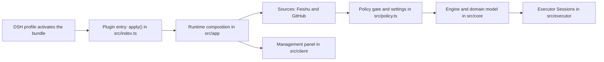

# src

`src` is the source root of the `dsh-superagent` plugin: the code the DeepSeek Harness (DSH) loads when a profile enables the agent, plus every layer that makes it work. Around the layered subdirectories it keeps a handful of small root modules that all layers share — the plugin entry, the settings/deployment surface, the authorization policy, the typed storage keys, the validation bounds, the setup-error catalogue and the panel's session-navigation helper. Read this directory when you want the whole map before diving into one layer.

## Layer map and functional flow

<!-- {
  "mermaid_info": {
    "name": "src layer flow: activation to worker Sessions",
    "nodes": [
      {
        "id": "profile_001",
        "name": "DSH profile activates the bundle",
        "path": "cordis.patch.yml",
        "hint": "The bundle layer inserts the plugin entries; the profile supplies stateDir",
        "isJumpable": true,
        "position": { "startLine": 4, "endLine": 12 },
        "references": []
      },
      {
        "id": "entry_002",
        "name": "Plugin entry: apply() in src/index.ts",
        "path": "src/index.ts",
        "hint": "Reads configuration, mounts the Runtime and supplies the restart callback",
        "isJumpable": true,
        "position": { "startLine": 10, "endLine": 25 },
        "references": []
      },
      {
        "id": "runtime_003",
        "name": "Runtime composition in src/app",
        "path": "src/app/runtime.ts",
        "hint": "The composition root that connects store, engine, sources, executor and HTTP",
        "isJumpable": true,
        "position": { "startLine": 54, "endLine": 60 },
        "references": []
      },
      {
        "id": "sources_004",
        "name": "Sources: Feishu and GitHub",
        "path": "src/sources",
        "hint": "Turns remote messages into Triggers and sends replies back out",
        "isJumpable": true,
        "position": { "startLine": 1, "endLine": 1 },
        "references": []
      },
      {
        "id": "policy_005",
        "name": "Policy gate and settings in src/policy.ts",
        "path": "src/policy.ts",
        "hint": "Validates the settings document and decides who may start work",
        "isJumpable": true,
        "position": { "startLine": 166, "endLine": 211 },
        "references": []
      },
      {
        "id": "core_006",
        "name": "Engine and domain model in src/core",
        "path": "src/core",
        "hint": "Triggers, decisions, mandates, tickets and the transactional Engine",
        "isJumpable": true,
        "position": { "startLine": 1, "endLine": 1 },
        "references": []
      },
      {
        "id": "executor_007",
        "name": "Executor Sessions in src/executor",
        "path": "src/executor",
        "hint": "Runs an accepted ticket in its own worker Session",
        "isJumpable": true,
        "position": { "startLine": 1, "endLine": 1 },
        "references": []
      },
      {
        "id": "client_008",
        "name": "Management panel in src/client",
        "path": "src/client",
        "hint": "Browser panel that displays state and writes settings through the management API",
        "isJumpable": true,
        "position": { "startLine": 1, "endLine": 1 },
        "references": []
      }
    ]
  }
} -->

    
        <a target="_self" href="#src:1?class=graph" style="color: inherit; text-decoration: none;">Graph: src layer flow: activation to worker Sessions</a>
    

The path starts as configuration: a DSH profile inserts the plugin and supplies its state directory, the entry module verifies the settings and starts the `Runtime`. The runtime then composes the layers — Sources feed Triggers, the policy decides whether one may become work, the core Engine records the outcome, and the executor turns an accepted ticket into a worker Session that the management panel can display.

## At a glance

- **Main role**: entry — `src/index.ts` is the module the DSH loader calls, and the surrounding directories are the implementation that entry mounts.
- **Ships as**: three Node bundles (`lib/index.js`, `lib/github-watch.js`, `lib/feishu-watch.js`) and one browser bundle (`lib/client.js`) built from this directory.
- **Confidence**: High — the entry file, build configuration and package exports all point at this directory as the plugin's source root.

## How the plugin begins

- **Trigger**: a DSH profile activates the `dsh-superagent` entry, so the loader calls `apply(ctx, config)` with the plugin's own configuration and the host services it asked for (agent sessions, tools, prompts, skills, web server, LLM, subprocess).
- **First meaningful step**: `machineOf(config)` turns the raw configuration into machine settings and rejects keys the plugin does not use, then DSH's auto-generated settings page is switched off because the plugin ships its own panel, and a `Runtime` is constructed with a restart callback.
- **Outcome**: once `runtime.ready` resolves, the log line tells the operator either that the agent is ready and the sidebar entry opens the management panel, or that it is waiting for setup, quoting the setup problem. The runtime is also registered for shutdown, so stopping the plugin closes it cleanly.

There is no command of your own to run: activation is the bundle insertion in 
<a target="_self" href="#cordis.patch.yml:4-12?class=code" style="color: inherit; text-decoration: none;">cordis.patch.yml:4-12</a>
, and the one setting the plugin refuses to start without is the state directory. The concrete entry logic is short enough to read whole in 
<a target="_self" href="#src/index.ts:10-25?class=code" style="color: inherit; text-decoration: none;">index.ts:10-25</a>
.

## Responsibilities and non-responsibilities

- **Responsible for**: the plugin's complete implementation — the lifecycle entry and its restart behavior, the reusable domain engine, the Feishu/GitHub Source adapters, the executor that runs ticket work, the shared infrastructure, the browser panel, and the root-level contracts every layer imports (settings validation and the policy gate, typed key-value keys, admission vocabulary, validation bounds, deployment checks, setup problems, session navigation).
- **Kept elsewhere**: the DSH host itself, which provides sessions, tools, prompts, the web server, the LLM and subprocesses; the behavior of external command-line tools (`gh`, `lark-cli`, `git`), which this tree only configures and invokes through `src/infra`; the shipped prompt and skill resources at the repository root; and the operator documentation under `docs/`.

## What an operator can configure

- **Controls**: the plugin's own configuration (the required state directory plus limits for prompt size and admission context reads), and the runtime settings document — pause state, which Sources are enabled and with what per-Source configuration, the assessment rules, the evaluation mode, and the executor limits (worker model, 1–16 concurrent workers, ticket directory, prepare command, blocked commands).
- **Value source**: the plugin schema in 
<a target="_self" href="#src/deployment.ts:15-43?class=code" style="color: inherit; text-decoration: none;">deployment.ts:15-43</a>
 read from the profile; the runtime document written by the management panel and validated against the schema in 
<a target="_self" href="#src/policy.ts:79-106?class=code" style="color: inherit; text-decoration: none;">policy.ts:79-106</a>
; and the account identities, which are not written by hand but discovered by running the configured CLIs.
- **Takes effect**: the numeric limits are read on each use, so editing them needs no restart; changing the state directory remounts the plugin; a change to a Source's account settings triggers the restart callback registered by the entry, which also re-asks DSH for the settings description so open forms stay editable.

A common first adjustment is `eval.mode`: it defaults to `observe`, and switching it to `auto` is what allows inferred candidates to be accepted rather than only recorded as what the agent would have done.

### One bound, two places

The numbers in 
<a target="_self" href="#src/limits.ts:1-11?class=code" style="color: inherit; text-decoration: none;">limits.ts:1-11</a>
 are deliberately shared between the server schemas and the panel forms, so a form cannot offer a value the server would reject.

## Rules that decide whether work starts

- **Decision**: may this arriving message start work, and with how much authority? A message can be an **explicit request**, an **inferred candidate** that the agent may act on proactively, or **ignored**.
- **Important conditions**: a sender on that Source's allowed list who addresses the agent is always explicit and bypasses the admission table. Unaddressed messages, or messages from unlisted senders, go through the per-scope admission row for that conversation; a message from a bot can never be more than an inferred candidate, and system/CI events must be observed by the Source. The evaluation mode then decides what an inferred candidate is worth: `off` starts nothing, `observe` records it, `auto` may accept it.
- **Outcomes**: the gate admits a Trigger with a strength and a recorded basis, or rejects it with a reason such as not a member, no mention, admission ignored, or not human. The main Session's assessment is then converted into an engine outcome — accepted, ignored, or unavailable — and an acceptance needs a settled direction, at least one matched enabled rule, and intent evidence.
- **Invariant**: a person is never mapped across Sources; identity lists are per Source, and a mandate is re-checked against the same Source's current rules when work resumes.

As a small example: a teammate mentions the agent in a group chat — explicit. The same teammate writes in the same group without a mention — the default admission row classifies it as an inferred candidate, so in `observe` mode the agent records a proposal instead of starting a worker; an unlisted stranger writing without a mention is ignored.

## Important direct children

### `src/core`

The reusable domain heart — triggers, threads, evaluations, decisions, mandates, tickets, assignments and the transactional `Engine` through which every change is accepted — plus the business rules that turn an event into authorized work.

<a target="_self" href="#src/core/core.info.md?class=text" style="color: inherit; text-decoration: none;">core.info.md</a>

### `src/app`

The application layer: it opens durable state, creates and decorates the AI sessions, schedules background work, serves the management panel and sends replies back to people.

<a target="_self" href="#src/app/app.info.md?class=text" style="color: inherit; text-decoration: none;">app.info.md</a>

### `src/sources`

The plugin contract a Source kind must satisfy, the registry of installed kinds, and the two complete implementations (Feishu and GitHub) that poll remote conversations, emit Triggers and post replies.

<a target="_self" href="#src/sources/sources.info.md?class=text" style="color: inherit; text-decoration: none;">sources.info.md</a>

### `src/executor`

The `Executor` contract the Engine talks to, and the worker lifecycle that turns an accepted ticket into one persistent DSH Session inside that ticket's own directory.

<a target="_self" href="#src/executor/executor.info.md?class=text" style="color: inherit; text-decoration: none;">executor.info.md</a>

### `src/infra`

The shared lower layer that reaches command-line tools, builds the isolated account-bound environment they run in, and keeps small registries and helpers the rest of the code calls.

<a target="_self" href="#src/infra/infra.info.md?class=text" style="color: inherit; text-decoration: none;">infra.info.md</a>

### `src/client`

The browser-side React panel loaded by the DSH web client: it renders Sources, Threads, Decisions, Tickets and the Executor, and writes settings through the management API without deciding policy itself.

<a target="_self" href="#src/client/client.info.md?class=text" style="color: inherit; text-decoration: none;">client.info.md</a>

### Root modules shared by those children

`policy.ts` holds the settings schema, the gate and the assessment conversion; `deployment.ts` holds the plugin configuration and the CLI identity checks; `setup.ts` is the closed catalogue of setup problems and their settings locations; `kv.ts` spells every retained key once with its value type; `admission.ts` names the three admission outcomes and their defaults; `limits.ts` holds the shared bounds; `navigation.ts` lets the panel open a known DSH Session once the catalog is ready. Being at the root is what keeps the browser bundle and the server bundle agreeing on the same vocabulary.

## How the children work together

1. A Source polls or receives a remote message and emits a `Trigger` with its actor, scope and metadata.
2. The runtime in `src/app` hands that Trigger to the policy built by `src/policy.ts`, which admits it or rejects it with a reason.
3. An admitted Trigger is assessed by the main Session; the assessment becomes an engine outcome, and the core `Engine` records the decision and, when accepted, a mandate and ticket.
4. The executor starts a worker Session for the ticket, streams the ticket's messages to it, and reports back through triggers and effects.
5. Replies, notices and record views travel back out through the Sources and into the management panel, which reads state over the management API.

## Recommended starting points

1. 
<a target="_self" href="#src/index.ts:1-28?class=code" style="color: inherit; text-decoration: none;">index.ts:1-28</a>
 — the whole activation story in one file: what the plugin asks DSH for, how configuration becomes settings, and what the operator sees.
2. 
<a target="_self" href="#src/app/runtime.ts:54-100?class=code" style="color: inherit; text-decoration: none;">runtime.ts:54-100</a>
 — the composition root, where the layers are actually connected.
3. 
<a target="_self" href="#src/policy.ts:166-211?class=code" style="color: inherit; text-decoration: none;">policy.ts:166-211</a>
 — read the gate before following any message, because it explains why most messages do nothing.
4. `src/core` — the vocabulary (`Trigger`, `Mandate`, `Ticket`) you need in order to read any other layer.
5. `src/sources` and `src/client` — pick the side you care about: how outside messages arrive, or what an operator sees.

---
name: src

update-time: 2026-11-02 14:11

description: `src` is the source root of the `dsh-superagent` plugin: the code the DeepSeek Harness (DSH) loads when a profile enables the agent, plus every layer that makes it work. Around the layered subdirectories it keeps a handful of small root modules that all layers share — the plugin entry, the settings/deployment surface, the authorization policy, the typed storage keys, the validation bounds, the setup-error catalogue and the panel's session-navigation helper. Read this directory when you want the whole map before diving into one layer.

---
