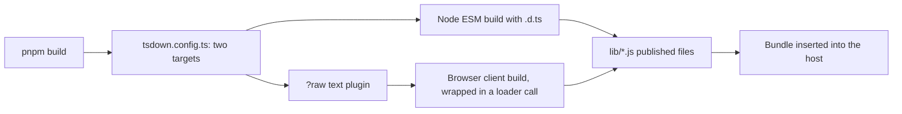

# tsdown.config.ts

This file is the build recipe for the `dsh-superagent` bundle: it tells `tsdown` how to turn the TypeScript sources into the JavaScript files that DeepSeek Harness loads. It describes two very different outputs — a Node ESM library with type declarations, and a single browser script that registers itself with DeepSeek Harness's web module loader — plus a small plugin that lets the panel import its stylesheet as text. Reading it tells you which source file becomes which published artifact in 
<a target="_self" href="#package.json?class=code" style="color: inherit; text-decoration: none;">package.json</a>
.

## Whole-unit functional diagram

The two target definitions read the same source tree but end in different shapes: the Node build emits ordinary ESM modules with declarations, while the browser build is post-processed by the inline `raw` plugin and wrapped so that `lib/client.js` registers itself when a browser loads it. 
<a target="_self" href="#tsdown.config.ts:9-14?class=code" style="color: inherit; text-decoration: none;">tsdown.config.ts:9-14</a>

## At a glance

- Primary role: Configuration — a control surface that decides what the `pnpm build` command produces, without touching application code.
- Secondary role: External adapter — the inline `raw` plugin bridges the bundler to a Vite-style `?raw` import convention, and the client wrapper adapts a CommonJS output to the host's browser module loader.
- Confidence: High — the whole 15-line file was read together with `package.json`, `cordis.patch.yml`, `tsconfig.json`, the client stylesheet import and the architecture/cookbook documents that reference it.

## What this file does

- **Defines the Node-facing library target.** Three entry points — the plugin itself, the GitHub Source plugin and the Feishu Source plugin — are built as ESM for `node` targeting `es2024` into `lib/`, with declaration files enabled and stale output cleaned first. 
<a target="_self" href="#tsdown.config.ts:10?class=code" style="color: inherit; text-decoration: none;">tsdown.config.ts:10</a>

- **Keeps host packages out of the bundle.** `@deepseek-ai/*` packages, `zod` and `proper-lockfile` are marked as never bundled, so the published files reference the host's own copies instead of duplicating them.
- **Builds the management panel for the browser.** A second target compiles `src/client/index.tsx` for `platform: 'browser'` in CommonJS format, without declarations, so the existing `lib/` contents from the first target are preserved (`clean: false`). 
<a target="_self" href="#tsdown.config.ts:11-13?class=code" style="color: inherit; text-decoration: none;">tsdown.config.ts:11-13</a>

- **Makes the browser output self-registering.** Banner, footer and intro text wrap the output in a `window.__ModuleLoader__.load({ id: "dsh-superagent", factory: (require) => { … } })` call, giving the bundle id the host expects and supplying the `module`/`exports` objects a CommonJS file assumes exist.
- **Loads the panel stylesheet as text.** The inline `raw` plugin answers `?raw` imports, so `import STYLES from './client.css?raw'` in the panel provider produces the CSS file's contents as a string. 
<a target="_self" href="#src/client/provider.tsx:6?class=code" style="color: inherit; text-decoration: none;">provider.tsx:6</a>

- **Pins product-level names.** `fixedExtension: false` keeps `.js` extensions even for ESM output, which matches the `main`, `types` and `exports` paths declared in `package.json`; the explicit `entryFileNames: 'client.js'` fixes the browser artifact name.

## Key functions or classes

### `raw` (with `resolveId` and `load`)

The only named value in the file: a small `tsdown` plugin that resolves a relative `?raw` import against the importer's directory and then replaces it with a module whose default export is the target file's text. 
<a target="_self" href="#tsdown.config.ts:4-8?class=code" style="color: inherit; text-decoration: none;">tsdown.config.ts:4-8</a>

### Default export: `defineConfig([…])`

The exported build definition, an array of exactly two target objects — the Node library first, then the browser client — which `tsdown` runs in that order for a single build command. 
<a target="_self" href="#tsdown.config.ts:9-14?class=code" style="color: inherit; text-decoration: none;">tsdown.config.ts:9-14</a>

## Main inputs and results

- Inputs: the source files named as entries (`src/index.ts`, `src/sources/github.ts`, `src/sources/feishu.ts`, `src/client/index.tsx`), the stylesheet read through `?raw`, and the `tsdown` command started by the `build` script in `package.json`.
- Results: `lib/index.js`, `lib/github-watch.js`, `lib/feishu-watch.js` with `lib/index.d.ts` for the Node target, and a single wrapped `lib/client.js` for the browser target.
- Visible side effects: the first target cleans `lib/` before writing, so a build replaces previous output while keeping the client file from the same run; the published paths line up with the `exports` map and with the plugin ids inserted by `cordis.patch.yml`.

## Configurable behavior

- Controls: which source files become published entry points, their output directory, module format and platform, whether type declarations are emitted, whether old output is removed, which packages stay external, and how the browser output is wrapped.
- Value source: this file only — it is a checked-in TypeScript module included in the type-checking scope, evaluated by `tsdown` when the `build` script runs (`pnpm check` runs type check, tests, then build).
- Takes effect: at build time. Changing a value changes what lands in `lib/`, so the project must be rebuilt and, in a running deployment, restarted for the host to pick up the new files.

### Common adjustment

`entry` — adding a new Source plugin means adding an entry here, exporting the built file in `package.json`, and inserting it in the bundle patch; the cookbook documents exactly this three-step path for a new `webhook-watch` module. 
<a target="_self" href="#docs/008-cookbook.md:334-351?class=text" style="color: inherit; text-decoration: none;">008-cookbook.md:334-351</a>

## External connection

- External system: the `tsdown` bundler (rolldown-based) for both targets, and, for the browser target, DeepSeek Harness's web module loader reached through `window.__ModuleLoader__`.
- Outbound translation: a Vite-style relative `?raw` import is rewritten by `raw.resolveId`/`raw.load` into a generated module whose default export is the file's text — the project's build-side equivalent of what `vitest` does in tests, working around `tsdown` refusing `.css` ids without its CSS plugin.
- Inbound translation: the finished CommonJS client module becomes a loader registration — `module.exports` is returned from the factory and handed to the host under the id `dsh-superagent`, while React, `react/jsx-runtime` and `react-dom` are left unbundled so the loader's own `require` supplies them.
- Operating requirements: since the client target externalizes React, the browser build only runs inside a host that provides those modules; and because `src/client/css.d.ts` merely declares the `*?raw` module type, the actual text loading depends on the plugin in this file being present in the build.

---
name: tsdown.config.ts

update-time: 2026-11-02 10:13

description: This file is the build recipe for the `dsh-superagent` bundle: it tells `tsdown` how to turn the TypeScript sources into the JavaScript files that DeepSeek Harness loads. It describes two very different outputs — a Node ESM library with type declarations, and a single browser script that registers itself with DeepSeek Harness's web module loader — plus a small plugin that lets the panel import its stylesheet as text. Reading it tells you which source file becomes which published artifact in 
<a target="_self" href="#package.json?class=code" style="color: inherit; text-decoration: none;">package.json</a>
.

---
