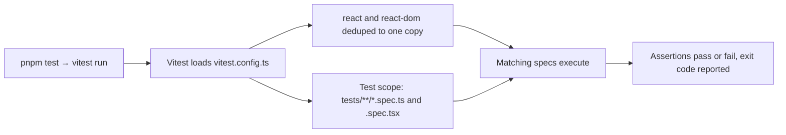

# vitest.config.ts

This four-line file tells Vitest how the project's test suite is collected and how modules resolve while it runs. It limits testing to spec files under `tests/`, and it forces `react` and `react-dom` to resolve to a single shared copy so that components in `src/client` and the specs that render them agree on the same React instance. If you are adding a test or wondering why a helper file under `tests/` is not executed as a test, this file is the answer.

## How the test configuration takes effect

Running the `test` script starts Vitest, which picks this file up automatically; the two settings it exports then decide both which files become tests and which React copy those tests see. The result is a single run whose pass/fail exit code is what `pnpm check` relies on.

<!-- {
  "mermaid_info": {
    "name": "How the test configuration takes effect",
    "nodes": [
      {
        "id": "trigger_001",
        "name": "pnpm test → vitest run",
        "path": "package.json",
        "hint": "The test script that starts the runner",
        "isJumpable": true,
        "position": { "startLine": 50, "endLine": 50 },
        "references": []
      },
      {
        "id": "config_002",
        "name": "Vitest loads vitest.config.ts",
        "path": "vitest.config.ts",
        "hint": "The exported configuration object read at run start",
        "isJumpable": true,
        "position": { "startLine": 1, "endLine": 3 },
        "references": []
      },
      {
        "id": "react_003",
        "name": "react and react-dom deduped to one copy",
        "path": "vitest.config.ts",
        "hint": "resolve.dedupe keeps a single React instance across client code and specs",
        "isJumpable": true,
        "position": { "startLine": 3, "endLine": 3 },
        "references": []
      },
      {
        "id": "scope_004",
        "name": "Test scope: tests/**/*.spec.ts and .spec.tsx",
        "path": "vitest.config.ts",
        "hint": "test.include decides which files are treated as tests",
        "isJumpable": true,
        "position": { "startLine": 3, "endLine": 3 },
        "references": []
      },
      {
        "id": "suite_005",
        "name": "Matching specs execute",
        "path": "",
        "hint": "Abstract step: the collected spec files run",
        "isJumpable": false,
        "position": { "startLine": 0, "endLine": 0 },
        "references": []
      },
      {
        "id": "result_006",
        "name": "Assertions pass or fail, exit code reported",
        "path": "",
        "hint": "Abstract result: the run summary and exit status",
        "isJumpable": false,
        "position": { "startLine": 0, "endLine": 0 },
        "references": []
      }
    ]
  }
} -->

    
        <a target="_self" href="#vitest.config.ts:1?class=graph" style="color: inherit; text-decoration: none;">Graph: How the test configuration takes effect</a>
    

## At a glance

- **Primary role**: Test verification — it defines the harness rule that decides which files count as tests and how they are executed, so the suite's results mean what the project claims.
- **Secondary roles**: Configuration — it is a small control surface for module resolution and test selection that changes behavior without touching any implementation code.
- **Confidence**: High — the whole file was read (4 lines), and its two settings are confirmed by the `test` script in `package.json` and by the spec files under `tests/`.

## What this file does

- **Restricts what counts as a test.** Only files matching `tests/**/*.spec.ts` and `tests/**/*.spec.tsx` are collected, so shared helpers in `tests/fixtures/` are imported by specs rather than run as tests themselves.
- **Shares one React instance.** Deduping `react` and `react-dom` means the panel components under `src/client` and the specs that render them resolve to the same copy, so component state and hooks behave as they do in the app.
- **Keeps pure-logic specs on the default Node environment.** No global `environment` is set; the DOM-rendering specs opt in individually with a `// @vitest-environment jsdom` comment as their first line.
- **Adds no global test API.** No `globals` or `setupFiles` are declared, so every spec imports `expect`, `it` and `vi` from `vitest` explicitly.
- **Runs on Vite's loader.** Because Vitest is Vite-based, the `?raw` stylesheet import used by `src/client/provider.tsx` resolves during tests without extra configuration here.

## Key functions or classes

This file declares no functions or classes — it exports one configuration object.

### Default export passed to `defineConfig`

The single exported value that carries the two settings: `resolve.dedupe` for the shared React instance, and `test.include` for the spec-file pattern.

    
        <a target="_self" href="#vitest.config.ts:1-3?class=code" style="color: inherit; text-decoration: none;">Code: vitest.config.ts:1-3</a>
    

## Main inputs and results

- **Inputs**: the `pnpm test` command (which runs `vitest run`) or any direct `vitest` invocation, the spec files found under `tests/`, and per-file `// @vitest-environment` comments that choose a DOM for that file.
- **Results**: a collected test run that reports per-spec pass/fail and exits with a status code; that code is what `pnpm check` treats as the gate before typecheck and build.
- **Visible side effects**: terminal output only — this configuration writes no files and starts no services.

## Behavior this configuration protects

- **Contract**: every spec under `tests/` whose name ends in `.spec.ts` or `.spec.tsx` is collected and none is silently skipped, and any module graph touched by a test sees exactly one React implementation.
- **Main scenarios**: non-DOM logic specs run in the Node environment for speed; the panel, client, controls and navigation specs render real components in jsdom after declaring it per file; fixture modules are only loaded through imports.
- **Regression boundary**: this prevents a second React copy from creeping in through dev dependencies (which would show up as broken hooks or `act` warnings across the panel tests), and it prevents a spec from passing review while never being executed because it sits outside the include pattern.

### Test setup that matters

`jsdom` is present as a dev dependency, but it is only used by the files that ask for it — 12 specs, mostly the `panel-*.spec.tsx` ones. Keeping the default environment non-DOM means a mistake in a DOM spec fails loudly rather than being masked, and the remaining specs stay lightweight.

## Configurable behavior

- **Controls**: which files Vitest treats as tests, and which copies of the React packages are collapsed into one.
- **Value source**: this file, exported as the default object via `defineConfig` from `vitest/config`; Vitest reads it on its own without being pointed at it.
- **Takes effect**: when a test run starts. There is no dev server here, so no restart or rebuild is involved — the next `pnpm test` uses the new values.

### Common adjustment

`test.include` — change or extend the pattern when you introduce a different spec naming convention; specs outside the pattern are silently not run, so the observable effect is a suite that suddenly covers more or fewer files.

`resolve.dedupe` — add a package name here when another dependency must resolve to a single instance across `src/client` and the specs; the observable effect is shared module-level state (React internals in particular) instead of duplicated copies.

---
name: vitest.config.ts

update-time: 2026-11-02 10:13

description: This four-line file tells Vitest how the project's test suite is collected and how modules resolve while it runs. It limits testing to spec files under `tests/`, and it forces `react` and `react-dom` to resolve to a single shared copy so that components in `src/client` and the specs that render them agree on the same React instance. If you are adding a test or wondering why a helper file under `tests/` is not executed as a test, this file is the answer.

---
